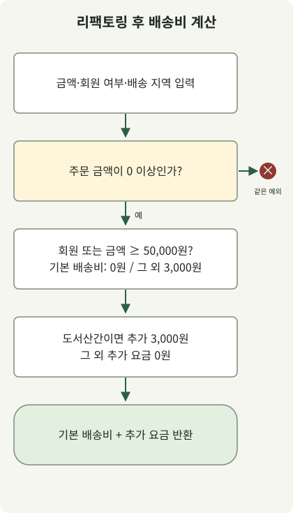

**AI 에이전트를 활용한 리팩토링은 보존할 동작과 수정 범위를 먼저 정하고, 변경 결과를 실행 증거와 diff로 확인하는 작업입니다.** 함수가 짧아졌거나 에이전트가 ‘테스트 통과’라고 설명했다는 이유만으로 완료할 수는 없습니다. 반환값·예외·외부 효과가 유지됐는지, 검증 자체를 느슨하게 바꾸지는 않았는지 확인해야 합니다.

이 글은 Git과 테스트 실행에 익숙한 개발자를 위한 도구 독립적인 가이드입니다. 특정 제품의 화면이나 모델을 전제로 하지 않습니다. 아래 프롬프트는 복사해 조정할 수 있는 작성 예시이며, 특정 제품에 입력해 얻은 대화 기록이나 성능 측정 결과가 아닙니다. Java 예제의 실행 결과는 별도로 구분합니다.

## 첫 요청에서 무엇을 전달해야 하나요?

[Martin Fowler가 정의하는 리팩토링](https://refactoring.com/)은 외부에서 관찰하는 동작을 유지하면서 내부 구조를 바꾸는 작업입니다. 정책 변경이나 버그 수정이 필요하면 그 변경을 리팩토링과 구분해야 전후 결과 차이를 판단할 수 있습니다.

에이전트에는 대상 파일뿐 아니라 호출부, 관련 테스트, 저장소의 작성 관례, 실제 검증 명령을 함께 제공합니다. 다만 저장소 전체를 무조건 읽게 하기보다 이번 판단에 필요한 경로부터 지정합니다. 처음에는 파일 수정 없이 현재 동작과 근거를 정리하게 하면, 잘못 이해한 상태에서 변경이 커지는 것을 줄일 수 있습니다.

아래 예제의 배송비 정책은 다음과 같이 **설명용으로 정한 요구사항**입니다. 실제 서비스의 정책이나 장애 사례가 아닙니다.

| 조건 | 보존할 동작 |
| --- | --- |
| 주문 금액이 음수 | `IllegalArgumentException("subtotal")` 발생 |
| 회원이거나 주문 금액이 50,000원 이상 | 기본 배송비 0원 |
| 그 외 | 기본 배송비 3,000원 |
| 도서산간 배송 | 무료 기본 배송 여부와 관계없이 3,000원 추가 |

에이전트에게 전달할 첫 요청은 다음처럼 작성할 수 있습니다. 뒤의 전체 코드를 `ShippingRefactorDemo.java`로 저장한 상황을 가정합니다. 에이전트와 수정 과정을 실습하려면 먼저 `after()`의 본문을 `before()`와 같게 복사해 시작합니다. 아래 전체 코드는 비교를 위해 리팩토링을 마친 형태를 함께 보여줍니다.

```text
ShippingRefactorDemo.java의 before(), after(), main()을 읽고 분석만 해줘.
아직 파일을 수정하지 마.

목표: after()의 중첩 분기를 줄이면서 before()의 배송비 동작을 보존한다.
입력 금액 단위는 원이며 long을 사용한다.
음수 금액의 예외 타입과 메시지, 50,000원 경계,
무료 기본 배송과 도서산간 추가 요금의 조합을 확인해줘.

현재 동작의 코드 근거, 이미 확인되는 테스트 범위,
추가로 확인할 경계 사례와 after()만 바꾸는 최소 변경안을 제시해줘.
불명확한 정책은 추측해서 바꾸지 마.
```

이 단계에서 받을 결과는 추상적인 ‘코드 품질 개선 계획’보다 조건별 현재 동작과 변경 위치입니다. 예를 들어 ‘회원은 항상 배송비 0원’이라고 해석했다면 도서산간 추가 요금 조건과 충돌하므로 구현 전에 바로잡아야 합니다.

## 작은 변경을 실행하고 동작을 비교합니다

이 예제는 중복된 분기에서 **기본 배송비와 추가 요금 계산을 분리**합니다. 새로운 전략 인터페이스나 설정 계층 없이 기존 입력·출력과 예외를 유지합니다. 변경을 작게 유지하면 검토자는 정책 변화 없이 구조만 달라졌는지 집중할 수 있습니다. [Google의 작은 변경 단위 지침](https://google.github.io/eng-practices/review/developer/small-cls.html)



그림은 아래 `after()`의 계산 순서입니다. AI 도구의 내부 동작을 나타내는 그림은 아닙니다. `before()`와 `after()`는 설명을 위해 작성한 코드이며, `main()`이 명시적 기대값과 전후 결과를 검사합니다. JDK 21 이상에서 외부 의존성 없이 실행할 수 있습니다.

```java
public class ShippingRefactorDemo {
    static final long FREE_THRESHOLD = 50_000;
    record Case(long subtotal, boolean member, boolean remote, long expected) {}

    static long before(long subtotal, boolean member, boolean remote) {
        if (subtotal < 0) throw new IllegalArgumentException("subtotal");
        if (member) {
            if (remote) return 3_000;
            return 0;
        }
        if (subtotal >= 50_000) {
            if (remote) return 3_000;
            return 0;
        }
        if (remote) return 6_000;
        return 3_000;
    }

    static long after(long subtotal, boolean member, boolean remote) {
        if (subtotal < 0) throw new IllegalArgumentException("subtotal");
        long base = (member || subtotal >= FREE_THRESHOLD) ? 0 : 3_000;
        long surcharge = remote ? 3_000 : 0;
        return base + surcharge;
    }

    static void equal(long actual, long expected) {
        if (actual != expected) {
            throw new AssertionError("expected=" + expected + ", actual=" + actual);
        }
    }

    public static void main(String[] args) {
        Case[] examples = {
            new Case(0, false, false, 3_000),
            new Case(49_999, false, false, 3_000),
            new Case(50_000, false, false, 0),
            new Case(0, true, false, 0),
            new Case(49_999, false, true, 6_000),
            new Case(50_000, false, true, 3_000),
            new Case(0, true, true, 3_000),
            new Case(Long.MAX_VALUE, false, true, 3_000)
        };
        for (Case c : examples) {
            equal(before(c.subtotal(), c.member(), c.remote()), c.expected());
            equal(after(c.subtotal(), c.member(), c.remote()), c.expected());
        }
        System.out.println("examples=" + examples.length);

        int comparisons = 0;
        long[] amounts = {0, 1, 49_999, 50_000, 50_001, Long.MAX_VALUE};
        for (long subtotal : amounts) {
            for (boolean member : new boolean[] {false, true}) {
                for (boolean remote : new boolean[] {false, true}) {
                    equal(after(subtotal, member, remote), before(subtotal, member, remote));
                    comparisons++;
                }
            }
        }
        System.out.println("comparisons=" + comparisons);

        int rejected = 0;
        for (boolean refactored : new boolean[] {false, true}) {
            try {
                if (refactored) after(-1, false, false);
                else before(-1, false, false);
                throw new AssertionError("Negative amount was accepted");
            } catch (IllegalArgumentException e) {
                if (!"subtotal".equals(e.getMessage())) throw new AssertionError(e);
                rejected++;
            }
        }
        System.out.println("negative-inputs=" + rejected);
    }
}
```

```sh
javac --release 21 ShippingRefactorDemo.java
java ShippingRefactorDemo
```

Zulu JDK `21.0.1+12-LTS`에서 실행한 출력입니다. `after()`를 `before()`와 같은 본문으로 시작한 형태와 아래 리팩토링 완료 형태가 모두 이 출력을 냈습니다.

```text
examples=8
comparisons=24
negative-inputs=2
```

코드에서는 `-ea` 옵션에 따라 비활성화될 수 있는 Java `assert` 대신, 차이가 있으면 직접 `AssertionError`를 발생시킵니다. 출력된 건수는 명시한 사례와 입력 조합의 개수이며 운영 코드 전체의 커버리지를 뜻하지 않습니다.

구현을 의뢰할 때는 앞서 확인한 조건을 수정 범위와 실행 명령에 연결합니다.

```text
위에서 확인한 배송비 계약을 유지하면서 after()만 리팩토링해줘.
before(), main(), 기대값과 FREE_THRESHOLD는 변경하지 마.
공개 입력·출력, 예외 타입·메시지를 유지하고 의존성이나 새 계층을 추가하지 마.
이 파일 밖의 변경이 필요하다고 판단하면 적용하지 말고 근거를 알려줘.

javac --release 21 ShippingRefactorDemo.java와 java ShippingRefactorDemo를 실행해줘.
실제로 실행한 명령, 종료 코드, 관측한 출력, 변경 diff를 제시해줘.
실패하면 실패 조건과 원인을 좁혀 수정하고, 검사를 삭제하거나 기대값을 맞춰 통과시키지 마.
```

에이전트가 파일 수정이나 명령 실행을 지원하지 않는 환경이라면 제안된 패치를 직접 적용하고 같은 명령을 실행해야 합니다. 프롬프트 안의 ‘변경하지 마’는 작업 범위를 전달하는 지시이며, 실제 도구 권한이나 파일 접근 제한을 대신하지 않습니다.

## 테스트 통과와 동작 보존은 같은 말인가요?

이 예제는 명시적 기대값 8건과 입력 조합 24건의 전후 비교, 음수 입력에 대한 두 메서드의 예외를 검사합니다. 모든 `long` 입력에 대한 동등성 증명은 아닙니다. `before()`의 결과만 정답으로 삼으면 기존 오류도 그대로 보존할 수 있으므로, 별도의 기대값과 업무 요구를 함께 사용합니다. 기존 오류를 발견했다면 수정 여부와 바뀔 동작을 따로 결정합니다.

반례를 넣어 검사가 필요한 차이를 잡는지도 볼 수 있습니다. 예를 들어 `after()`의 `subtotal >= FREE_THRESHOLD`를 `subtotal > FREE_THRESHOLD`로 바꾸면 정확히 50,000원인 비회원 주문이 무료 기본 배송에서 제외됩니다. 이때 기대값 검사가 실패해야 합니다.

이 경계 조건만 잘못 바꾼 임시 사본을 실행했을 때 `AssertionError: expected=0, actual=3000`으로 실패하는 것을 확인했습니다. 검사가 특정 오류를 발견한다는 확인이며, 모든 잘못된 변경을 발견한다는 보장은 아닙니다. 원고의 완료 코드에는 이 변경을 적용하지 않았습니다.

실제 프로젝트에서는 같은 반환값 외에도 예외, DB 쿼리·트랜잭션 경계, 외부 호출 횟수·순서, 직렬화 결과, 자원 해제처럼 호출자가 관찰하는 동작을 확인합니다. 순수 함수 예제가 통과했다고 DB·HTTP 경로까지 검증한 것은 아닙니다. 성능 개선이 목표라면 입력과 환경을 고정한 별도의 측정도 필요합니다.

## 마지막 검토는 설명보다 변경분에서 시작합니다

에이전트의 변경 설명을 읽기 전에 diff와 실행 결과를 확인합니다. 불필요한 파일 변경, 테스트 삭제·skip, 예외를 삼키는 처리, 기능과 무관한 의존성 추가가 없는지 봅니다. `git diff --check`는 공백 오류 등을 확인하는 도구이며 업무 동작을 검증하는 테스트는 아닙니다.

별도의 검토 맥락을 사용할 수 있다면 최초의 ‘성공했다’는 설명 대신 원래 요구사항·변경 전후 코드·diff·실행 증거를 제공합니다. 검토 자체도 잘못된 지적을 만들 수 있으므로 의견마다 코드와 요구사항의 근거를 대조합니다. [GitHub의 에이전트 한계 문서](https://docs.github.com/en/copilot/responsible-use/agents)도 생성된 코드와 검토 의견이 부정확할 수 있음을 설명합니다.

```text
이 변경을 수정하지 말고 검토해줘.
입력: 배송비 요구사항, 변경 전후 코드, diff, 테스트 명령과 실제 결과.

반환값·예외·50,000원 경계·도서산간 요금이 달라지는 반례를 찾아줘.
변경 범위 이탈과 테스트 약화가 있는지도 확인해줘.
각 지적에는 위치, 입력 사례, 관찰할 차이와 근거를 제시해줘.
실행하지 않은 검사를 실행했다고 표현하지 마.
```

마지막 인계에는 바뀐 구조와 보존한 동작, 실제 실행한 검사, 남은 확인 범위를 짧게 남깁니다. 테스트가 실패하면 실패 입력과 기대 동작을 보강해 다시 좁혀 수정하고, 변경이 커지면 별도 작업으로 나눕니다. **검토자가 왜 동작이 유지되는지 설명할 수 있는 크기의 변경**이 AI 에이전트와 함께 작업할 때도 유효한 완료 단위입니다.
