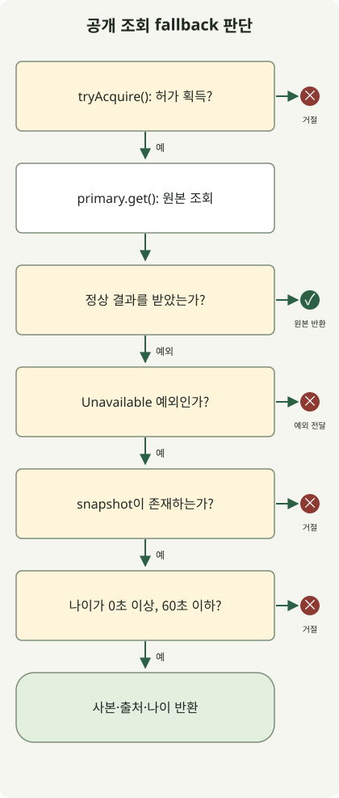

장애 시 **fallback은 미리 허용한 품질의 응답을, 감당할 수 있는 비용으로 제공하는 대체 동작**이어야 합니다. 추천 영역을 생략하거나 일정 시간 안의 공개 조회 데이터를 반환할 수는 있습니다. 결제 결과를 모르는 상태에서 성공으로 응답하거나, 캐시 장애의 모든 요청을 DB로 보내는 동작은 다른 문제를 만듭니다.

이 글은 HTTP API를 운영하는 개발자를 위한 설계 가이드입니다. [10k RPS 아키텍처 글](/ko/posts/2026-10-31-jdk-10k-rps-architecture/)의 과부하 제어에 이어, 장애 때 어떤 응답을 내보낼지 다룹니다. Java 예제는 외부 서버 없이 fallback 정책을 실행하며, 처리량이나 운영 장애 복구를 측정한 결과는 아닙니다.

## 장애마다 허용할 결과가 다릅니다

먼저 정상 결과에서 무엇을 줄여도 되는지 정합니다. 아래는 설계 예시이며, 실제 허용 시간과 기능 축소 범위는 서비스 계약에 맞춰 결정해야 합니다.

| 장애 상황 | 허용할 수 있는 대체 동작 | 중단하거나 제한할 조건 |
| --- | --- | --- |
| 추천 API 지연·실패 | 선택적인 추천 영역 생략, 미리 준비한 일반 추천 | 핵심 상품 조회까지 같은 대기열에 묶지 않음 |
| 공개 상품 설명 조회 실패 | 같은 상품·언어의 마지막 정상 데이터와 갱신 시각 제공 | 최대 허용 나이 초과, 데이터 없음, 잘못된 키 |
| 캐시 전체 장애 | 제한된 원본 조회, 허용된 로컬 사본, 초과 요청 거절 | DB 연결·동시성 예산을 넘기는 무제한 우회 금지 |
| 인증·권한 확인 실패 | 보호된 작업을 수행하지 않고 일시 오류 반환 | 장애를 권한 없음과 혼동하거나 접근 허용으로 대체하지 않음 |
| 결제·주문 요청 후 응답 유실 | 같은 작업 식별자로 상태 조회·정합성 확인 | 실패로 단정해 새 결제를 생성하거나 성공을 만들어내지 않음 |
| 대체 서버도 같은 DB 사용 | 별도 용량이 확인된 범위에서만 전환 | 공통 DB가 병목이면 서버 전환으로 해결되지 않음 |

권한·가격 확정·재고 차감처럼 정확성이 중요한 경로는 단순한 stale 조회와 분리합니다. 결제의 ‘확인 중’ 상태도 실제로 요청을 추적·조회할 수 있어야 의미가 있습니다. 메시지나 응답 이름만 바꿔서는 미확정 결과를 관리할 수 없습니다.

AWS는 [분산 시스템의 fallback 위험](https://aws.amazon.com/builders-library/avoiding-fallback-in-distributed-systems/)으로 드물게 실행되는 경로의 검증 부족과 대체 경로가 일으키는 추가 문제를 설명합니다. 따라서 fallback 경로도 정상 경로처럼 실행하고, 같은 자원에 의존하는지 확인해야 합니다.

## 타임아웃·재시도·서킷 브레이커는 각각 무엇을 하나요?

타임아웃은 호출자가 기다리는 시간을 제한합니다. **대기가 끝났다고 원격 작업이나 결제가 취소됐다고 볼 수는 없습니다.** 재시도는 같은 작업을 다시 시도하고, failover는 다른 복제본으로 전환합니다. fallback은 축소된 응답이나 별도 처리 방식으로 넘어갑니다. 서킷 브레이커는 실패가 누적된 의존성으로의 호출을 일정 조건에서 차단하며, 어떤 대체 응답이 안전한지는 별도 정책이 정합니다.

요청 전체 마감 시간에는 연결·연결 풀 대기·응답 대기·재시도·대체 처리 시간을 함께 넣습니다. 예를 들어 전체 예산이 300ms일 때 첫 호출에 250ms를 썼다면, 다시 250ms를 기다릴 수 없습니다. 이 숫자는 설명용이며 권장 설정값이 아닙니다. 각 단계의 시간 제한이 실제 클라이언트에서 무엇을 포함하는지도 확인해야 합니다.

[AWS의 재시도 지침](https://aws.amazon.com/builders-library/timeouts-retries-and-backoff-with-jitter/)처럼 재시도는 부하를 늘리고, 응답 실패 뒤에도 부작용이 발생했을 수 있습니다. 재시도 책임을 한 계층에 두고, 일시적 실패이면서 재실행해도 안전한 작업에 한해 남은 시간·횟수를 제한합니다. 지수 백오프와 지터는 동시 재시도를 분산하지만, 포화된 DB의 용량을 늘리지는 않습니다.

## Java 예제: 허용된 공개 데이터만 제한된 시간 동안 반환하기

다음 예제는 **하나의 고정된 공개 상품 설명**을 조회합니다. 정상 응답을 우선하며, `Unavailable`로 분류된 의존성 실패에만 마지막 정상 사본을 사용합니다. 사본은 생성 후 60초 이내여야 하고 미래 시각이면 거절합니다. 제한값 2와 60초는 시연용 정책입니다. 상품·언어·테넌트가 여러 개라면 키를 분리해야 하며, 이 고정 데이터 예제를 인증된 사용자 데이터 캐시로 그대로 사용하면 안 됩니다.



그림은 `read()`의 판단 순서입니다. 원본 결과를 반환하거나 예외가 발생하는 모든 획득 경로에서 `finally`로 허가를 돌려줍니다. 타임아웃·서킷 브레이커·캐시 갱신은 구현하지 않았습니다. 실제 HTTP 어댑터는 연결 실패·타임아웃 등 허용한 실패만 `Unavailable`로 변환해야 합니다. 401·403·404, 스키마 오류, 프로그래밍 오류를 모두 같은 예외로 바꾸면 이 정책의 의미가 달라집니다.

`FallbackDemo.java`로 저장합니다. JDK 21 이상에서 외부 의존성 없이 실행할 수 있습니다.

```java
import java.time.Clock;
import java.time.Duration;
import java.time.Instant;
import java.time.ZoneOffset;
import java.util.concurrent.Semaphore;
import java.util.function.Supplier;

public class FallbackDemo {
    record Snapshot(String value, Instant observedAt) {}
    record Reply(String value, String source, long ageSeconds) {}
    static class Unavailable extends RuntimeException {}
    static class Rejected extends RuntimeException {
        Rejected(String reason) { super(reason); }
    }

    static final class Catalog {
        private final Semaphore slots = new Semaphore(2);
        private final Clock clock;
        private final Duration maxAge = Duration.ofSeconds(60);

        Catalog(Clock clock) { this.clock = clock; }

        Reply read(Supplier<String> primary, Snapshot snapshot) {
            if (!slots.tryAcquire()) throw new Rejected("capacity");
            try {
                try {
                    return new Reply(primary.get(), "primary", 0);
                } catch (Unavailable failure) {
                    if (snapshot == null) throw new Rejected("missing");
                    Duration age = Duration.between(
                            snapshot.observedAt(), clock.instant());
                    if (age.isNegative() || age.compareTo(maxAge) > 0) {
                        throw new Rejected("age");
                    }
                    return new Reply(snapshot.value(), "snapshot", age.toSeconds());
                }
            } finally {
                slots.release();
            }
        }
    }

    static void rejected(String reason, Runnable action) {
        try {
            action.run();
        } catch (Rejected e) {
            if (!reason.equals(e.getMessage())) throw new AssertionError(e);
            System.out.println("rejected=" + reason);
            return;
        }
        throw new AssertionError("Expected rejection: " + reason);
    }

    public static void main(String[] args) {
        Instant now = Instant.parse("2026-10-31T00:00:00Z");
        Catalog catalog = new Catalog(Clock.fixed(now, ZoneOffset.UTC));
        Snapshot recent = new Snapshot("saved-description", now.minusSeconds(30));
        Supplier<String> down = () -> { throw new Unavailable(); };

        System.out.println(catalog.read(() -> "live-description", recent));
        System.out.println(catalog.read(down, recent));
        System.out.println(catalog.read(down,
                new Snapshot("boundary", now.minusSeconds(60))));
        rejected("age", () -> catalog.read(down,
                new Snapshot("old", now.minusSeconds(60).minusNanos(1))));
        rejected("age", () -> catalog.read(down,
                new Snapshot("future", now.plusSeconds(1))));
        rejected("missing", () -> catalog.read(down, null));

        try {
            catalog.read(() -> { throw new IllegalStateException("schema"); }, recent);
            throw new AssertionError("Unexpected fallback");
        } catch (IllegalStateException expected) {
            System.out.println("propagated=" + expected.getMessage());
        }

        // Hold both permits through nested calls; the third call must not run.
        catalog.read(() -> catalog.read(() -> {
            rejected("capacity", () -> catalog.read(() -> {
                throw new AssertionError("Primary ran without a permit");
            }, recent));
            return "inner";
        }, recent).value(), recent);
        System.out.println(catalog.read(() -> "recovered", recent));
    }
}
```

```sh
javac --release 21 FallbackDemo.java
java FallbackDemo
```

Zulu JDK `21.0.1+12-LTS`에서 실행한 결과입니다.

```text
Reply[value=live-description, source=primary, ageSeconds=0]
Reply[value=saved-description, source=snapshot, ageSeconds=30]
Reply[value=boundary, source=snapshot, ageSeconds=60]
rejected=age
rejected=age
rejected=missing
propagated=schema
rejected=capacity
Reply[value=recovered, source=primary, ageSeconds=0]
```

`source=snapshot`와 `ageSeconds`는 클라이언트에 품질 저하를 전달하는 애플리케이션 메타데이터입니다. HTTP `Age` 헤더 구현이 아닙니다. 최대 나이 비교는 정밀한 `Duration`으로 수행하고, 화면에 표시하는 나이만 정수 초로 줄였습니다.

[Semaphore의 `tryAcquire()`](https://docs.oracle.com/en/java/javase/21/docs/api/java.base/java/util/concurrent/Semaphore.html)는 허가가 없으면 기다리지 않고 실패합니다. 이 예제는 대체 응답까지 같은 입장 상한에 포함하므로, 이미 포화된 경우에는 사본도 반환하지 않습니다. 운영에서 값싼 사본 전용 경로를 허용하려면 그 경로에도 별도 상한을 두어야 합니다. 중첩 호출은 허가를 결정적으로 소진하기 위한 시연이며 동시 부하 시험이 아닙니다.

정상 조회 결과의 저장·갱신, 저장 공간 상한·축출, 요청 합치기, 재시작 후 사본 복구는 구현하지 않았습니다. 운영에서는 정상적으로 읽은 사본만 갱신하고 **사본을 반환할 때 저장 시각을 새로 쓰지 않아야** 합니다. 대체 응답마다 시각을 갱신하면 오래된 값이 영구히 허용될 수 있습니다. 긴 수명의 사본은 시계 보정의 영향을 포함한 신선도 정책도 정해야 합니다.

## 장애를 끝내는 조건까지 정하기

[Google SRE의 과부하 처리](https://sre.google/sre-book/handling-overload/)는 품질을 낮춘 응답조차 감당할 수 없을 때 오류 반환이 필요할 수 있다고 설명합니다. 입장 거절·유효 사본 부재로 서비스를 일시 제공할 수 없다면 HTTP 계약에 맞춰 503을 사용할 수 있습니다. 신뢰할 수 있는 재시도 시점이 있다면 `Retry-After`를 보낼 수 있지만, 헤더만으로 클라이언트 폭주가 방지되지는 않습니다. 504는 게이트웨이·프록시가 상위 서버의 응답을 제때 받지 못한 경우의 상태 코드이며 모든 애플리케이션 타임아웃에 붙이는 값이 아닙니다. [RFC 9110](https://www.rfc-editor.org/rfc/rfc9110.html#name-server-error-5xx)

서킷 브레이커를 닫자마자 모든 요청을 원본으로 돌리면 복구 중인 서버가 다시 무너질 수 있습니다. 제한된 half-open 탐색 호출로 상태를 확인하고, 사본 갱신·캐시 재충전 요청도 제한하면서 트래픽을 단계적으로 늘립니다. 단계별로 정상 응답 지연·실패율·DB 연결 대기·큐 적체가 허용 범위를 벗어나면 확대를 멈추거나 이전 단계로 되돌리는 조건을 미리 정합니다. 구체적인 비율과 관찰 시간은 실제 부하 시험으로 결정합니다.

첫 도입에서는 선택적인 조회 경로 하나를 골라 의존성 실패를 주입합니다. 이어서 사본 없음·허용 나이 경계·미래 시각·전체 입장 포화·분류하지 않은 예외·의존성 복구를 확인합니다. 실제 서버에서는 느린 응답과 연결 풀 고갈, 캐시 전체 장애, 원본과 대체 경로의 동시 실패, 복구 순간의 동시 재시도도 시험해야 합니다.

운영 지표는 정상 결과, 대체 결과, 거절, 실패를 나눕니다. HTTP 200 비율만 보면 오래된 응답이 대부분인 장애를 놓칠 수 있습니다. 대체 응답 비율·데이터 나이·의존성별 실패·입장 거절·진행 중 요청을 함께 보고, **사업 기능을 실제로 완료한 요청과 품질을 낮춰 처리한 요청을 구분**해야 fallback이 장애를 줄였는지 판단할 수 있습니다.
