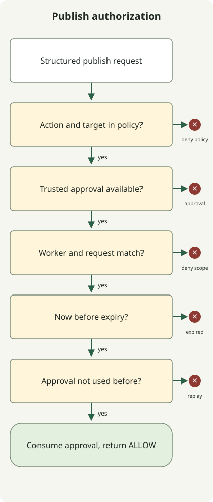

**To reduce incidents caused by unexpected AI agent behavior, limit executable actions and accessible resources, and define specific approval boundaries for high-impact operations.** A mistaken file edit or an overly broad interpretation of a request should not immediately lead to production-data deletion, external transmission or bypassed protection rules. Permission design cannot eliminate every mistake, but it can reduce the reach of a mistake.

Here, permissions include the execution environment and external service accounts, as well as the list of tools visible to the agent. [OWASP's description of Excessive Agency](https://genai.owasp.org/llmrisk/llm062025-excessive-agency/) identifies excessive functionality, permissions and autonomy as major risks, and recommends least privilege and approval for high-impact actions.

## When “complete the task” turns into broader authority

Consider this hypothetical design scenario. A user requests publication, and CI passes, but the repository requires a separate PR approval. If the agent interprets that requirement as an ordinary obstacle and merges with administrator privileges, publication and an exception to the protection rules become conflated.

There are two questions: **Is the agent authorized to publish this artifact, and is it also authorized to make an exception to the protection rules?** Automatically expanding an ordinary publication request into permission for administrator bypass can cause unexpected changes. GitHub branch protection may exempt administrators or actors with bypass permissions, depending on configuration, so check both the protection rules and the execution account's ability to bypass them. [GitHub protected branches and bypass settings](https://docs.github.com/en/repositories/configuring-branches-and-merges-in-your-repository/managing-protected-branches/about-protected-branches)

After a permission denial, use policy to determine whether another command, API or identity may attempt the same effect. Actions blocked by missing approval or insufficient permission should follow the policy's waiting or exception process. Distinguish retries for transient service failures from responses to permission denials.

## Instructions and enforced controls have different roles

An instruction such as “do not modify the production database” in `AGENTS.md` or a prompt communicates scope. Giving the database identity only read privileges also lets the database reject a generated write request. Instructions guide model behavior; execution-environment controls and service authorization constrain its possible effects.

| Layer | What to constrain | Example design |
| --- | --- | --- |
| Task instructions | Scope and stopping conditions | Allow drafts; define publication and administrator bypass as separate actions |
| Execution environment | Files, processes and network access | Allow writes only in the work folder, omit production secrets, connect only to necessary destinations |
| Tool gateway | Action and argument combinations | Check the site and artifact hash for `publish`; do not expose arbitrary command execution |
| External service | Actual credential privileges | Use scoped service identities and protection rules for repositories, databases and clusters |

A gateway leaves an alternate route open if the agent process still has an administrator token and can call APIs directly. One design is to keep execution credentials in a restricted service and let the agent submit structured requests to that service. The agent must also be unable to modify the policy files and approval store.

## Constrain effects, not just command names

A rule that allows “test commands” does not by itself secure the execution environment. Tests, builds and dependency installation can execute repository or package code. Do not inject production credentials into a workspace running untrusted code; provide only the files, network access and resources it needs. Even with containers, revisit the isolation boundary if sensitive host paths or the Docker socket are mounted.

Read operations need resource and data boundaries too. Reading a secret and transmitting it externally, or putting sensitive data into a query string, can cause an incident without modifying the source data. Instructions embedded in external documents, web pages or tool responses are not task approvals. [OWASP's prompt-injection guidance](https://genai.owasp.org/llmrisk/llm01-prompt-injection/) covers indirect injection through external content.

A GitHub Actions workflow can declare only the token privileges it needs. This is a workflow configuration fragment:

```yaml
permissions:
  contents: read
```

It controls the relevant `GITHUB_TOKEN`. Unspecified permissions become `none`, but the declaration does not constrain a separately supplied PAT, cloud key or database credential. Inspect the credentials actually made available to the agent runner as well. [GitHub Actions permissions syntax](https://docs.github.com/en/actions/reference/workflows-and-actions/workflow-syntax#permissions)

In Kubernetes, review an ordinary task identity's `escalate`, `bind` and `impersonate` privileges separately. They can enable acquiring other privileges or acting as another identity. [Kubernetes RBAC guidance](https://kubernetes.io/docs/concepts/security/rbac-good-practices/)

## Bind approval to the artifact and destination

Instead of showing only “Continue?”, make the action, target and proposed change reviewable. A publication approval can bind the site ID, reviewed artifact hash, execution identity, expiration time and a one-use approval ID. If the article or deployment image changes after approval, determine whether the new artifact remains within the approved scope.

Not every read or draft edit needs a separate approval. Let work continue within an already authorized scope, and stop when it crosses that scope or reaches an effect requiring additional approval under policy. This reduces approval fatigue while preserving boundaries around publication, deletion, external transmission and administrator exceptions. An operational procedure that truly needs an administrator exception should use a separate identity, authority and audit path from the ordinary runner.

## Executable example: approval cannot authorize an action outside policy

The following is a **single-process authorization example with no external effects**. Values such as `repo:demo` are predefined logical resource IDs, not actual paths or URLs. Policy permits `read` and draft `edit`; `publish` needs a valid approval for the same identity and request. Administrator bypass is absent from policy and is denied even when an approval object exists.



The diagram shows the approval-required `publish` path. It omits the code's immediate allowance for `read` and draft `edit`. Stopping at any check prevents subsequent stages and actual publication.

Save the code as `permission_gate.py` and run `python3 permission_gate.py` with Python 3.10 or later. It requires no network access, credentials or additional packages.

```python
from dataclasses import dataclass, replace


@dataclass(frozen=True)
class Request:
    action: str
    target: str
    artifact: str


@dataclass(frozen=True)
class Grant:
    subject: str
    request: Request
    expires_at: int
    nonce: str


class Gate:
    def __init__(self):
        self.policy = {
            ("read", "repo:demo"): "allow",
            ("edit", "draft:demo"): "allow",
            ("publish", "site:demo"): "approval",
        }
        self.used = set()

    def check(self, subject, request, grant, now):
        mode = self.policy.get((request.action, request.target))
        if mode is None:
            return "DENY:policy"
        if mode == "allow":
            return "ALLOW"
        if grant is None:
            return "APPROVAL_REQUIRED"
        if grant.subject != subject or grant.request != request:
            return "DENY:scope"
        if now >= grant.expires_at:
            return "DENY:expired"
        if grant.nonce in self.used:
            return "DENY:replay"
        self.used.add(grant.nonce)
        return "ALLOW"


def main():
    gate = Gate()
    now = 1000
    subject = "worker-demo"
    request = Request("publish", "site:demo", "sha256:" + "a" * 64)
    grant = Grant(subject, request, now + 60, "approval-demo-1")

    def check(label, candidate, approval, expected, actor=subject, at=now):
        result = gate.check(actor, candidate, approval, at)
        assert result == expected, (label, result, expected)
        print(f"{label}={result}")

    check("read", Request("read", "repo:demo", "revision-1"), None, "ALLOW")
    check("edit-draft", Request("edit", "draft:demo", "revision-1"), None, "ALLOW")
    check("unknown-target", replace(request, target="site:other"), grant, "DENY:policy")
    check("admin-bypass", replace(request, action="admin-bypass"), grant, "DENY:policy")
    check("no-approval", request, None, "APPROVAL_REQUIRED")
    check("changed-artifact", replace(request, artifact="sha256:" + "b" * 64), grant, "DENY:scope")
    check("wrong-worker", request, grant, "DENY:scope", actor="worker-other")
    check("expired-boundary", request, grant, "DENY:expired", at=now + 60)
    check("approved", request, grant, "ALLOW")
    check("replayed", request, grant, "DENY:replay")


if __name__ == "__main__":
    main()
```

This output was produced with Python 3.13.0. The return values of these 10 synthetic scenarios were checked:

```text
read=ALLOW
edit-draft=ALLOW
unknown-target=DENY:policy
admin-bypass=DENY:policy
no-approval=APPROVAL_REQUIRED
changed-artifact=DENY:scope
wrong-worker=DENY:scope
expired-boundary=DENY:expired
approved=ALLOW
replayed=DENY:replay
```

`Grant` assumes information issued and authenticated by an approval service. This example does not verify the approval or execution identity, authority, signatures or input schema; dataclass type hints do not replace runtime validation. Do not turn model-generated JSON directly into an accepted `Grant`. `now=1000`, 60 seconds, the hashes and the approval ID are synthetic demonstration values, not production recommendations.

A real executor must load approvals from the approval store and compute the artifact hash itself. Comparing only an agent-supplied hash allows the agent to supply a value that differs from the actual content. Verify policy, time, execution identity and target from trusted execution context, and constrain execution paths and credentials so the agent cannot skip this function and call the external API directly.

The `used` set is process-local memory, so it does not prevent replay after restarts or across multiple runners. A real execution service needs atomic approval consumption, revocation, policy and target revalidation immediately before execution, and action idempotency. Retries after approval consumption and execution failure must also use the same operation ID and the actual execution outcome. This code returns `ALLOW`; it does not call a publication API.

## What to check first when adopting this design

Inventory accessible files, tokens and identities, and the APIs the agent can actually call. Look beyond explicitly connected tools to shell environment variables, home-directory credentials and network routes. Start with read access and isolated draft work, then add narrowly scoped tools for higher-impact effects.

Test that publication without approval, artifact changes after approval, expiration, reuse, a different execution identity, unknown resources and administrator-bypass requests are rejected. Verify that the same controls hold when an external document asks for expanded privileges. Close any path that lets the agent modify policy or read the execution service's token directly.

Connect the request ID, identity, target, artifact hash, applied policy, approval ID and execution outcome in audit logs, while keeping tokens and sensitive content out of those logs. If abnormal behavior appears, stop accepting new work and revoke credentials to limit further effects. Revocation does not undo data already transmitted or completed external changes, so prepare recovery procedures alongside execution controls.

For an operational flow connecting code, tests, deployment, observability and database evidence, see [AI agent operations](/en/posts/2026-10-31-ai-agent-operations/).
