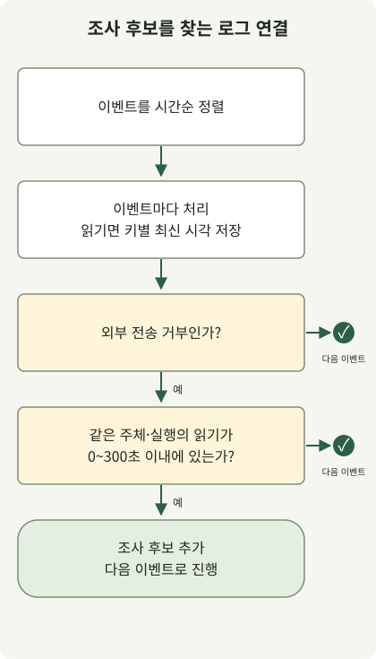

**AI를 활용한 공격에 대비하려면 계정 탈취와 공개 취약점 악용을 줄이고, AI 에이전트가 외부 콘텐츠를 읽더라도 허용되지 않은 행동을 실행하지 못하게 해야 합니다.** 공격 문장이 AI로 작성됐는지 알아내는 것보다 인증·패치·권한·외부 전송 통제가 실제로 작동하는지 확인하는 편이 대응에 직접 도움이 됩니다.

서비스를 운영하거나 AI 에이전트를 개발 업무에 도입하는 팀을 위한 글입니다. 공격 경로별 대응과 로컬 로그 상관분석을 다룹니다. 아래 운영 절차는 제안이며, 실제 조직의 사고나 방어 효과를 측정한 사례가 아닙니다.

## 공격에 AI를 쓰는 경우와 AI를 공격하는 경우

공격자는 AI로 표적 정보를 정리하고 사칭 문구나 코드를 만들 수 있습니다. 반대로 공격 대상이 우리 AI 에이전트일 수도 있습니다. 외부 문서에 숨은 지시를 따르게 해 자료를 전송하거나 배포 설정을 바꾸도록 유도하는 간접 프롬프트 인젝션이 그 예입니다.

[영국 NCSC의 2027년까지의 위협 평가](https://www.ncsc.gov.uk/report/impact-ai-cyber-threat-now-2027)는 AI가 정찰·사회공학·취약점 연구 등 기존 공격 과정을 더 효율적으로 만들 것으로 전망합니다. 알려진 취약점의 공개와 악용 사이 대응 시간이 더 줄어들 수 있다는 평가도 포함합니다. 미래 전망을 모든 공격의 자동화가 이미 완성됐다는 관측으로 읽어서는 안 됩니다.

| 공격 경로 | 공격자가 노리는 결과 | 우선 보호할 경계 |
| --- | --- | --- |
| 맞춤형 피싱·임원 사칭 | 로그인, 계정 복구, 송금 승인 | 인증·복구 절차와 별도 확인 채널 |
| 취약점 탐색·악용 보조 | 공개 서비스 침입, 비밀 탈취 | 외부 노출 자산과 패치·격리 |
| 에이전트 프롬프트 인젝션 | 허용되지 않은 도구 실행·외부 전송 | 데이터와 지시의 구분, 도구·네트워크 권한 |

한 사건에 여러 경로가 이어질 수 있습니다. 계정이 탈취된 뒤 내부 문서에 악성 지시가 들어가면, 로그인 방어와 에이전트 방어를 함께 확인해야 합니다.

## 피싱은 문체보다 인증과 승인 경로로 막기

[Microsoft의 임원 사칭·청구서 사기 분석](https://www.microsoft.com/en-us/security/blog/2026/09/10/protecting-organizations-ai-assisted-executive-impersonation-invoice-fraud/)에서는 가짜 임원 메일, 청구서, 전달된 대화처럼 꾸민 내용을 결합한 캠페인을 설명합니다. 연구진은 AI 보조 템플릿 제작과 일치하는 정황을 관찰했지만, 그 정황만으로 AI가 생성한 범위를 확정할 수 없다고 밝힙니다. 특정 문장부호나 주석 형식을 공격 판정 규칙으로 삼을 근거는 되지 않습니다.

운영에서는 다음 경계를 먼저 확인합니다.

- **로그인:** 지원되는 계정에 FIDO2·패스키 같은 피싱 저항성 인증을 적용하고 실제 로그인 정책에서 요구하는지 확인합니다. [Microsoft의 피싱 저항성 MFA 안내](https://learn.microsoft.com/en-us/security/zero-trust/sfi/phishing-resistant-mfa)는 SMS·OTP·푸시 인증의 가로채기와 피로 공격 위험, 더 강한 인증 수단으로의 전환을 설명합니다.
- **복구·등록:** 헬프데스크가 새 인증 수단을 등록하거나 계정을 복구할 때 신뢰할 수 있는 기존 기록과 별도 절차로 신원을 확인합니다. 메일이나 화상 통화 한 번만으로 복구를 승인하지 않는 운영 규칙을 정합니다.
- **업무 승인:** 계좌 변경·비밀 전달 요청은 메시지에 적힌 연락처가 아닌 기존 등록 연락처나 내부 승인 시스템으로 확인합니다. 송금 사기는 계정 탈취 없이도 성립할 수 있어 로그인 강화만으로 끝나지 않습니다.

SPF·DKIM·DMARC와 사칭 탐지는 메일 방어에 함께 사용합니다. 다만 인증을 통과한 유사 도메인이나 탈취된 정상 계정의 요청까지 업무상 정당함을 보장하지는 않습니다. 피싱 저항성 인증도 이미 탈취된 세션이나 감염된 단말을 모두 해결하는 수단은 아닙니다.

## 취약점 대응은 외부 노출과 악용 가능성부터 확인하기

공격자가 AI를 썼다는 증거를 기다리는 동안 공개 서비스의 취약점은 그대로 남습니다. 먼저 인터넷에 노출된 서비스의 제품·실행 버전·담당자·패치 상태를 연결하고, 공급사 권고와 실제 악용 정보를 확인합니다. 소스나 이미지 태그를 바꿨다는 기록보다 **현재 트래픽을 받는 인스턴스가 수정 버전인지**가 중요합니다.

대응 우선순위는 외부 노출, 실제 악용 여부, 접근 가능한 데이터와 권한, 서비스 영향을 함께 보고 정합니다. 즉시 패치하기 어렵다면 공급사가 지원하는 완화책이나 노출 제한을 적용하고, 예외의 담당자와 재확인 시점을 남깁니다. WAF 규칙 추가만으로 원인 취약점이 제거됐다고 처리하지 않습니다.

이미 악용됐을 가능성이 있다면 패치 작업과 사고 조사를 병행합니다. 프로세스·인증·외부 통신 기록을 보존하고, 침해 범위에 따라 자격증명 회전과 신뢰 가능한 이미지로의 재구축을 판단합니다. 패치 성공이 침입 흔적과 지속성까지 제거했다는 뜻은 아닙니다.

## 에이전트는 읽은 내용을 실행 권한으로 바꾸지 않기

AI 에이전트가 이슈·저장소 파일·웹페이지를 읽는 환경에서는 그 내용이 공격자의 입력일 수 있습니다. “문서를 읽었으니 다음 명령을 실행하라”는 텍스트와 사용자가 승인한 작업을 같은 권한으로 취급하면 정보 조회가 외부 전송으로 이어질 수 있습니다.

[OWASP의 프롬프트 인젝션 방어 지침](https://cheatsheetseries.owasp.org/cheatsheets/LLM_Prompt_Injection_Prevention_Cheat_Sheet.html)은 도구 호출을 사용자 권한·세션 맥락과 대조하고, 도구별 인자를 검증하며, 최소 권한을 적용하도록 권고합니다. 입력에 경고문을 붙이거나 모델에게 악성 지시를 무시하라고 요청하는 것만으로 실행 권한이 통제되지는 않습니다.

구현에서는 사용자·작업별 허용 자원과 행동을 **모델 밖의 도구 실행 경계**에서 검사합니다. 읽기 전용 계정과 짧은 수명의 자격증명을 사용하고, 네트워크 전송은 목적지·프로토콜·데이터 범위에 맞춰 제한합니다. 승인된 도메인이라도 공격자 계정이나 임의 경로로 전송할 수 있다면 허용 목록만으로 충분하지 않습니다. 중요한 변경·전송 승인은 구체적인 대상과 변경 내용을 보여주고 받습니다.

로그에는 작업 ID, 실행 주체, 도구명, 정책 결정과 결과를 남깁니다. 판단 근거는 관찰 가능한 정책 코드로 기록하고 모델의 숨은 추론을 수집할 필요는 없습니다. 원문·토큰·비밀번호를 통째로 기록하면 조사 로그가 새로운 유출 지점이 됩니다. 운영 권한 경계는 [AI 에이전트 permission 설계 글](/ko/posts/2026-11-01-ai-agent-permission-boundaries/)과 연결됩니다.

## 외부 문서를 읽은 뒤의 전송 거부를 로그로 연결하기

아래는 **신뢰할 수 있는 실행기에서 나온 합성 이벤트**를 연결하는 Python 예제입니다. 같은 주체·실행 ID에서 외부 콘텐츠를 읽은 뒤 300초 이내에 외부 전송이 거부되면 조사 후보로 표시합니다. 프롬프트 인젝션을 판별하거나 요청을 차단하는 코드가 아닙니다. 거부 이벤트는 별도 도구·네트워크 정책이 이미 생성했다고 가정합니다.



그림은 이벤트 하나를 처리하는 분기를 요약합니다. 오른쪽 종료 표시는 현재 이벤트를 건너뛴다는 뜻이며 안전 판정이 아닙니다. 코드에서는 이벤트마다 반복하고, 읽기 이벤트의 최신 시각을 저장합니다. 조건을 만족하지 않으면 다음 이벤트로 넘어갑니다. 그림은 전체 공격 탐지나 사고 대응 절차를 표현하지 않습니다.

Python 3.13.0에서 실행한 예제이며 외부 패키지·네트워크·운영 로그를 사용하지 않습니다. `correlate.py`에 저장합니다. `at`은 예제 시작점 기준 초이며, 실제 수집 시에는 동기화된 이벤트 시각과 안정적인 실행 ID가 필요합니다. `kind`와 식별자는 문서 본문이나 모델이 자유롭게 만든 값을 신뢰해서 채우면 안 됩니다.

```python
from dataclasses import dataclass


@dataclass(frozen=True)
class Event:
    at: int
    actor: str
    run: str
    kind: str


def correlate(events: list[Event], window: int = 300) -> list[tuple[str, str, int]]:
    if window < 0:
        raise ValueError("window")
    last_read: dict[tuple[str, str], int] = {}
    candidates = []
    for event in sorted(events, key=lambda item: item.at):
        key = (event.actor, event.run)
        if event.kind == "untrusted_read":
            last_read[key] = event.at
        elif event.kind == "egress_denied":
            read_at = last_read.get(key)
            if read_at is not None and 0 <= event.at - read_at <= window:
                candidates.append((event.actor, event.run, event.at))
    return candidates


if __name__ == "__main__":
    events = [
        Event(20, "agent-a", "run-1", "egress_denied"),
        Event(0, "agent-a", "run-1", "untrusted_read"),
        Event(30, "agent-a", "run-2", "egress_denied"),
        Event(40, "agent-b", "run-1", "egress_denied"),
        Event(301, "agent-a", "run-1", "egress_denied"),
    ]
    print(correlate(events))
```

```sh
python3 correlate.py
```

실제 실행 결과는 다음과 같습니다.

```text
[('agent-a', 'run-1', 20)]
```

같은 실행의 20초 이벤트만 선택됩니다. 다른 실행·주체와 시간 범위 밖의 거부는 선택되지 않습니다. 300초는 설명용 선택값이며 검증된 보안 임계값이 아닙니다. 시간상 가까운 두 사건의 연결이 인젝션의 인과관계를 증명하지도 않습니다. 정상적인 자동화도 같은 패턴을 만들 수 있습니다.

별도 로컬 검사 13건에서는 300초 경계 포함, 301초 제외, 이벤트 입력 순서 변경, 시각 0, 다른 주체·실행 격리, 읽기 없는 거부, 전송 성공, 음수 범위를 확인했습니다. 300초 경계를 제외하거나 주체를 무시하고 시각 0을 잘못 처리하는 회귀 변이 3개도 검사에서 검출됐습니다. 경보가 없더라도 안전하다는 뜻은 아닙니다. 차단되지 않은 유출과 로그 누락은 이 규칙이 놓칠 수 있습니다. 운영 적용에는 스트림 지연·역순, 저장 상태의 만료, 중복 제거, 재시작 복구와 오탐 평가를 추가해야 합니다. 이 코드는 배치 예제이며 그 기능을 구현하지 않습니다.

## 경보 이후에는 실행 결과를 확인하고 피해 경로를 닫기

에이전트의 “차단했다”는 설명보다 실행기 정책 결과와 네트워크·대상 서비스 기록을 확인합니다. 위 예제의 `egress_denied` 한 건은 해당 시도가 거부됐다는 신호일 뿐, 다른 경로에서 유출이 없었다는 증거가 아닙니다. 의심되는 실행을 중단하고 작업 ID로 원문 접근·도구 호출·외부 통신 기록을 연결해 조사합니다.

| 상황 | 초기 대응 제안 | 재개 전 확인 |
| --- | --- | --- |
| 피싱 이후 로그인·계정 변경 의심 | 관련 세션·토큰 무효화, 계정 복구, 등록 인증 수단·동의 권한 조사 | 공격자가 추가한 접근 경로 제거와 정상 로그인 확인 |
| 공개 서비스 악용 의심 | 영향 자산 격리와 증거 보존, 수정 버전 적용·필요 시 재구축 | 실행 버전, 노출 경로, 지속성·횡적 이동 조사 |
| 에이전트의 허용되지 않은 호출 | 해당 실행 중단, 관련 자격증명 폐기·회전, 도구·전송 경로 제한 | 요청이 거부되고 승인된 작업은 계속 가능한지 회귀 시험 |

자동 차단은 서비스 중단을 만들 수 있으므로 탐지 규칙의 신뢰도와 영향 범위에 맞춰 적용합니다. 격리와 증거 보존이 충돌하면 진행 중인 피해와 수집 비용을 보고 순서를 정합니다. 공격자가 남긴 자료를 조사용 AI에 넣을 때도 도구·외부 전송 권한을 분리해야 합니다. [다국가 보안기관의 AI 에이전트 도입 지침](https://www.ncsc.govt.nz/protect-your-organisation/careful-adoption-of-agentic-ai-services/)도 구성요소·연동·운영까지 위험 평가 범위에 포함합니다.

시작점은 외부 노출 자산 하나, 중요 계정 하나, 외부 문서를 읽는 에이전트 작업 하나를 고르는 것입니다. 각 대상에서 보호 정책의 실제 적용, 조사 가능한 로그, 담당자가 실행할 복구 절차를 연결합니다. 반복 시험에는 정상 요청의 성공도 포함하고, [AI·TDD 글](/ko/posts/2026-11-02-ai-assisted-tdd/)처럼 거부 조건의 경계를 바꿨을 때 검사가 실패하는지도 확인합니다.
