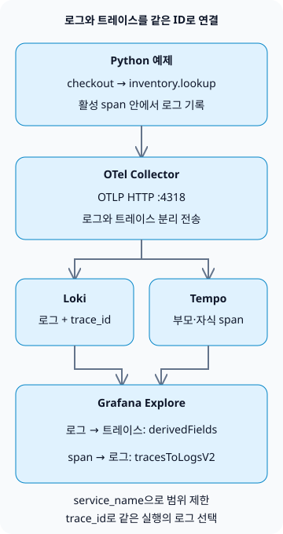

**Grafana LGTM에서 로그와 트레이스를 연결하려면, 애플리케이션이 같은 `trace_id`를 가진 로그와 span을 내보내고 Grafana의 Loki·Tempo 데이터 소스를 양방향으로 연결해야 합니다.** 오류 로그에서 요청의 실행 흐름으로 이동하고, 느리거나 실패한 span에서 관련 로그로 돌아가는 구성을 만들어 보겠습니다.

LGTM은 Loki(로그), Grafana(조회·시각화), Tempo(트레이스), Mimir(메트릭)을 뜻합니다. 이 글은 로그와 트레이스의 연결에 집중합니다. 메트릭 알림이나 운영 자동화까지 이어지는 전체 흐름은 [AI 에이전트 운영 기법](/ko/posts/2026-10-31-ai-agent-operations/)에서 다룹니다.

## 무엇을 같은 ID로 연결할까?

한 번의 실행은 하나의 trace, 그 안의 개별 작업은 span으로 표현합니다. 예제의 `checkout` 부모 span과 `inventory.lookup` 자식 span은 `trace_id`를 공유하고 `span_id`는 다릅니다. 활성 span 안에서 로그를 기록하면 해당 span의 문맥을 로그에 연결할 수 있습니다. 다른 서비스까지 같은 trace로 묶으려면 HTTP `traceparent` 같은 문맥 전파도 필요합니다. [OpenTelemetry 문맥 전파 설명](https://opentelemetry.io/docs/concepts/context-propagation/)



그림의 두 저장소를 잇는 연결은 Grafana의 조회 기능입니다. Loki가 Tempo에 로그를 보내거나, Grafana가 없는 trace를 만들어 주는 구조는 아닙니다. 예제는 하나의 프로세스에서 수동으로 span을 만듭니다. HTTP 서버·서비스 간 호출·실제 재고 DB는 구현하지 않습니다.

## 로컬 수집 환경 만들기

Docker와 Python 가상환경을 사용할 수 있는 환경에서 빈 폴더에 아래 네 파일을 만듭니다. 실제 확인한 조합은 **Python 3.13.0, OpenTelemetry Python 1.45.2, `grafana/otel-lgtm` 0.39.0**입니다. 이미지 안의 Grafana는 13.3.0, Loki는 3.7.9, Tempo는 3.1.1, Collector는 0.164.0입니다.

[공식 Docker LGTM 이미지](https://grafana.com/docs/opentelemetry/docker-lgtm/)는 개발·데모·테스트용입니다. 이 이미지의 메트릭 백엔드는 Prometheus이며, 운영 Mimir 클러스터를 구성하는 예제가 아닙니다. 로그·트레이스 실습에는 이미지에 포함된 Collector·Loki·Tempo·Grafana를 사용합니다.

### `compose.yaml`

```yaml
services:
  lgtm:
    image: grafana/otel-lgtm:0.39.0@sha256:4c8056c9c05fcb3c8fd93800e85334bfd79b4d0271b47a54a121a64af41fe1fe
    ports:
      - '127.0.0.1:13000:3000'
      - '127.0.0.1:14318:4318'
    environment:
      GF_AUTH_ANONYMOUS_ENABLED: 'true'
      GF_AUTH_ANONYMOUS_ORG_ROLE: Editor
    volumes:
      - ./datasources.yaml:/otel-lgtm/grafana/conf/provisioning/datasources/grafana-datasources.yaml:ro
```

이 실습은 로컬 전용입니다. 익명 사용자에게 Explore 사용을 위한 Editor 권한을 부여하고, Grafana와 OTLP 포트는 호스트의 `127.0.0.1`에 바인딩합니다. 운영에서는 인증·TLS·접근 제한을 별도로 설계해야 합니다. 호스트의 Python은 `14318`, 컨테이너 안의 Collector는 `4318`을 사용합니다. 데이터 소스의 `127.0.0.1`은 Grafana가 실행되는 같은 컨테이너를 가리킵니다. Loki·Tempo를 별도 컨테이너로 분리하면 서비스 DNS 이름으로 바꿉니다.

### `datasources.yaml`

```yaml
apiVersion: 1
datasources:
  - name: Tempo
    type: tempo
    uid: tempo
    url: http://127.0.0.1:3200
    jsonData:
      tracesToLogsV2:
        datasourceUid: loki
        spanStartTimeShift: '-2s'
        spanEndTimeShift: '2s'
        tags:
          - key: service.name
            value: service_name
        customQuery: true
        query: '{$${__tags}} | trace_id = "$${__trace.traceId}"'
  - name: Loki
    type: loki
    uid: loki
    url: http://127.0.0.1:3100
    jsonData:
      derivedFields:
        - name: trace_id
          matcherType: label
          matcherRegex: '^trace_id$'
          datasourceUid: tempo
          url: '$${__value.raw}'
          urlDisplayLabel: View trace
```

`tracesToLogsV2`는 span에서 로그로 가는 쿼리이고, `derivedFields`는 로그에서 Tempo로 가는 링크입니다. `service.name`을 Loki의 `service_name`에 매핑하고 trace ID를 추가 필터로 사용합니다. `customQuery`가 켜져 있으므로 trace ID 조건을 쿼리에 직접 넣었습니다. 설정의 의미와 양방향 연결은 [Grafana 공식 설명](https://grafana.com/docs/grafana/latest/datasources/tempo/configure-tempo-data-source/configure-trace-to-logs/)에서 확인할 수 있습니다.

`$${...}`는 **Grafana 프로비저닝 파일**에서 변수를 보존하기 위한 표기입니다. 별도 마운트 파일이므로 Compose의 문자열 치환 대상은 아닙니다. Grafana UI에 직접 입력할 때는 `${...}`를 사용합니다. 이 파일은 [공식 이미지의 데이터 소스 설정](https://github.com/grafana/docker-otel-lgtm/blob/v0.39.0/docker/grafana-datasources.yaml)에서 로그·트레이스 연결 부분을 좁혀 구성했습니다.

OTLP로 받은 `trace_id`는 로그 본문의 JSON 필드가 아니라 Loki의 structured metadata로 조회합니다. 따라서 이 예제에는 `| json`이 필요하지 않습니다. `matcherType: label`은 Grafana가 해당 필드를 찾는 방식이며, trace ID를 Loki 색인 라벨로 승격한다는 뜻은 아닙니다. [Loki의 OTLP 저장 규칙](https://grafana.com/docs/loki/latest/send-data/otel/)

### `requirements.txt`

```text
opentelemetry-sdk==1.45.2
opentelemetry-exporter-otlp-proto-http==1.45.2
```

### `demo.py`

```python
import logging

from opentelemetry import trace
from opentelemetry.exporter.otlp.proto.http._log_exporter import OTLPLogExporter
from opentelemetry.exporter.otlp.proto.http.trace_exporter import OTLPSpanExporter
from opentelemetry.sdk._logs import LoggerProvider, LoggingHandler
from opentelemetry.sdk._logs.export import BatchLogRecordProcessor
from opentelemetry.sdk.resources import Resource
from opentelemetry.sdk.trace import TracerProvider
from opentelemetry.sdk.trace.export import BatchSpanProcessor
from opentelemetry.sdk.trace.sampling import ALWAYS_ON
from opentelemetry.trace import Status, StatusCode

resource = Resource.create({"service.name": "checkout-demo"})
traces = TracerProvider(resource=resource, sampler=ALWAYS_ON)
traces.add_span_processor(BatchSpanProcessor(OTLPSpanExporter(
    endpoint="http://127.0.0.1:14318/v1/traces")))
trace.set_tracer_provider(traces)
logs = LoggerProvider(resource=resource)
logs.add_log_record_processor(BatchLogRecordProcessor(OTLPLogExporter(
    endpoint="http://127.0.0.1:14318/v1/logs")))
handler = LoggingHandler(logger_provider=logs)
logger = logging.getLogger("checkout-demo")
logger.setLevel(logging.INFO)
logger.propagate = False
logger.addHandler(handler)
tracer = trace.get_tracer("checkout-demo")

try:
    with tracer.start_as_current_span("checkout") as checkout:
        trace_id = f"{checkout.get_span_context().trace_id:032x}"
        logger.info("checkout_started")
        with tracer.start_as_current_span("inventory.lookup") as inventory:
            logger.error("inventory_unavailable")
            inventory.set_status(Status(StatusCode.ERROR, "demo failure"))
        checkout.set_status(Status(StatusCode.ERROR, "inventory unavailable"))
    assert logs.force_flush(timeout_millis=10000), "log flush timed out"
    assert traces.force_flush(timeout_millis=10000), "trace flush timed out"
    print(f"trace_id={trace_id}")
finally:
    logger.removeHandler(handler)
    logs.shutdown()
    traces.shutdown()
```

`inventory_unavailable`은 의도적으로 만든 오류 로그입니다. 실제 재고 서비스의 장애나 성능을 재현한 결과가 아닙니다. 두 span을 오류 상태로 표시하는 것도 예제 코드에서 명시한 동작입니다. `LoggingHandler`와 OTLP exporter가 활성 span의 ID를 로그에 전달합니다. [Python 계측 문서](https://opentelemetry.io/docs/languages/python/instrumentation/)

예제는 확인한 SDK 버전에 고정했습니다. [Python 지원 상태](https://opentelemetry.io/docs/languages/python/)에서 로그는 Development로 분류되므로 업그레이드할 때 로그 API·exporter의 호환성을 다시 확인합니다. `ALWAYS_ON`도 학습을 위해 모든 예제 span을 기록하는 선택이며 운영 샘플링 정책으로 권장하는 값은 아닙니다.

## 실행한 trace ID로 양쪽 데이터 확인하기

네 파일이 있는 폴더에서 실행합니다. 초기 실행에는 Docker Hub와 PyPI에서 다운로드가 발생합니다. 아래 명령은 Unix 계열 셸 기준입니다.

```sh
docker compose -p blog-lgtm-lab up -d --wait --wait-timeout 180
python3 -m venv .venv
.venv/bin/python -m pip install -r requirements.txt
.venv/bin/python demo.py
```

컨테이너가 healthy 상태가 된 뒤 Python을 실행합니다. 처음 이미지를 받거나 Grafana가 초기화되는 동안 시간이 걸릴 수 있습니다. 준비 전에 실행하면 exporter가 전송에 실패할 수 있습니다. `force_flush()`는 전송 처리 대기를 위한 호출이며 저장소에 데이터가 있다는 최종 증거로 삼지 않습니다.

실습에서 출력된 ID는 다음과 같습니다. 실행할 때마다 ID가 바뀌므로 아래 쿼리에는 **자신의 출력값**을 넣습니다.

```text
trace_id=b95b8ec2e8c6fa5a608f197d1cfe3691
```

1. `http://127.0.0.1:13000`을 열고 **Explore → Loki**에서 시간 범위를 최근 1시간으로 선택합니다.
2. 다음 LogQL로 두 로그를 조회합니다.

```text
{service_name="checkout-demo"} | trace_id = "b95b8ec2e8c6fa5a608f197d1cfe3691"
```

3. `inventory_unavailable` 행을 펼쳐 `trace_id`의 **View trace** 링크를 누릅니다. Tempo에서 `checkout` 아래 `inventory.lookup`을 확인합니다.
4. Tempo 패널의 **Related logs** 버튼으로 Loki로 돌아갑니다. 버전에 따라 span의 **Logs for this span** 링크로 제공됩니다. 이 설정은 `span_id`로 제한하지 않으므로 시간 범위와 서비스가 맞으면 같은 trace의 두 로그가 표시될 수 있습니다.

실제 로컬 조회에서는 로그 **2건**, span **2개**, 부모·자식 관계와 각 로그의 span ID 일치를 확인했습니다. Loki series API에서는 `trace_id`·`span_id`가 색인 라벨에 없었고, 존재하지 않는 trace ID로 조회하면 0건이었습니다. 브라우저에서도 오류 로그 → Tempo → 관련 Loki 로그로 양방향 이동하는 것을 확인했습니다. 이 결과는 단일 프로세스의 수집·연결 예제에 한정되며 운영 부하·장애 복구 검증은 아닙니다.

## 링크는 있는데 데이터가 없다면

| 증상 | 첫 확인 | 다음 조치 |
| --- | --- | --- |
| 로그는 있지만 trace ID가 없음 | 로그를 활성 span 안에서 기록했는가 | 스레드·코루틴·비동기 경계를 넘는 문맥 전파 확인 |
| Loki 쿼리는 되지만 Tempo 링크가 없음 | `derivedFields`의 필드명·Tempo UID | 실제 `trace_id` 필드와 matcher 대조 |
| span에서 로그 링크가 없음 | `service.name`과 데이터 소스 태그 매핑 | Loki의 `service_name` 값과 동일하게 정렬 |
| 링크를 누르면 로그가 0건 | 시간 범위·서비스명·trace ID | 원본 LogQL로 조회하고 수집 지연·시계 오차 확인 |
| 로그는 있고 trace 조회만 실패 | trace exporter·샘플링·Tempo 보존 기간 | Collector 전송 오류와 저장소 보존 정책 확인 |

운영에서는 `trace_id`, `user_id`, 주문번호를 색인 라벨로 넣지 않습니다. 고유값이 늘어날수록 Loki 스트림 수가 커지므로 서비스·환경 같은 제한된 값으로 먼저 범위를 좁히고, ID는 본문이나 structured metadata에서 필터링합니다. [Loki cardinality 설명](https://grafana.com/docs/loki/latest/get-started/labels/cardinality/)

로그나 trace를 조회하지 못했다는 이유만으로 정상이라고 판단하지 않습니다. 샘플링으로 trace가 남지 않았거나, 로그와 trace의 보존 기간이 다르거나, Collector 전송이 지연됐을 수 있습니다. 인증 토큰·개인정보를 본문이나 baggage에 넣지 않고, 운영 전에는 수집 실패 알림과 보존·마스킹 정책도 확인합니다.

실습을 끝내면 아래 명령으로 전용 컨테이너와 연결된 익명 볼륨을 정리합니다. 예제는 데이터를 보존하지 않습니다.

```sh
docker compose -p blog-lgtm-lab down -v
```
