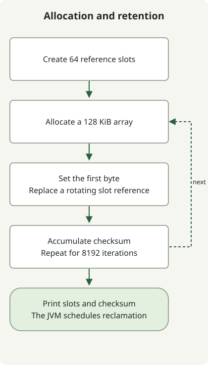

**For modern HotSpot, establish a measured G1 baseline, compare ZGC or Shenandoah for strict latency goals, and consider Parallel GC when throughput dominates.** Before copying old JVM flags, check which collector is the default and which implementations exist in the actual JDK distribution.

The reference date is **November 3, 2026**. [JDK 27](https://jdk.java.net/27/) is the latest generally available feature release; [JDK 28 is Early Access](https://jdk.java.net/28/). This article covers **OpenJDK HotSpot**, not every JVM implementation. Oracle's LTS lines—8, 11, 17, 21 and 25—are common deployment choices, but support periods and update terms depend on the distributor. [Oracle support roadmap](https://www.oracle.com/java/technologies/java-se-support-roadmap.html)

## From the latest JDK back to earlier releases

| JDK | Main GC change | What to check in existing deployments |
| --- | --- | --- |
| **28 EA** | [JEP 535](https://openjdk.org/jeps/535), making Shenandoah's generational mode the default, is Targeted | Do not treat this as delivered in a GA release. It does not make Shenandoah the JVM-wide default collector |
| **27** | [JEP 523](https://openjdk.org/jeps/523) selects G1 by default regardless of CPU count and memory size | Recheck defaults for services that previously selected Serial in small environments |
| **26** | [JEP 522](https://openjdk.org/jeps/522) reduces synchronization overhead in G1 to improve throughput | An upstream improvement does not establish the same percentage gain for your service |
| **25** | [JEP 521](https://openjdk.org/jeps/521) promotes Generational Shenandoah from experimental to a product feature | Availability of a mode and selection of that mode by default are different changes |
| **24 / 23** | 24 removes non-generational ZGC ([JEP 490](https://openjdk.org/jeps/490)); 23 makes generational mode the default when selecting ZGC ([JEP 474](https://openjdk.org/jeps/474)). 24 also introduces experimental Generational Shenandoah ([JEP 404](https://openjdk.org/jeps/404)) | A default within ZGC is not a change to the JVM's default collector |
| **21 / 17 / 15** | 21 introduces Generational ZGC ([JEP 439](https://openjdk.org/jeps/439)). ZGC and Shenandoah become product features in 15 ([JEP 377](https://openjdk.org/jeps/377), [379](https://openjdk.org/jeps/379)), so they are product features in 17 as well | Select generational ZGC explicitly in 21. Check platform and distribution availability separately |
| **14 / 12 / 11** | 14 removes CMS ([JEP 363](https://openjdk.org/jeps/363)). 12 adds experimental Shenandoah ([JEP 189](https://openjdk.org/jeps/189)); 11 introduces experimental ZGC and Epsilon ([JEP 333](https://openjdk.org/jeps/333), [318](https://openjdk.org/jeps/318)) | Distinguish historical experimental status from current product status; initial support did not cover every platform |
| **9** | G1 becomes the server-configuration default ([JEP 248](https://openjdk.org/jeps/248)); CMS is deprecated ([JEP 291](https://openjdk.org/jeps/291)); unified GC logging arrives ([JEP 271](https://openjdk.org/jeps/271)) | Do not migrate JDK 8 log parsers and options unchanged |
| **8** | Parallel is the server-class throughput default; G1 and CMS are alternatives. PermGen is removed ([JEP 122](https://openjdk.org/jeps/122)) | Parallel was not the default in every environment. Do not carry PermGen flags into new deployments |
| **7u4 / 6 / 5 / 1.4.1** | Oracle JDK supports G1 from 7u4. Parallel full collection arrives in 5u6 and improves in 6. 1.4.1 documentation presents parallel young collection and concurrent old collection | Distinguish early Parallel young collection from later parallel old collection |

Read JDK 8 defaults in the context of its [ergonomics guide](https://docs.oracle.com/javase/8/docs/technotes/guides/vm/gctuning/ergonomics.html). Earlier milestones are documented in the [G1 support history](https://docs.oracle.com/javase/8/docs/technotes/guides/vm/G1.html), [Parallel Compaction description](https://docs.oracle.com/javase/8/docs/technotes/guides/vm/par-compaction-6.html), and [JDK 1.4.1 GC article](https://www.oracle.com/technical-resources/articles/java/garbagecollection-in-java-applications-using-jdk141.html). Historical heap-size recommendations and pause targets describe their period; they are not current deployment defaults.

The table selects important milestones. It is not a list of every update fix or a claim that every historical release was executed for this article.

## Three distinctions before choosing a collector

GC reclaims memory belonging to objects **unreachable from GC roots**, such as references held by running threads. A cache or global collection can keep objects reachable even after the application no longer needs them. Generational collection exploits the observation that many objects die quickly while some survive, collecting young and old objects differently. [HotSpot GC implementation](https://docs.oracle.com/en/java/javase/27/gctuning/garbage-collector-implementation.html)

**Parallel** means multiple GC threads work together; **concurrent** means some GC work overlaps application execution. They are different dimensions. A **stop-the-world (STW)** phase pauses application execution. Concurrent collectors can still have short pauses or allocation stalls; concurrency does not eliminate request latency.

Marking identifies live objects; sweeping makes reclaimable space available for reuse. Compaction moves live objects to consolidate free space, while evacuation copies survivors from selected regions elsewhere. Collectors combine these tasks differently across generations, regions, parallel work and concurrent work.

| Collector | Main approach | Conditions to compare |
| --- | --- | --- |
| Serial | One GC thread; limited coordination overhead can suit small tasks | Measure throughput and pauses even for a small heap or restricted CPU |
| Parallel | Multiple collection threads, prioritizing throughput | Compare batch completion time and tolerated pauses |
| G1 | Regions, concurrent marking and evacuation during pauses | General server baseline; its pause target is not a real-time guarantee |
| ZGC | Performs much relocation and reference work concurrently to target short pauses | Observe CPU and heap headroom, allocation rate and application latency together |
| Shenandoah | Low-pause collector with concurrent relocation; generational-mode status varies by release | Check distribution availability and the selected mode first |
| CMS / Epsilon | CMS is the historical concurrent mark-sweep collector; experimental Epsilon does not reclaim memory | CMS is unavailable in the latest JDK. Epsilon is not a general service GC replacement |

For Serial and Parallel, start with the [current collector-selection guide](https://docs.oracle.com/en/java/javase/27/gctuning/available-collectors.html). The [G1 tuning guide](https://docs.oracle.com/en/java/javase/27/gctuning/garbage-first-garbage-collector-tuning.html) explains G1's behavior and pause targets. The [historical CMS documentation](https://docs.oracle.com/en/java/javase/13/gctuning/concurrent-mark-sweep-cms-collector.html) describes concurrent phases and fragmentation constraints; [JEP 318](https://openjdk.org/jeps/318) specifies Epsilon's lack of reclamation.

## Check the generational mode as well as the collector

For ZGC in JDK 21, `-XX:+UseZGC -XX:+ZGenerational` selects generational mode. In 23, `-XX:+UseZGC` defaults to generational mode; 24 removes the non-generational implementation. Obsoleting and removing a flag are separate steps from removing an implementation. JDK 27 in this lab rejected `-XX:+ZGenerational`, so do not append it to the current configuration. [Current ZGC guide](https://docs.oracle.com/en/java/javase/27/gctuning/z-garbage-collector.html)

Check Shenandoah separately. The generational product mode introduced in 25 is selected with `-XX:+UseShenandoahGC -XX:ShenandoahGCMode=generational`. **Selecting Shenandoah alone in 27 does not establish that generational mode is selected.** JEP 535 targets 28 and remains Targeted at the reference date. Build options and backports can affect which collectors a distribution provides; check the actual executable.

## Read logs from the same allocation program

This **single-threaded lab** illustrates object lifetimes and GC logs. It allocates 8192 arrays of 128 KiB, totaling 1 GiB of array payload, while replacing references in 64 rotating slots. The final retained payload is 8 MiB; array headers, references and JVM memory are additional. It does not implement production load or a GC benchmark.



The diagram follows allocation and reference replacement in the code. The JVM decides when unreachable objects are reclaimed; the code does not call `System.gc()`. Do not assume each replaced object is reclaimed immediately.

### `GcProbe.java`

```java
import java.lang.management.GarbageCollectorMXBean;
import java.lang.management.ManagementFactory;

public final class GcProbe {
    private static volatile byte[][] retained;
    private static volatile long checksum;

    public static void main(String[] args) {
        System.out.println("runtime=" + System.getProperty("java.runtime.version"));
        for (GarbageCollectorMXBean gc : ManagementFactory.getGarbageCollectorMXBeans()) {
            System.out.println("collector=" + gc.getName());
        }
        retained = new byte[64][];
        for (int i = 0; i < 8192; i++) {
            byte[] block = new byte[128 * 1024];
            block[0] = (byte) i;
            retained[i % retained.length] = block;
            checksum += block[0] & 0xff;
        }
        System.out.println("iterations=8192 retainedSlots=" + retained.length
                + " checksum=" + checksum);
    }
}
```

The arrays remain externally reachable through `retained`. This small program still does not establish a production service's object-lifetime distribution or bottleneck.

### Select four collectors and inspect logs in JDK 27

These commands use a Unix-style shell. Replace `GC_JDK` with your **JDK home directory**, save the Java file in a new working directory, and run the commands there. No external libraries or network requests are required. Each run uses a maximum heap of 128 MiB and bounded rotating logs.

```sh
GC_JDK="/path/to/jdk-27"
"$GC_JDK/bin/java" -version
mkdir -p out logs
"$GC_JDK/bin/javac" -d out GcProbe.java
for gc in G1 Parallel Serial Z; do
  "$GC_JDK/bin/java" "-XX:+Use${gc}GC" -Xms128m -Xmx128m \
    '-Xlog:gc*,safepoint:file=logs/gc-%p.log:time,uptime,level,tags:filecount=3,filesize=5M' \
    -cp out GcProbe
done
```

`%p` expands to the JVM PID, distinguishing logs from separate runs. Check that all four runs end with the following line. The preceding runtime and collector lines depend on the JDK and collector.

```text
iterations=8192 retainedSlots=64 checksum=1044480
```

The executed environment was **macOS arm64, Zulu 8u392-b08, and Temurin 21.0.13+9, 25.0.5+8 and 27.0.1.0.2+1**. Archived versions illustrate historical behavior; this is not a recommendation for current security update combinations. The executed scope was:

| JDK | Executions checked |
| --- | --- |
| 8 | Default Parallel, explicit G1 and CMS, including completion and legacy GC logs |
| 21 | Non-generational and explicitly generational ZGC, including completion and logs |
| 25 | Generational ZGC selected with the ZGC flag, including completion and logs |
| 27 | Serial, Parallel, G1, ZGC, non-generational Shenandoah and explicitly generational Shenandoah, including completion and logs |

All **12 execution configurations** produced the same checksum and GC logs. They do not control implementation, optimization and security differences across JDKs, so elapsed time or GC counts are not a collector ranking. The 28 EA and 1.4.1–7, 9–20, 22–24 and 26 milestones were checked against the official sources above.

### What one log line tells you

This is an actual G1 event from JDK 27 with only timestamp and tag decorations removed.

```text
GC(0) Pause Young (Normal) (G1 Evacuation Pause) 47M->10M(128M) 1.468ms
```

`47M->10M` is heap usage before and after this GC; `(128M)` is heap capacity at that point. The parenthesized value is not universally the maximum heap. This lab sets equal `-Xms` and `-Xmx` values. `1.468ms` is this event's pause, not service p99 or total GC CPU cost. The line alone neither rules out a memory leak nor establishes a pause-time guarantee.

### JDK 8 also needs different logging options

Do not apply JDK 9 unified logging unchanged to 8. Recompile the same source with that JDK's compiler to avoid class-file version mismatches.

```sh
GC_JDK="/path/to/jdk-8"
mkdir -p out8 logs
"$GC_JDK/bin/javac" -d out8 GcProbe.java
"$GC_JDK/bin/java" -Xms128m -Xmx128m -XX:+UseConcMarkSweepGC \
  -XX:+PrintGCDetails -XX:+PrintGCDateStamps -Xloggc:logs/jdk8-cms.log \
  -cp out8 GcProbe
```

JDK 27 also rejected `-XX:+UseConcMarkSweepGC`. Support, obsoletion and removal stages differ by release; inspect actual startup messages and exit status during upgrades.

Check default collector selection as follows. This reports one CPU to a **new JVM**; it does not change a running service's CPU allocation.

```sh
GC_JDK="/path/to/jdk-27"
"$GC_JDK/bin/java" -XX:ActiveProcessorCount=1 -Xms128m -Xmx128m \
  -XX:+PrintCommandLineFlags -version
```

Under the same conditions, Temurin 21 printed `UseSerialGC` and Temurin 27 printed `UseG1GC`. An explicit collector selection overrides the default. The CPU and memory visible to the JVM matter; host specifications alone do not establish a container's selection.

## What should a production comparison measure?

For an existing service, record the current JDK, distribution, flags and workload first. With the same request pattern and CPU/memory budget, observe **application throughput, p95/p99, errors, RSS, heap usage, allocation rate, GC pauses and concurrent GC CPU** together. Shorter pauses can still accompany worse application latency if GC and application threads compete more heavily for CPU.

For G1, build a baseline with defaults instead of pinning a young-generation size inherited from another collector, then adjust overall heap and pause goals if needed. ZGC needs headroom for the live set and new allocations during concurrent collection. `-Xmx` is not process RSS or the container-wide memory limit; budget for metaspace, thread stacks and direct buffers as well.

If reachable objects keep growing, inspect retained references, cache bounds and request lifetimes first. Switching collectors does not automatically remove reachable objects. Combine service evidence with the [LGTM log–trace workflow](/en/posts/2026-11-02-grafana-lgtm-log-trace/), while avoiding the assumption that coincident request latency and GC events establish causation.
