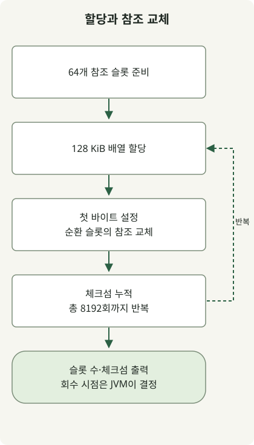

**최신 HotSpot에서는 G1을 기준선으로 측정하고, 지연 목표가 엄격하면 ZGC·Shenandoah를, 처리량이 우선이면 Parallel GC를 비교하는 것이 출발점입니다.** 과거 JDK의 GC 옵션을 그대로 복사하기보다, 사용 중인 JDK·배포판에서 무엇이 기본이고 어떤 구현이 남아 있는지 먼저 확인해야 합니다.

기준일은 **2026년 11월 3일**입니다. 최신 정식 기능 릴리스는 [JDK 27](https://jdk.java.net/27/)이며 [JDK 28은 Early Access](https://jdk.java.net/28/)입니다. 이 글은 **OpenJDK HotSpot 계열**을 다루며, 모든 JVM 구현의 GC가 같다고 가정하지 않습니다. Oracle의 LTS 계열인 8·11·17·21·25는 운영 선택에서 자주 만나지만, 지원 기간과 업데이트 제공 조건은 배포사별로 확인해야 합니다. [Oracle 지원 로드맵](https://www.oracle.com/java/technologies/java-se-support-roadmap.html)

## 최신 JDK에서 과거로: 어떤 변화가 있었나?

| JDK | GC의 주요 변화 | 기존 운영 설정에서 확인할 것 |
| --- | --- | --- |
| **28 EA** | Shenandoah의 기본 모드를 세대형으로 바꾸는 [JEP 535](https://openjdk.org/jeps/535)가 Targeted 상태 | 아직 정식판에 완료된 변화로 간주하지 않음. JVM 전체의 기본 GC를 Shenandoah로 바꾼다는 뜻도 아님 |
| **27** | [JEP 523](https://openjdk.org/jeps/523)으로 CPU·메모리 규모에 관계없이 G1을 기본 선택 | 예전에 작은 환경에서 Serial이 선택됐던 서비스도 기본값을 다시 확인 |
| **26** | [JEP 522](https://openjdk.org/jeps/522): G1의 동기화 비용을 줄여 처리량 개선 | 공식 개선 목표를 내 서비스의 동일 비율 향상으로 해석하지 않음 |
| **25** | [JEP 521](https://openjdk.org/jeps/521): 세대형 Shenandoah가 실험 기능에서 제품 기능으로 전환 | 세대형 모드를 사용할 수 있다는 것과 그 모드가 기본이라는 것을 구분 |
| **24 / 23** | 24에서 ZGC의 비세대형 구현 제거([JEP 490](https://openjdk.org/jeps/490)); 23에서 ZGC 선택 시 세대형이 기본([JEP 474](https://openjdk.org/jeps/474)). 24에는 실험적 세대형 Shenandoah도 도입([JEP 404](https://openjdk.org/jeps/404)) | ZGC 내부 모드 변경을 JVM 기본 GC 변경과 혼동하지 않음 |
| **21 / 17 / 15** | 21에서 세대형 ZGC 도입([JEP 439](https://openjdk.org/jeps/439)). 15에서 ZGC·Shenandoah 제품화([JEP 377](https://openjdk.org/jeps/377), [379](https://openjdk.org/jeps/379)); 따라서 17에서도 제품 기능으로 사용 가능 | 21의 ZGC는 세대형을 명시적으로 선택해야 함. CPU·OS·배포판의 포함 여부는 별도 확인 |
| **14 / 12 / 11** | 14에서 CMS 제거([JEP 363](https://openjdk.org/jeps/363)). 12에서 실험적 Shenandoah([JEP 189](https://openjdk.org/jeps/189)), 11에서 실험적 ZGC·Epsilon 도입([JEP 333](https://openjdk.org/jeps/333), [318](https://openjdk.org/jeps/318)) | 과거 실험 상태와 현재 제품 상태를 구분. 모든 초기 플랫폼에서 지원됐다고 가정하지 않음 |
| **9** | 서버 구성의 기본 GC가 G1으로 변경([JEP 248](https://openjdk.org/jeps/248)), CMS 사용 중단 예고([JEP 291](https://openjdk.org/jeps/291)), 통합 GC 로그 도입([JEP 271](https://openjdk.org/jeps/271)) | JDK 8 로그 파서·옵션을 그대로 옮기지 않음 |
| **8** | 서버급 환경의 기본은 처리량 GC인 Parallel. G1·CMS도 선택 가능. PermGen 제거([JEP 122](https://openjdk.org/jeps/122)) | 모든 환경의 기본이 Parallel이었다고 일반화하지 않음. PermGen 옵션도 새 환경에 이식하지 않음 |
| **7u4 / 6 / 5 / 1.4.1** | G1은 Oracle JDK 7u4부터 정식 지원. 병렬 Full GC는 5u6에서 도입돼 6에서 개선. 1.4.1에는 병렬 Young GC와 동시 Old GC가 소개됨 | 초기 Parallel의 Young 병렬화와 이후 Old 병렬화를 구분 |

JDK 8의 서버급 기본값은 [당시 ergonomics 문서](https://docs.oracle.com/javase/8/docs/technotes/guides/vm/gctuning/ergonomics.html)를 기준으로 읽습니다. 더 오래된 흐름은 [G1 지원 이력](https://docs.oracle.com/javase/8/docs/technotes/guides/vm/G1.html), [Parallel Compaction 설명](https://docs.oracle.com/javase/8/docs/technotes/guides/vm/par-compaction-6.html), [JDK 1.4.1의 GC 설명](https://www.oracle.com/technical-resources/articles/java/garbagecollection-in-java-applications-using-jdk141.html)에서 확인할 수 있습니다. 과거 문서의 힙 크기 추천이나 목표 시간은 당시 환경의 설명이므로 최신 운영 권장값으로 가져오지 않습니다.

이 표는 중요한 변경 지점입니다. 각 업데이트의 수정 내역을 모두 나열한 목록은 아니며, 과거 버전 전체를 직접 실행했다는 뜻도 아닙니다.

## GC 이름보다 먼저 구분할 세 가지

GC는 실행 중인 스레드의 참조 등 **GC 루트에서 도달할 수 없는 객체**의 메모리를 회수합니다. 캐시나 전역 컬렉션이 계속 참조하는 객체는 애플리케이션이 더 이상 필요로 하지 않아도 회수 대상이 되지 않을 수 있습니다. 세대형 GC는 많은 객체가 짧게 살고 일부가 오래 산다는 특성을 이용해 Young·Old를 다르게 수집합니다. [HotSpot의 GC 구현 설명](https://docs.oracle.com/en/java/javase/27/gctuning/garbage-collector-implementation.html)

**Parallel**은 여러 GC 스레드가 함께 일한다는 뜻이고, **Concurrent**는 GC의 일부 작업을 애플리케이션 실행과 겹쳐 수행한다는 뜻입니다. 둘은 같은 분류 축이 아닙니다. **Stop-the-world(STW)**는 애플리케이션 실행을 멈추는 구간입니다. 동시 수집기에도 짧은 정지나 할당 대기가 있을 수 있으므로, 이름에 Concurrent가 있다고 요청 지연이 사라지지는 않습니다.

마킹(marking)은 살아 있는 객체를 식별하는 작업이고, sweep은 회수 가능한 공간을 재사용하는 작업입니다. 압축(compaction)은 살아 있는 객체를 이동시켜 빈 공간을 모으며, evacuation은 선택한 영역의 생존 객체를 다른 영역으로 복사합니다. 수집기는 이런 작업을 세대·region 단위와 병렬·동시 실행 방식으로 다르게 조합합니다.

| GC | 주된 접근 | 비교할 조건 |
| --- | --- | --- |
| Serial | 하나의 GC 스레드로 수집. 작은 작업에서 조정 비용을 줄일 수 있음 | 작은 힙·CPU 제한 환경에서도 실제 처리량과 정지를 확인 |
| Parallel | 여러 스레드로 수집하며 처리량을 중시 | 일괄 처리에서 정지 허용 범위와 전체 완료 시간 확인 |
| G1 | 힙을 region으로 나누고, 동시 마킹과 정지 중 evacuation을 조합 | 일반적인 서버의 기준선. pause 목표는 실시간 보장이 아님 |
| ZGC | 이동·참조 처리 등 많은 작업을 동시 수행하며 짧은 정지를 목표로 함 | CPU·힙 여유, 할당 속도, 애플리케이션 지연을 함께 관찰 |
| Shenandoah | 동시 객체 이동을 사용하는 저정지 수집기. 세대형·비세대형의 버전별 상태가 다름 | 실제 배포판의 포함 여부와 선택한 모드를 먼저 확인 |
| CMS / Epsilon | CMS는 과거의 동시 mark-sweep 수집기. Epsilon은 메모리를 회수하지 않는 실험적 수집기 | CMS는 최신 JDK에서 선택할 수 없음. Epsilon은 일반 서비스의 GC 대안으로 쓰지 않음 |

Serial·Parallel의 출발점은 [현재 수집기 선택 가이드](https://docs.oracle.com/en/java/javase/27/gctuning/available-collectors.html), G1의 동작과 정지 목표는 [G1 튜닝 가이드](https://docs.oracle.com/en/java/javase/27/gctuning/garbage-first-garbage-collector-tuning.html)를 참고합니다. CMS의 동시 단계·단편화 한계는 [과거 CMS 문서](https://docs.oracle.com/en/java/javase/13/gctuning/concurrent-mark-sweep-cms-collector.html), Epsilon의 회수 없음은 [JEP 318](https://openjdk.org/jeps/318)에 설명돼 있습니다.

## ZGC·Shenandoah는 세대형 옵션까지 확인하기

ZGC를 선택할 때 JDK 21에서는 `-XX:+UseZGC -XX:+ZGenerational`이 세대형 조합입니다. 23에서는 `-XX:+UseZGC`만으로 세대형이 기본이 됐고, 24에서는 비세대형 구현이 제거됐습니다. 옵션 자체의 폐기·제거는 구현 제거와 별도 단계로 진행됩니다. 이 글의 JDK 27 실행에서는 `-XX:+ZGenerational`이 인식되지 않았으므로 최신 설정에 덧붙이지 않습니다. [현재 ZGC 가이드](https://docs.oracle.com/en/java/javase/27/gctuning/z-garbage-collector.html)

Shenandoah도 따로 봅니다. 25에서 제품화된 세대형 모드는 `-XX:+UseShenandoahGC -XX:ShenandoahGCMode=generational`로 선택합니다. **27에서 수집기만 선택했다고 세대형을 선택한 것으로 간주하면 안 됩니다.** 세대형을 기본으로 바꾸는 JEP 535는 기준일 현재 28을 대상으로 하는 Targeted 상태입니다. 배포판의 빌드 옵션·백포트에 따라 제공되는 수집기가 다를 수 있으므로 실제 실행 파일로 확인합니다.

## 같은 할당 코드로 로그를 읽어 보기

다음 예제는 객체 수명과 GC 로그를 관찰하기 위한 **단일 스레드 실습**입니다. 128 KiB 배열을 8192번 만들어 총 1 GiB의 배열 payload를 할당하고, 64개 슬롯을 순환하며 참조를 교체합니다. 최종 슬롯에 남은 payload는 8 MiB이며 배열 헤더·참조·JVM 자체 메모리는 별도입니다. 실서비스 부하나 GC 성능 비교를 구현하지 않습니다.



그림은 아래 코드의 할당·참조 교체 순서입니다. 참조가 끊긴 객체의 회수 시점은 JVM이 결정하며, 코드에서 `System.gc()`를 호출하지 않습니다. 각 객체가 교체 직후 즉시 회수된다고 가정하지 않습니다.

### `GcProbe.java`

```java
import java.lang.management.GarbageCollectorMXBean;
import java.lang.management.ManagementFactory;

public final class GcProbe {
    private static volatile byte[][] retained;
    private static volatile long checksum;

    public static void main(String[] args) {
        System.out.println("runtime=" + System.getProperty("java.runtime.version"));
        for (GarbageCollectorMXBean gc : ManagementFactory.getGarbageCollectorMXBeans()) {
            System.out.println("collector=" + gc.getName());
        }
        retained = new byte[64][];
        for (int i = 0; i < 8192; i++) {
            byte[] block = new byte[128 * 1024];
            block[0] = (byte) i;
            retained[i % retained.length] = block;
            checksum += block[0] & 0xff;
        }
        System.out.println("iterations=8192 retainedSlots=" + retained.length
                + " checksum=" + checksum);
    }
}
```

`retained`를 통해 배열이 외부에서 도달 가능한 상태로 남도록 했습니다. 그래도 이 작은 프로그램의 로그만으로 실제 서비스의 객체 수명 분포나 병목을 판단할 수는 없습니다.

### JDK 27에서 네 수집기 선택과 로그 확인

아래는 Unix 계열 셸 명령입니다. `GC_JDK`를 자신의 **JDK 홈 디렉터리**로 바꾸고, 새 작업 폴더에 위 Java 파일을 저장한 뒤 실행합니다. 외부 라이브러리·네트워크 요청은 없습니다. 각 실행은 최대 힙 128 MiB를 설정하며 로그 파일은 회전하도록 제한합니다.

```sh
GC_JDK="/path/to/jdk-27"
"$GC_JDK/bin/java" -version
mkdir -p out logs
"$GC_JDK/bin/javac" -d out GcProbe.java
for gc in G1 Parallel Serial Z; do
  "$GC_JDK/bin/java" "-XX:+Use${gc}GC" -Xms128m -Xmx128m \
    '-Xlog:gc*,safepoint:file=logs/gc-%p.log:time,uptime,level,tags:filecount=3,filesize=5M' \
    -cp out GcProbe
done
```

`%p`는 JVM PID로 바뀌므로 실행별 로그를 구분할 수 있습니다. 네 실행 모두 아래 마지막 줄이 나오는지 확인합니다. 앞의 runtime·collector 줄은 사용한 JDK와 수집기에 따라 달라집니다.

```text
iterations=8192 retainedSlots=64 checksum=1044480
```

실제 재현 환경은 **macOS arm64, Zulu 8u392-b08, Temurin 21.0.13+9·25.0.5+8·27.0.1.0.2+1**입니다. 보관된 버전은 역사적 동작 확인용이며 최신 보안 업데이트 조합을 추천하는 표가 아닙니다. 다음 범위를 실행했습니다.

| JDK | 확인한 실행 |
| --- | --- |
| 8 | 기본 Parallel·명시적 G1·CMS의 예제 완료와 구형 GC 로그 |
| 21 | ZGC 비세대형·명시적 세대형의 예제 완료와 로그 |
| 25 | ZGC 선택 시 세대형의 예제 완료와 로그 |
| 27 | Serial·Parallel·G1·ZGC·Shenandoah 비세대형·명시적 세대형의 예제 완료와 로그 |

이 **12개 실행 조합**에서 체크섬이 같고 GC 로그가 생성되는 것을 확인했습니다. 서로 다른 JDK의 구현·최적화·보안 상태를 통제한 벤치마크가 아니므로 실행 시간이나 GC 횟수로 우열을 매기지 않습니다. 28 EA와 1.4.1~7·9~20·22~24·26의 변경 지점은 위 공식 자료로 확인했습니다.

### 로그 한 줄에서 알 수 있는 것과 없는 것

JDK 27의 G1 로그에서 시간·태그 장식만 뺀 실제 한 줄입니다.

```text
GC(0) Pause Young (Normal) (G1 Evacuation Pause) 47M->10M(128M) 1.468ms
```

`47M->10M`은 이 GC 전후의 힙 사용량이고 `(128M)`은 당시 힙 용량입니다. 일반적으로 괄호의 값을 항상 최대 힙으로 읽으면 안 됩니다. 이 실습은 `-Xms`와 `-Xmx`를 같게 설정해 초기·최대 크기를 맞췄습니다. `1.468ms`는 이 이벤트의 정지 시간이며 서비스 요청의 p99나 GC의 전체 CPU 비용이 아닙니다. 이 한 줄만으로 누수가 없거나 정지 목표를 보장한다고 판단할 수 없습니다.

### JDK 8에서는 로그 옵션도 달라진다

8에는 9의 통합 로깅 형식을 그대로 적용하지 않습니다. 같은 소스를 해당 JDK의 컴파일러로 다시 빌드하면 클래스 파일 버전 차이도 피할 수 있습니다.

```sh
GC_JDK="/path/to/jdk-8"
mkdir -p out8 logs
"$GC_JDK/bin/javac" -d out8 GcProbe.java
"$GC_JDK/bin/java" -Xms128m -Xmx128m -XX:+UseConcMarkSweepGC \
  -XX:+PrintGCDetails -XX:+PrintGCDateStamps -Xloggc:logs/jdk8-cms.log \
  -cp out8 GcProbe
```

최신 JDK 27에서는 `-XX:+UseConcMarkSweepGC`도 인식되지 않는 것을 확인했습니다. 과거 옵션의 지원 종료·폐기·제거 단계는 버전마다 다르므로 업그레이드 시 실제 시작 로그와 종료 코드를 확인합니다.

기본 GC 선택도 다음처럼 확인할 수 있습니다. 이 명령은 실행 중인 서비스의 CPU 제한을 바꾸지 않고 **새 JVM**에만 한 CPU를 보고하도록 지정합니다.

```sh
GC_JDK="/path/to/jdk-27"
"$GC_JDK/bin/java" -XX:ActiveProcessorCount=1 -Xms128m -Xmx128m \
  -XX:+PrintCommandLineFlags -version
```

동일한 조건에서 Temurin 21은 `UseSerialGC`, Temurin 27은 `UseG1GC`를 출력했습니다. 수집기를 명시적으로 지정하면 기본 선택 대신 그 수집기를 사용합니다. JVM이 인식하는 CPU·메모리 조건이 중요하며 호스트 사양만으로 컨테이너 내부의 선택을 추정하지 않습니다.

## 운영에서 무엇부터 비교할까?

기존 서비스라면 현재 JDK·배포판·GC 옵션과 부하를 먼저 기록합니다. 같은 요청 패턴과 CPU·메모리 예산에서 **애플리케이션 처리량·p95/p99·오류·RSS·힙 사용량·할당 속도·GC 정지·동시 GC CPU**를 함께 봅니다. 정지 시간이 짧아져도 GC와 애플리케이션이 CPU를 더 경쟁하면 전체 지연이 나빠질 수 있습니다.

G1에서는 기존 수집기의 Young 크기 옵션을 그대로 고정하기보다 기본값으로 기준선을 만들고 필요에 따라 전체 힙·정지 목표를 조정합니다. ZGC에서는 살아 있는 데이터와 동시 수집 중 새 할당을 감당할 힙 여유가 필요합니다. `-Xmx`는 프로세스 RSS나 컨테이너 전체 메모리 제한이 아니며, metaspace·스레드 스택·direct buffer 등도 예산에 포함합니다.

도달 가능한 객체가 계속 늘어난다면 보유 참조·캐시 상한·요청 수명부터 확인합니다. GC 변경은 계속 참조되는 객체를 자동으로 없애 주지 않습니다. 실제 서비스의 관측 흐름은 [LGTM 로그·트레이스 연결 글](/ko/posts/2026-11-02-grafana-lgtm-log-trace/)과 함께 구성하되, 요청 지연과 GC 이벤트가 같은 시간에 나타났다는 이유만으로 원인을 확정하지 않습니다.
