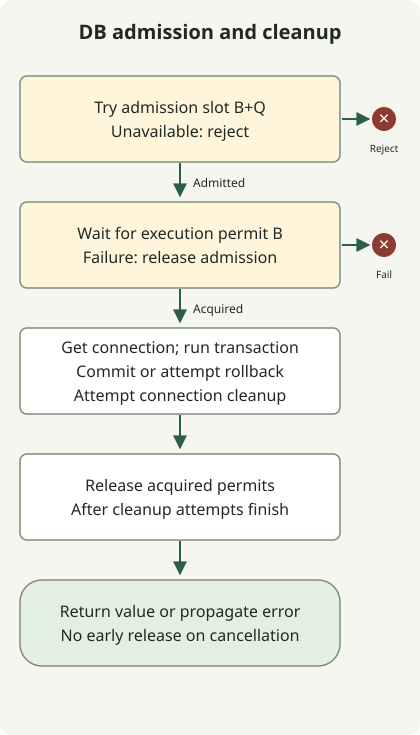

Using virtual threads does not mean you must add a semaphore in front of the database. The connection pool already limits connection count. An additional semaphore is useful when you want to **reject DB work earlier, bound the number of admitted operations, or allocate concurrency budgets to particular workloads**. Oracle's virtual-thread guide also explains that a database connection pool itself acts as a semaphore. [Oracle virtual-thread guide](https://docs.oracle.com/en/java/javase/25/core/virtual-threads.html)

This article follows the [JDK 21–25 virtual-thread comparison](/en/posts/2026-10-31-virtual-threads-jdk21-jdk25/) into database connections. It makes the DB-work boundary concrete within the broader admission control discussed in the [10k RPS architecture](/en/posts/2026-10-31-jdk-10k-rps-architecture/). The scope is Java 21 or later, with one synchronous JDBC transaction using one connection. Share the semaphore across an application instance; do not create a new one for every request.

## What should you limit when you already have a connection pool?

Virtual threads let you retain many waiting tasks with relatively little thread overhead. They do not increase the database's query capacity or reduce lock contention by themselves. Requests waiting for a connection from a full pool still retain memory and request state.

| Situation | Control to apply first |
| --- | --- |
| Connection limits and the pool's wait limit are sufficient | Keep the connection-pool configuration |
| You want to reject overloaded requests before they enter the pool | Add admission control |
| A batch workload or expensive queries monopolize connections | Set workload-specific budgets; separate pools if needed |
| Slow SQL or locks hold connections for too long | Check queries, indexes, transactions and database limits first |

HikariCP's `maximumPoolSize` limits the number of connections in the pool. If none is available, `getConnection()` waits up to `connectionTimeout` and then throws an exception. Its minimum value is 250ms. A 20ms semaphore wait does not make the pool wait end within 20ms as well. [HikariCP configuration](https://github.com/brettwooldridge/HikariCP#configuration-knobs-baby)

## Bound both execution and total admission

The example uses two semaphores.

- **B execution permits:** limit operations in progress from connection acquisition through transaction and connection cleanup.
- **B+Q admission permits:** limit all operations inside this gate, including those waiting for an execution permit. Reject immediately when no admission permit remains.

When all B execution permits are in use, at most Q additional admitted operations can remain. However, tasks may also be scheduled before acquiring an execution permit, so this does not mean the number of waiters is always exactly bounded by Q at every instant. A single semaphore that only limits waiting time does not bound the number of admitted waiters.



The DB-resource box summarizes internal exception paths. If connection acquisition fails, skip the work and proceed to permit release. If transaction setup fails, attempt to clean up the acquired connection. If the work or commit fails, attempt a rollback.

If admission fails, there is no permit to release. If execution acquisition fails or the waiting thread is interrupted, release only the admission permit. After both permits have been acquired, release them after connection acquisition, transaction processing and cleanup have unwound normally or exceptionally. **Do not release permits from another thread merely because the caller timed out.** If the actual DB work continues, doing so can exceed the configured execution limit.

## How should you choose B, Q and pool size?

B counts concurrent DB operations, not requests per second. It includes connection-acquisition waits, commit and cleanup, so actual SQL concurrency may be lower than B. Choose it by measuring database saturation, connection holding time and the budgets of other workloads. Q is the number of additional operations to admit during overload; choose it with both the waiting budget and memory in mind.

For example, with pool P=24 and gate B=16, at most 16 operations can be in progress through this gate. The remaining 8 connections are not reserved for other work. Callers outside the gate that share the pool could occupy every connection. Even if you separate pools for isolation, add their connection budgets together at the database level.

When budgeting connection limits, check `peak simultaneous instances × pool size per instance + batch, operations and other client connections ≤ DB connection budget`. The instance peak includes autoscaling and overlapping old and new instances during a rolling deployment. `instance count × B` bounds only work passing through this gate. These numbers illustrate the calculation; they are neither recommended settings nor performance measurements.

## A runnable JDBC example

The example gate owns its transaction and connection. The callback must execute synchronously and return only a fully materialized value. Do not commit, roll back or change auto-commit settings inside the callback. Returning a `Connection`, `ResultSet` or lazy query stream, or starting separate asynchronous DB work inside the callback, escapes the protection of this boundary.

### `DbBulkhead.java`

```java
import java.sql.Connection;
import java.sql.SQLException;
import java.time.Duration;
import java.util.Objects;
import java.util.concurrent.RejectedExecutionException;
import java.util.concurrent.Semaphore;
import java.util.concurrent.TimeUnit;
import javax.sql.DataSource;

public final class DbBulkhead {
    @FunctionalInterface
    public interface SqlWork<T> {
        T run(Connection connection) throws SQLException;
    }

    private final DataSource source;
    private final Semaphore slots;
    private final Semaphore running;

    public DbBulkhead(DataSource source, int concurrent, int extraSlots) {
        this.source = Objects.requireNonNull(source);
        if (concurrent < 1 || extraSlots < 0) {
            throw new IllegalArgumentException("invalid capacity");
        }
        slots = new Semaphore(Math.addExact(concurrent, extraSlots));
        running = new Semaphore(concurrent, true);
    }

    public <T> T transaction(Duration queueWait, SqlWork<T> work)
            throws SQLException, InterruptedException {
        Objects.requireNonNull(work);
        long nanos = queueWait.toNanos();
        if (nanos < 0) throw new IllegalArgumentException("negative wait");
        if (!slots.tryAcquire()) {
            throw new RejectedExecutionException("db admission full");
        }
        boolean acquired = false;
        try {
            acquired = running.tryAcquire(nanos, TimeUnit.NANOSECONDS);
            if (!acquired) {
                throw new RejectedExecutionException("db admission timed out");
            }
            try (Connection connection = source.getConnection()) {
                connection.setAutoCommit(false);
                try {
                    T value = work.run(connection);
                    connection.commit();
                    return value;
                } catch (SQLException | RuntimeException | Error failure) {
                    try {
                        connection.rollback();
                    } catch (SQLException rollbackFailure) {
                        failure.addSuppressed(rollbackFailure);
                    }
                    throw failure;
                }
            }
        } finally {
            if (acquired) running.release();
            slots.release();
        }
    }

    int available() { return running.availablePermits(); }
    int availableSlots() { return slots.availablePermits(); }
}
```

The code releases `running` only if it was acquired, so a failed wait or interruption cannot inflate permit count. SQL exceptions, runtime exceptions and errors trigger a rollback attempt; if rollback fails, that failure is attached to the original exception as a suppressed exception. The caller receives the return value only after commit and connection `close()` complete. If commit fails, or connection cleanup fails after commit, a write may have taken effect even though the caller receives an exception. Do not retry writes unconditionally.

Even a fair semaphore does not guarantee end-to-end ordering for every request. The example uses timed acquisition on a fair execution semaphore, but immediate acquisition for admission. Untimed `tryAcquire()` does not honor the fairness setting. The `available()` methods are for observing the lab; reading their values and deciding admission separately creates a race. [Semaphore API](https://docs.oracle.com/en/java/javase/25/docs/api/java.base/java/util/concurrent/Semaphore.html)

The demo configures pool size 2, B=1 and Q=0. It checks that a second operation is rejected while the first transaction holds its permit. Holding the transaction briefly with a latch coordinates the reproduction; it is not a recommended service-processing pattern.

### `Demo.java`

```java
import com.zaxxer.hikari.HikariConfig;
import com.zaxxer.hikari.HikariDataSource;
import java.sql.SQLException;
import java.time.Duration;
import java.util.concurrent.CountDownLatch;
import java.util.concurrent.ExecutionException;
import java.util.concurrent.Executors;
import java.util.concurrent.RejectedExecutionException;
import java.util.concurrent.TimeUnit;

public class Demo {
    static HikariDataSource pool() {
        HikariConfig config = new HikariConfig();
        config.setJdbcUrl(System.getenv("DB_URL"));
        config.setUsername(System.getenv("DB_USER"));
        config.setPassword(System.getenv("DB_PASSWORD"));
        config.setMaximumPoolSize(2);
        config.setMinimumIdle(0);
        config.setConnectionTimeout(500);
        config.setValidationTimeout(250);
        return new HikariDataSource(config);
    }

    public static void main(String[] args) throws Exception {
        try (var pool = pool(); var tasks = Executors.newVirtualThreadPerTaskExecutor()) {
            var gate = new DbBulkhead(pool, 1, 0);
            var entered = new CountDownLatch(1);
            var release = new CountDownLatch(1);
            var first = tasks.submit(() -> gate.transaction(Duration.ZERO, connection -> {
                if (!Thread.currentThread().isVirtual()) throw new AssertionError();
                try (var statement = connection.createStatement()) {
                    statement.setQueryTimeout(2);
                    try (var rows = statement.executeQuery("SELECT 42")) {
                        rows.next();
                        int value = rows.getInt(1);
                        entered.countDown();
                        try {
                            if (!release.await(5, TimeUnit.SECONDS)) {
                                throw new SQLException("demo coordination timed out");
                            }
                        } catch (InterruptedException interrupted) {
                            Thread.currentThread().interrupt();
                            throw new SQLException("demo interrupted", interrupted);
                        }
                        return value;
                    }
                }
            }));
            try {
                if (!entered.await(5, TimeUnit.SECONDS)) throw new AssertionError("not entered");
                var second = tasks.submit(() -> gate.transaction(Duration.ZERO, c -> 0));
                try {
                    second.get(5, TimeUnit.SECONDS);
                    throw new AssertionError("must reject");
                } catch (ExecutionException failure) {
                    if (!(failure.getCause() instanceof RejectedExecutionException)) throw failure;
                    System.out.println("overload=rejected");
                }
            } finally {
                release.countDown();
            }
            System.out.println("query=" + first.get(5, TimeUnit.SECONDS));
            System.out.println("available=" + gate.available());
        }
    }
}
```

### `build.gradle`

```groovy
plugins { id 'application' }
repositories { mavenCentral() }
dependencies {
    implementation 'com.zaxxer:HikariCP:7.1.0'
    runtimeOnly 'org.postgresql:postgresql:42.7.14'
    runtimeOnly 'org.slf4j:slf4j-simple:2.0.20'
}
sourceSets.main.java {
    srcDirs = ['.']
    include 'DbBulkhead.java', 'Demo.java', 'DbBulkheadChecks.java'
}
tasks.withType(JavaCompile).configureEach { options.release = 21 }
application { mainClass = 'Demo' }
tasks.register('copyDependencies', Copy) {
    from configurations.runtimeClasspath
    into layout.buildDirectory.dir('deps')
}
tasks.register('contracts', JavaExec) {
    classpath = sourceSets.main.runtimeClasspath
    mainClass = 'DbBulkheadChecks'
}
```

### `settings.gradle`

```groovy
rootProject.name = 'virtual-threads-db-semaphore'
```

### Run locally

Save the four files above in a separate lab directory with Docker, JDK 21 and Gradle 8.14.3 installed. Gradle runs on JDK 21 to download dependencies. Compilation and execution then use the selected JDK's `javac` and `java` directly, so testing JDK 25 does not require running Gradle 8.14.3 on JDK 25. Running Gradle itself on JDK 21 requires version 8.5 or later; this lab uses 8.14.3. [Gradle's Java 21 runtime support](https://docs.gradle.org/8.5/release-notes.html)

Run the following commands in a POSIX shell. `JAVA_HOME` must point to the JDK to execute; select JDK 21 for the dependency-download step. The example password is only for the temporary local database. If port 55432 is already in use, choose a different port.

```sh
(
  set -eu
  gradle --no-daemon -q copyDependencies
  db_container=$(docker run -d --rm -p 127.0.0.1:55432:5432 \
    -e POSTGRES_USER=demo -e POSTGRES_DB=demo \
    -e POSTGRES_PASSWORD=example-only \
    postgres@sha256:839fbb5a4942a7758dd93e18b42ea5649807491a0545b5eeeb8f0b8bb11857a5)
  trap 'docker stop "$db_container" >/dev/null' EXIT
  ready=false
  for attempt in $(seq 1 30); do
    if docker exec "$db_container" pg_isready -h 127.0.0.1 -U demo -d demo >/dev/null 2>&1; then
      ready=true
      break
    fi
    sleep 1
  done
  if [ "$ready" != true ]; then exit 1; fi
  mkdir -p build/classes
  "$JAVA_HOME/bin/javac" --release 21 -cp 'build/deps/*' \
    -d build/classes DbBulkhead.java Demo.java
  DB_URL='jdbc:postgresql://127.0.0.1:55432/demo?connectTimeout=2&socketTimeout=5' \
    DB_USER=demo DB_PASSWORD=example-only \
    "$JAVA_HOME/bin/java" -cp 'build/classes:build/deps/*' Demo
)
```

The standard output observed locally was as follows. HikariCP startup and shutdown logs may appear separately.

```text
overload=rejected
query=42
available=1
```

The verification environment was Temurin 21.0.13+9 and 25.0.5+8, PostgreSQL 17.11, HikariCP 7.1.0 and pgJDBC 42.7.14. Supplementary checks verified 45 conditions on each JDK: commit and rollback, excess admission, timed-out and interrupted waits, work continuing after cancellation, recovery after a server-side statement timeout, pool exhaustion and permit recovery after repeated failures. No HTTP load test or production throughput measurement was performed.

## Boundaries to preserve with timeouts and Spring transactions

**Separate waiting timeouts from work timeouts.** The example's `queueWait` limits only the wait for an execution permit. Pool acquisition, SQL and lock waits, networking and cleanup have separate budgets. An overall request deadline requires additional design to propagate remaining time to each stage. This example does not implement that end-to-end deadline propagation.

PostgreSQL's `statement_timeout` limits statement execution time on the server, while `lock_timeout` limits waits to acquire locks. The lab set `SET LOCAL statement_timeout = '100ms'` inside a transaction, checked that `pg_sleep(2)` failed with SQLState `57014`, and verified that subsequent work could proceed. Choose actual values to suit your queries and deadlines. [PostgreSQL 17 timeout settings](https://www.postgresql.org/docs/17/runtime-config-client.html)

Neither `Future.cancel(true)` nor ending an HTTP request guarantees immediate JDBC-query termination. pgJDBC has separate limits for queries, cancellation-signal transmission and socket reads. Closing a connection after a socket timeout is also different from confirming that server-side work has stopped. The executing boundary retains permit ownership during cancellation and cleanup. When the outcome of a write is uncertain, use an idempotency key or query the result to decide whether to retry. [pgJDBC connection properties](https://jdbc.postgresql.org/documentation/use/)

**With Spring, acquire admission before starting the transaction.** A nontransactional entry method in a separate bean can pass through the gate before calling a transactional proxy, or you can run a `TransactionTemplate` inside the admitted scope. Release permits after the proxy call or template has completed commit and cleanup and returned. Waiting inside a method whose transaction has already started can retain resources belonging to the outer transaction. Do not mix the JDBC-ownership code above directly into an existing Spring transaction.

`REQUIRES_NEW` may need another connection while retaining the outer transaction's connection. That breaks this example's assumption of one connection per operation and can cause pool exhaustion or deadlock waits. The gate is also not reentrant; do not acquire the same gate recursively. [Spring transaction propagation and pool-exhaustion warning](https://docs.spring.io/spring-framework/reference/data-access/transaction/declarative/tx-propagation.html)

In production, count admission-full rejections separately from wait timeouts, and observe gate waiting time, pool waiting time, connection holding time, SQL duration and lock waits together. When mapping rejections to HTTP 503 or another response, define client retry budgets so unbounded retries do not amplify load. Do not raise B based only on rejection counts; use database latency and saturation to decide.
