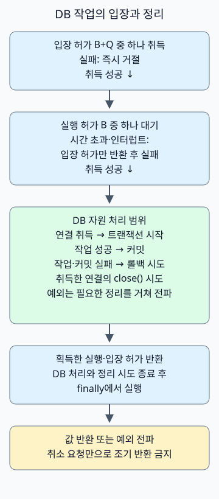

가상 스레드를 사용한다고 DB 앞에 세마포어를 반드시 추가할 필요는 없습니다. 커넥션 풀이 이미 연결 수를 제한하기 때문입니다. 별도 세마포어는 **DB 작업을 더 일찍 거절하거나, 입장한 작업 수를 제한하거나, 특정 작업군의 동시 실행 예산을 나눌 때** 유용합니다. Oracle의 가상 스레드 가이드도 DB 연결 풀 자체가 세마포어 역할을 한다고 설명합니다. [Oracle 가상 스레드 가이드](https://docs.oracle.com/en/java/javase/25/core/virtual-threads.html)

[가상 스레드의 JDK 21·25 차이](/ko/posts/2026-10-31-virtual-threads-jdk21-jdk25/)를 DB 연결 관점으로 이어서 살펴봅니다. [10k RPS 아키텍처](/ko/posts/2026-10-31-jdk-10k-rps-architecture/)의 전체 입장 제어 중 DB 작업 경계를 구체화하는 예제입니다. 이 글은 Java 21 이상에서 동기 JDBC 트랜잭션 하나가 연결 하나를 사용하는 경우를 다룹니다. 세마포어는 애플리케이션 인스턴스 안에서 공유하며, 요청마다 새로 만들지 않습니다.

## 커넥션 풀이 있는데 무엇을 더 제한할까?

가상 스레드는 많은 대기 작업을 비교적 적은 스레드 자원으로 유지하게 해 줍니다. DB가 처리할 수 있는 쿼리 수나 잠금 경합까지 줄여 주지는 않습니다. 풀이 꽉 찼을 때 연결을 기다리는 요청도 메모리와 요청 상태를 유지합니다.

| 상황 | 우선 적용할 제어 |
| --- | --- |
| 연결 수 제한과 풀의 대기 제한만으로 충분함 | 커넥션 풀 설정 유지 |
| 풀에 들어가기 전에 과부하 요청을 거절하고 싶음 | 입장 제한 추가 |
| 특정 배치·비싼 조회가 연결을 독점함 | 작업군별 예산 설정, 필요하면 풀 분리 |
| 느린 SQL·잠금 때문에 연결을 오래 점유함 | 쿼리·인덱스·트랜잭션과 DB 제한부터 점검 |

HikariCP의 `maximumPoolSize`는 풀의 연결 수를 제한합니다. 사용할 연결이 없으면 `getConnection()`은 `connectionTimeout`까지 기다린 뒤 예외를 던집니다. 이 값의 최솟값은 250ms입니다. 세마포어의 대기를 20ms로 설정해도 풀 대기까지 20ms로 끝나는 것은 아닙니다. [HikariCP 설정](https://github.com/brettwooldridge/HikariCP#configuration-knobs-baby)

## 실행 수와 전체 입장 수를 함께 제한하기

다음 예제는 두 개의 세마포어를 사용합니다.

- **실행 허가 B개:** 연결 취득부터 트랜잭션과 연결 정리까지 진행 중인 작업 수를 제한합니다.
- **입장 허가 B+Q개:** 실행 허가를 기다리는 작업까지 포함해 이 게이트 안에 있는 전체 작업 수를 제한합니다. 남은 입장 허가가 없으면 즉시 거절합니다.

B개가 모두 실행 중이면 추가로 입장해 남아 있을 수 있는 작업은 최대 Q개입니다. 다만 실행 허가를 얻기 전 스케줄링되는 작업도 있으므로, 모든 순간의 대기자 수가 정확히 Q 이하라는 뜻은 아닙니다. 대기 시간만 제한하는 세마포어 하나로는 입장한 대기자 수를 제한할 수 없습니다.



그림의 DB 자원 처리 상자는 내부 예외 분기를 요약합니다. 연결 취득에 실패하면 작업을 실행하지 않고 허가 반환으로 이동하며, 트랜잭션 설정에 실패하면 취득한 연결의 정리를 시도합니다. 작업·커밋 실패 시에는 롤백을 시도합니다.

입장에 실패하면 반환할 허가가 없습니다. 실행 허가를 얻지 못했거나 기다리다 인터럽트되면 입장 허가만 반환합니다. 두 허가를 얻은 뒤에는 연결 취득·트랜잭션·정리 과정이 정상 또는 예외로 끝난 다음 두 허가를 반환합니다. **호출자의 타임아웃만 보고 다른 스레드에서 허가를 반환해서는 안 됩니다.** 실제 DB 작업이 계속되면 설정한 실행 상한을 넘을 수 있습니다.

## B, Q와 풀 크기는 어떻게 정할까?

B는 초당 요청 수가 아니라 동시에 진행할 DB 작업 수입니다. 연결 취득 대기와 커밋·정리도 포함하므로 실제 SQL 실행 수는 B보다 작을 수 있습니다. DB가 포화되는 지점, 연결 점유 시간, 다른 작업의 예산을 측정하면서 정합니다. Q는 과부하 때 받아 둘 작업 수이며, 대기 예산과 메모리를 함께 보고 정합니다.

예를 들어 풀 P=24, 게이트 B=16이면 게이트가 사용하는 작업의 동시 진행 상한은 16입니다. 남은 8개가 다른 작업 전용으로 예약되는 것은 아닙니다. 같은 풀을 사용하는 게이트 밖의 코드가 연결을 모두 점유할 수도 있습니다. 격리가 필요해 풀을 나누더라도 DB 전체 연결 예산은 합산해야 합니다.

연결 상한을 예산으로 삼는다면 `최대 동시 인스턴스 수 × 인스턴스당 풀 크기 + 배치·운영·기타 클라이언트 연결 수 ≤ DB 연결 예산`을 확인합니다. 최대 인스턴스 수에는 자동 확장뿐 아니라 롤링 배포 중 신구 인스턴스의 중첩도 포함합니다. `인스턴스 수 × B`는 이 게이트를 통과하는 작업만 제한합니다. 위 숫자는 계산 예시이며 권장 설정이나 성능 측정값이 아닙니다.

## 실행 가능한 JDBC 예제

예제의 게이트는 트랜잭션과 연결을 직접 소유합니다. 콜백은 동기적으로 실행하고 완성된 값만 반환해야 합니다. 콜백 안에서 직접 커밋·롤백하거나 자동 커밋 설정을 바꾸지 않습니다. `Connection`, `ResultSet`, 지연 조회 스트림을 밖으로 반환하거나, 내부에서 별도 비동기 DB 작업을 시작하면 이 경계로 보호할 수 없습니다.

### `DbBulkhead.java`

```java
import java.sql.Connection;
import java.sql.SQLException;
import java.time.Duration;
import java.util.Objects;
import java.util.concurrent.RejectedExecutionException;
import java.util.concurrent.Semaphore;
import java.util.concurrent.TimeUnit;
import javax.sql.DataSource;

public final class DbBulkhead {
    @FunctionalInterface
    public interface SqlWork<T> {
        T run(Connection connection) throws SQLException;
    }

    private final DataSource source;
    private final Semaphore slots;
    private final Semaphore running;

    public DbBulkhead(DataSource source, int concurrent, int extraSlots) {
        this.source = Objects.requireNonNull(source);
        if (concurrent < 1 || extraSlots < 0) {
            throw new IllegalArgumentException("invalid capacity");
        }
        slots = new Semaphore(Math.addExact(concurrent, extraSlots));
        running = new Semaphore(concurrent, true);
    }

    public <T> T transaction(Duration queueWait, SqlWork<T> work)
            throws SQLException, InterruptedException {
        Objects.requireNonNull(work);
        long nanos = queueWait.toNanos();
        if (nanos < 0) throw new IllegalArgumentException("negative wait");
        if (!slots.tryAcquire()) {
            throw new RejectedExecutionException("db admission full");
        }
        boolean acquired = false;
        try {
            acquired = running.tryAcquire(nanos, TimeUnit.NANOSECONDS);
            if (!acquired) {
                throw new RejectedExecutionException("db admission timed out");
            }
            try (Connection connection = source.getConnection()) {
                connection.setAutoCommit(false);
                try {
                    T value = work.run(connection);
                    connection.commit();
                    return value;
                } catch (SQLException | RuntimeException | Error failure) {
                    try {
                        connection.rollback();
                    } catch (SQLException rollbackFailure) {
                        failure.addSuppressed(rollbackFailure);
                    }
                    throw failure;
                }
            }
        } finally {
            if (acquired) running.release();
            slots.release();
        }
    }

    int available() { return running.availablePermits(); }
    int availableSlots() { return slots.availablePermits(); }
}
```
`running`을 얻은 경우에만 반환하므로 대기 실패나 인터럽트가 허가 수를 늘리지 않습니다. SQL 오류·런타임 예외·오류가 발생하면 롤백을 시도하고, 롤백 실패는 원래 예외의 suppressed 예외로 남깁니다. 반환값은 커밋과 연결 `close()`가 끝나야 호출자에게 전달됩니다. 커밋 실패나 커밋 후 연결 정리 실패에서는 호출자가 예외를 받아도 쓰기가 반영됐을 수 있으므로 무조건 재시도하면 안 됩니다.

공정한 세마포어도 모든 요청의 전체 처리 순서를 보장하지는 않습니다. 예제의 실행 허가는 공정 모드의 시간 제한 취득을 사용하지만 입장 허가는 즉시 취득을 사용합니다. 시간 제한 없는 `tryAcquire()`는 공정성 설정을 따르지 않습니다. `available()` 계열 메서드는 실습 관찰용이며, 그 값을 읽고 별도로 입장을 판단하면 경쟁 상태가 생깁니다. [Semaphore API](https://docs.oracle.com/en/java/javase/25/docs/api/java.base/java/util/concurrent/Semaphore.html)

다음 데모는 풀 크기 2, B=1, Q=0으로 구성합니다. 첫 트랜잭션이 허가를 보유한 동안 두 번째 작업이 거절되는지 확인합니다. 래치로 트랜잭션을 잠시 붙잡는 부분은 재현을 위한 동기화이며 실제 서비스의 처리 방식으로 권장하는 코드가 아닙니다.

### `Demo.java`

```java
import com.zaxxer.hikari.HikariConfig;
import com.zaxxer.hikari.HikariDataSource;
import java.sql.SQLException;
import java.time.Duration;
import java.util.concurrent.CountDownLatch;
import java.util.concurrent.ExecutionException;
import java.util.concurrent.Executors;
import java.util.concurrent.RejectedExecutionException;
import java.util.concurrent.TimeUnit;

public class Demo {
    static HikariDataSource pool() {
        HikariConfig config = new HikariConfig();
        config.setJdbcUrl(System.getenv("DB_URL"));
        config.setUsername(System.getenv("DB_USER"));
        config.setPassword(System.getenv("DB_PASSWORD"));
        config.setMaximumPoolSize(2);
        config.setMinimumIdle(0);
        config.setConnectionTimeout(500);
        config.setValidationTimeout(250);
        return new HikariDataSource(config);
    }

    public static void main(String[] args) throws Exception {
        try (var pool = pool(); var tasks = Executors.newVirtualThreadPerTaskExecutor()) {
            var gate = new DbBulkhead(pool, 1, 0);
            var entered = new CountDownLatch(1);
            var release = new CountDownLatch(1);
            var first = tasks.submit(() -> gate.transaction(Duration.ZERO, connection -> {
                if (!Thread.currentThread().isVirtual()) throw new AssertionError();
                try (var statement = connection.createStatement()) {
                    statement.setQueryTimeout(2);
                    try (var rows = statement.executeQuery("SELECT 42")) {
                        rows.next();
                        int value = rows.getInt(1);
                        entered.countDown();
                        try {
                            if (!release.await(5, TimeUnit.SECONDS)) {
                                throw new SQLException("demo coordination timed out");
                            }
                        } catch (InterruptedException interrupted) {
                            Thread.currentThread().interrupt();
                            throw new SQLException("demo interrupted", interrupted);
                        }
                        return value;
                    }
                }
            }));
            try {
                if (!entered.await(5, TimeUnit.SECONDS)) throw new AssertionError("not entered");
                var second = tasks.submit(() -> gate.transaction(Duration.ZERO, c -> 0));
                try {
                    second.get(5, TimeUnit.SECONDS);
                    throw new AssertionError("must reject");
                } catch (ExecutionException failure) {
                    if (!(failure.getCause() instanceof RejectedExecutionException)) throw failure;
                    System.out.println("overload=rejected");
                }
            } finally {
                release.countDown();
            }
            System.out.println("query=" + first.get(5, TimeUnit.SECONDS));
            System.out.println("available=" + gate.available());
        }
    }
}
```
### `build.gradle`

```groovy
plugins { id 'application' }
repositories { mavenCentral() }
dependencies {
    implementation 'com.zaxxer:HikariCP:7.1.0'
    runtimeOnly 'org.postgresql:postgresql:42.7.14'
    runtimeOnly 'org.slf4j:slf4j-simple:2.0.20'
}
sourceSets.main.java {
    srcDirs = ['.']
    include 'DbBulkhead.java', 'Demo.java', 'DbBulkheadChecks.java'
}
tasks.withType(JavaCompile).configureEach { options.release = 21 }
application { mainClass = 'Demo' }
tasks.register('copyDependencies', Copy) {
    from configurations.runtimeClasspath
    into layout.buildDirectory.dir('deps')
}
tasks.register('contracts', JavaExec) {
    classpath = sourceSets.main.runtimeClasspath
    mainClass = 'DbBulkheadChecks'
}
```
### `settings.gradle`

```groovy
rootProject.name = 'virtual-threads-db-semaphore'
```
### 로컬에서 실행하기

Docker, JDK 21, Gradle 8.14.3가 있는 별도 실습 디렉터리에 위 네 파일을 저장합니다. Gradle은 JDK 21에서 의존성을 내려받는 데 사용합니다. 이후 컴파일·실행은 선택한 JDK의 `javac`와 `java`로 직접 수행하므로, JDK 25를 확인할 때 Gradle 8.14.3를 JDK 25에서 실행할 필요가 없습니다. JDK 21에서 Gradle 자체를 실행하려면 8.5 이상이 필요하며, 여기서는 8.14.3을 사용합니다. [Gradle의 Java 21 실행 지원](https://docs.gradle.org/8.5/release-notes.html)

다음 명령은 POSIX 셸에서 실행합니다. `JAVA_HOME`은 실행할 JDK를 가리켜야 하며, 의존성 다운로드 단계에서는 JDK 21을 선택합니다. 예제 비밀번호는 로컬 임시 DB 전용입니다. 55432 포트가 이미 사용 중이면 다른 포트로 바꿉니다.

```sh
(
  set -eu
  gradle --no-daemon -q copyDependencies
  db_container=$(docker run -d --rm -p 127.0.0.1:55432:5432 \
    -e POSTGRES_USER=demo -e POSTGRES_DB=demo \
    -e POSTGRES_PASSWORD=example-only \
    postgres@sha256:839fbb5a4942a7758dd93e18b42ea5649807491a0545b5eeeb8f0b8bb11857a5)
  trap 'docker stop "$db_container" >/dev/null' EXIT
  ready=false
  for attempt in $(seq 1 30); do
    if docker exec "$db_container" pg_isready -h 127.0.0.1 -U demo -d demo >/dev/null 2>&1; then
      ready=true
      break
    fi
    sleep 1
  done
  if [ "$ready" != true ]; then exit 1; fi
  mkdir -p build/classes
  "$JAVA_HOME/bin/javac" --release 21 -cp 'build/deps/*' \
    -d build/classes DbBulkhead.java Demo.java
  DB_URL='jdbc:postgresql://127.0.0.1:55432/demo?connectTimeout=2&socketTimeout=5' \
    DB_USER=demo DB_PASSWORD=example-only \
    "$JAVA_HOME/bin/java" -cp 'build/classes:build/deps/*' Demo
)
```

로컬 실행에서 확인한 표준 출력은 다음과 같습니다. HikariCP의 시작·종료 로그는 별도로 표시될 수 있습니다.

```text
overload=rejected
query=42
available=1
```

검증 환경은 Temurin 21.0.13+9와 25.0.5+8, PostgreSQL 17.11, HikariCP 7.1.0, pgJDBC 42.7.14입니다. 보조 검사에서는 각 JDK에서 45개 조건을 확인했습니다. 커밋·롤백, 입장 초과, 대기 시간 초과와 인터럽트, 취소 후 계속되는 작업, 서버 쿼리 시간 초과 후 복구, 풀 고갈과 반복 실패 후 허가 복구가 대상입니다. HTTP 부하 시험이나 운영 환경의 처리량 측정은 수행하지 않았습니다.

## 타임아웃과 Spring 트랜잭션에서 지킬 경계

**대기 타임아웃과 작업 타임아웃을 나눕니다.** 예제의 `queueWait`는 실행 허가 대기만 제한합니다. 풀 연결 대기, SQL·잠금 대기, 네트워크, 정리는 별도 예산입니다. 전체 요청 마감 시간이 있다면 각 단계에 남은 시간을 반영하는 추가 설계가 필요합니다. 위 예제는 그 전체 마감 시간 전파까지 구현하지 않습니다.

PostgreSQL의 `statement_timeout`은 서버에서 문장 실행 시간을 제한하고, `lock_timeout`은 잠금 취득 대기를 제한합니다. 실습에서는 트랜잭션 안에서 `SET LOCAL statement_timeout = '100ms'`를 설정한 뒤 `pg_sleep(2)`가 SQLState `57014`로 실패하고 다음 작업이 가능한지 확인했습니다. 실제 값은 서비스의 쿼리 특성과 마감 시간에 맞춰 정합니다. [PostgreSQL 17 시간 제한 설정](https://www.postgresql.org/docs/17/runtime-config-client.html)

`Future.cancel(true)`나 HTTP 요청 종료가 JDBC 쿼리의 즉시 중단을 보장하지는 않습니다. pgJDBC에는 쿼리 시간 제한, 취소 신호 전송 제한, 소켓 읽기 시간 제한이 각각 있습니다. 소켓 시간 초과로 연결을 닫는 것과 서버 작업의 종료를 확인하는 것도 구분해야 합니다. 취소·정리가 진행되는 동안 허가는 작업을 실행하는 경계가 소유하고, 쓰기 결과가 불확실하면 멱등성 키나 결과 조회로 재시도를 판단합니다. [pgJDBC 연결 속성](https://jdbc.postgresql.org/documentation/use/)

**Spring에서는 입장 허가를 트랜잭션 시작 전에 얻습니다.** 별도 빈의 비트랜잭션 진입 메서드가 게이트를 통과한 뒤 트랜잭션 프록시를 호출하거나, 허가를 얻은 범위 안에서 `TransactionTemplate`을 실행하는 구조를 사용할 수 있습니다. 프록시 호출이나 템플릿이 커밋·정리를 마치고 반환한 뒤 허가를 반환합니다. 이미 트랜잭션이 시작된 메서드 안에서 기다리면 바깥 트랜잭션의 자원을 붙잡은 채 대기할 수 있습니다. 위 JDBC 소유 코드를 기존 Spring 트랜잭션에 그대로 섞지 않습니다.

`REQUIRES_NEW`는 바깥 트랜잭션의 연결을 유지하면서 안쪽에 새 연결이 필요할 수 있습니다. 이때 작업 하나당 연결 하나라는 예제의 가정이 깨지고, 풀 고갈이나 교착 대기가 생길 수 있습니다. 이 게이트 역시 재진입용이 아니므로 같은 게이트를 중첩 취득하지 않습니다. [Spring 트랜잭션 전파와 풀 고갈 주의사항](https://docs.spring.io/spring-framework/reference/data-access/transaction/declarative/tx-propagation.html)

운영에서는 입장 초과 거절과 대기 시간 초과를 구분해 집계하고, 게이트 대기 시간·풀 대기 시간·연결 점유 시간·SQL과 잠금 시간을 함께 봅니다. 거절을 HTTP 503 등으로 매핑할 때도 무제한 재시도가 부하를 다시 키우지 않도록 클라이언트 재시도 예산을 정합니다. B를 늘릴지는 거절 수만 보고 결정하지 말고 DB 지연과 포화 여부로 판단합니다.
