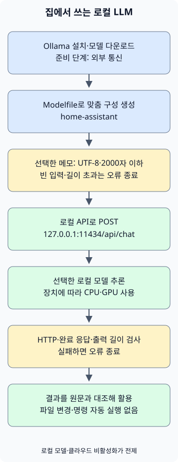

집에서 개인용 LLM을 쓰려면 **Ollama를 설치하고, PC에서 실행할 모델을 내려받은 뒤, 작은 작업 하나에 연결하는 것**부터 시작하면 됩니다. 이 글에서는 한국어 대화와 짧은 메모 요약을 목표로 합니다. 기존 모델의 실행 방식과 지시문을 내 용도에 맞추는 과정이며, 모델을 처음부터 학습시키는 작업은 포함하지 않습니다.

먼저 Ollama에서 로컬 모델로 대화를 해 보고, 같은 모델을 Python에서 호출해 메모를 요약하겠습니다. 설치·API 설명은 2026년 11월 5일 확인한 공식 문서를 기준으로 합니다. [Ollama 시작 안내](https://docs.ollama.com/quickstart)

## 모델 파일 크기만큼 메모리가 있으면 될까?

예제 모델은 `qwen3:4b-instruct-2507-q4_K_M`입니다. Ollama 목록에는 약 2.5GB의 Q4_K_M 모델로 표시됩니다. Q4_K_M은 가중치를 낮은 비트 수로 표현하는 양자화 형식 중 하나입니다. 이 파일 크기는 실행에 필요한 전체 메모리가 아닙니다. [예제 모델의 파일·라이선스 정보](https://ollama.com/library/qwen3:4b-instruct-2507-q4_K_M)

실행 시에는 가중치 외에 대화 내용을 처리하는 KV 캐시와 런타임 자원이 필요하고, 운영체제와 다른 앱도 메모리를 사용합니다. 컨텍스트를 늘리면 메모리 사용량이 증가하므로 예제에서는 `num_ctx`를 4096으로 명시합니다. 모델이 지원하는 최대 컨텍스트를 가정용 PC에서 그대로 쓸 수 있다는 뜻은 아닙니다. [Ollama 컨텍스트와 메모리 설명](https://docs.ollama.com/context-length)

| 확인할 자원 | 선택에 반영할 내용 |
| --- | --- |
| GPU 메모리 또는 통합 메모리 | 외장 GPU의 VRAM과 시스템 RAM을 구분합니다. Apple Silicon은 통합 메모리를 다른 앱과 공유합니다. |
| 실행 중 남는 메모리 | 부족하면 더 작은 모델이나 짧은 컨텍스트로 시작합니다. 파일 크기를 최소 RAM 요구량으로 읽지 않습니다. |
| 디스크 여유 | 모델 파일과 추가 다운로드를 보관할 공간을 확인합니다. 여러 모델을 모으면 사용량이 커집니다. |
| GPU·드라이버 지원 | 모델을 고르기 전에 현재 OS와 장치가 지원되는지 확인합니다. |

Ollama의 macOS 문서는 macOS 14 이상, Apple M 계열의 CPU·GPU 실행과 Intel Mac의 CPU 실행을 안내합니다. Windows는 Windows 10 22H2 이상을 지원하며 GPU별 드라이버 조건이 있습니다. 구입부터 하기보다 현재 PC에서 작은 작업의 응답 속도와 메모리를 먼저 확인하는 편이 좋습니다. [macOS 요구사항](https://docs.ollama.com/macos), [Windows 요구사항](https://docs.ollama.com/windows), [GPU 지원 목록](https://docs.ollama.com/gpu)

## 설치하고 로컬 전용으로 설정하기

macOS와 Windows에서는 [공식 다운로드 페이지](https://ollama.com/download)에서 설치 파일을 받아 앱을 실행합니다. Linux에서는 공식 문서가 제공하는 설치 명령을 사용합니다. 아래 Linux 명령은 프로그램과 서비스를 설치하므로 설치할 PC에서 실행합니다. [Linux 설치 안내](https://docs.ollama.com/linux)

```sh
curl -fsSL https://ollama.com/install.sh | sh
```

설치 후 새 터미널에서 버전을 확인합니다. 앱이나 서비스가 이미 서버를 실행 중이면 `ollama serve`를 추가로 실행할 필요가 없습니다.

```sh
ollama --version
```

개인 자료를 로컬에서 처리하려면 모델 선택과 서버 설정을 함께 봐야 합니다. Ollama는 로컬 API를 통해서도 클라우드 모델을 호출할 수 있습니다. **접속 주소가 localhost라는 사실만으로 추론 위치를 판단하면 안 됩니다.** [로컬 API와 클라우드 모델의 관계](https://docs.ollama.com/api/authentication)

macOS·Windows의 사용자 앱에서는 서버를 실행하는 계정의 `~/.ollama/server.json`에 다음 설정을 넣습니다. Windows에서 `~`는 사용자 홈 폴더를 뜻합니다. 기존 파일이 있다면 다른 설정을 유지하며 항목을 추가하고, 변경 후 앱을 재시작합니다. 클라우드 모델과 웹 검색이 비활성화되며, 서버 로그의 `Ollama cloud disabled: true`로 적용 여부를 확인합니다. 모델 설치·다운로드에는 인터넷 연결이 필요합니다. [로컬 전용 설정](https://docs.ollama.com/faq#how-do-i-disable-ollamas-cloud-features)

```json
{
  "disable_ollama_cloud": true
}
```

Linux의 systemd 서비스는 로그인한 사용자와 실행 계정이 다를 수 있습니다. 이때는 `sudo systemctl edit ollama.service`로 서비스 환경 변수를 설정합니다. 다음 내용을 저장한 뒤 서비스를 재시작합니다. [Linux 서비스 설정](https://docs.ollama.com/linux#customizing)

```ini
[Service]
Environment="OLLAMA_NO_CLOUD=1"
Environment="OLLAMA_HOST=127.0.0.1:11434"
```

```sh
sudo systemctl daemon-reload
sudo systemctl restart ollama.service
```

서비스를 쓰지 않고 직접 서버를 실행한다면 POSIX 셸에서 `OLLAMA_NO_CLOUD=1 OLLAMA_HOST=127.0.0.1:11434 ollama serve`를 실행한 터미널을 유지합니다. 이미 실행 중인 서버와 중복으로 띄우지 않습니다. 어느 방식이든 클라우드 비활성화가 적용됐는지 먼저 확인한 뒤 개인 자료를 입력합니다.

다음 명령으로 예제 모델을 내려받고 대화를 시작합니다. 이 모델은 non-thinking 변형이므로 별도의 thinking 옵션을 넣지 않습니다. 짧은 태그는 다른 변형을 가리킬 수 있어 전체 태그를 사용합니다. [Qwen 모델 카드](https://huggingface.co/Qwen/Qwen3-4B-Instruct-2507)

```sh
ollama pull qwen3:4b-instruct-2507-q4_K_M
ollama run qwen3:4b-instruct-2507-q4_K_M
```

첫 질문은 “한국어로 답해 줘. 내가 적은 메모를 요약할 때 확인할 기준 세 가지를 알려 줘” 정도면 충분합니다. 답이 한국어인지, 요청한 범위를 지키는지 확인하고 `/bye`로 대화를 마칩니다. 다른 터미널에서 `ollama list`로 모델 ID를, `ollama ps`로 CPU·GPU 배치와 메모리 상태를 확인합니다. 모델 태그와 함께 설치한 Ollama 버전·모델 ID를 기록하면 나중에 결과가 달라졌을 때 비교하기 쉽습니다. [모델 실행 상태 확인](https://docs.ollama.com/faq#how-can-i-tell-if-my-model-was-loaded-onto-the-gpu)

## 내 용도의 지시문을 기본값으로 만들기

다음 파일을 빈 작업 폴더에 저장합니다. `FROM`은 기반 모델을, `SYSTEM`은 기본 지시문을 지정합니다. `num_predict`는 생성할 토큰 수의 상한이고, `temperature`는 생성의 무작위성에 영향을 줍니다. 아래 값은 짧은 메모 요약용 예시입니다. 낮은 temperature도 사실 정확성을 보장하지 않습니다. [Modelfile 문법](https://docs.ollama.com/modelfile)

### `Modelfile`

```text
FROM qwen3:4b-instruct-2507-q4_K_M
PARAMETER num_ctx 4096
PARAMETER num_predict 512
PARAMETER temperature 0.2
SYSTEM """
한국어로 간결하게 답하세요.
제공된 자료에서 확인할 수 없는 내용은 추측하지 말고 모른다고 말하세요.
원문에 있는 사실과 제안을 구분하세요.
"""
```
다음 명령으로 `home-assistant`라는 이름의 맞춤 모델 구성을 만듭니다.

```sh
ollama create home-assistant -f Modelfile
ollama run home-assistant
```

지시문을 바꾸는 것만으로 새로운 지식을 학습하거나 내 디스크의 문서를 읽게 되지는 않습니다. 다음 예제처럼 필요한 자료를 요청에 넣어야 합니다. 문서가 많아지면 필요한 부분을 검색해 전달하는 RAG를 별도 단계로 설계할 수 있지만, 우선 짧은 파일 하나의 요약 품질부터 확인합니다.

## 선택한 메모 하나를 Python으로 요약하기

이 예제는 Python 3의 표준 라이브러리만 사용합니다. 저장한 파일 하나를 읽어 `127.0.0.1:11434/api/chat`으로 보내고 결과를 출력합니다. 환경의 HTTP 프록시 설정을 사용하지 않도록 했고, 모델에 파일 탐색이나 명령 실행 도구를 제공하지 않습니다.



그림에서 설치와 모델 다운로드는 외부 통신이 있는 준비 단계입니다. 이후 추론은 로컬 모델 선택과 클라우드 비활성화 설정이 적용됐다는 전제입니다. 입력이나 응답 검사에 실패하면 요약 결과를 내보내지 않고 오류로 종료합니다.

### `notes.txt`

```text
2026-11-05 집 서버 정리
결정: 사진 백업용 디스크 상태를 주말에 점검한다.
후속 작업: 작업 전 복구 테스트 방법을 찾아본다.
담당자와 정확한 시각은 정하지 않았다.
```
### `summarize.py`

```python
import json
from pathlib import Path
import sys
from urllib.request import ProxyHandler, Request, build_opener

ENDPOINT = "http://127.0.0.1:11434/api/chat"
MODEL = "home-assistant"
MAX_CHARS = 2000


def summarize(path):
    text = path.read_text(encoding="utf-8")
    if not text.strip() or len(text) > MAX_CHARS:
        raise ValueError(f"메모는 비어 있지 않은 {MAX_CHARS}자 이하의 UTF-8 텍스트여야 합니다.")
    prompt = (
        "다음 메모의 결정 사항과 후속 작업을 나누어 한국어로 요약하세요. "
        "원문에 없는 담당자나 기한을 추가하지 마세요.\n\n<자료>\n"
        + text + "\n</자료>"
    )
    payload = {
        "model": MODEL,
        "messages": [{"role": "user", "content": prompt}],
        "stream": False,
        "options": {"num_ctx": 4096, "num_predict": 512},
        "keep_alive": 0,
    }
    request = Request(
        ENDPOINT,
        data=json.dumps(payload, ensure_ascii=False).encode("utf-8"),
        headers={"Content-Type": "application/json"},
        method="POST",
    )
    opener = build_opener(ProxyHandler({}))
    with opener.open(request, timeout=120) as response:
        result = json.load(response)
    message = result.get("message") if isinstance(result, dict) else None
    answer = message.get("content") if isinstance(message, dict) else None
    if not isinstance(answer, str) or not answer.strip() or result.get("done") is not True:
        raise RuntimeError("완료된 텍스트 응답을 받지 못했습니다.")
    if result.get("done_reason") == "length":
        raise RuntimeError("출력 길이 제한에 도달했습니다. 메모나 요청 범위를 줄이세요.")
    return answer


if __name__ == "__main__":
    if len(sys.argv) != 2:
        raise SystemExit("사용법: python3 summarize.py notes.txt")
    try:
        print(summarize(Path(sys.argv[1])))
    except (OSError, ValueError, RuntimeError) as error:
        print(f"요약 실패: {error}", file=sys.stderr)
        raise SystemExit(1)
```
두 파일을 같은 폴더에 저장한 뒤 실행합니다. Windows에서는 Python 설치 환경에 따라 `python3` 대신 `py -3`를 사용합니다.

```sh
python3 summarize.py notes.txt
```

`stream: false`는 응답을 하나의 JSON으로 받기 위한 설정입니다. 예제는 빈 입력·2000자 초과 입력을 거절하고, HTTP 오류·잘못된 응답·출력 길이 제한을 오류로 처리합니다. 문자 수 제한은 정확한 토큰 계산이 아니므로 입력과 답변이 컨텍스트에 들어가는지도 확인해야 합니다. `keep_alive: 0`은 처리 후 모델을 메모리에서 내리도록 요청하므로 반복 실행에서는 다시 로딩하는 시간이 들 수 있습니다. [채팅 API와 응답 필드](https://docs.ollama.com/api/chat)

클라이언트는 Python 3.13.0에서 로컬 모의 HTTP 서버로 정상·오류 응답 처리를 확인했습니다. 실제 Ollama 설치·Modelfile 빌드·모델 다운로드·추론 속도와 요약 품질은 이 글을 준비한 환경에서 실행 검증하지 않았습니다. 설치 후 위 메모로 결과를 대조해야 합니다. 120초의 네트워크 타임아웃도 서버의 모델 작업 중단을 확인하는 기능은 아닙니다.

확인할 내용은 세 가지입니다. 디스크 상태 점검이 결정 사항으로 남았는지, 복구 테스트 방법 확인이 후속 작업으로 분리됐는지, 정하지 않은 담당자·정확한 시각을 만들어 내지 않았는지 봅니다. 문장이 매끄러운 것과 원문에 충실한 것은 따로 평가합니다.

## 매일 쓸 작업과 멈출 기준 정하기

| 작업 | 작게 시작하는 입력 | 사용 전에 확인할 것 |
| --- | --- | --- |
| 개인 메모 정리 | 짧은 회의·학습 메모 하나 | 결정과 제안, 미정인 항목이 구분됐는지 |
| 글 초안 다듬기 | 직접 쓴 문단과 원하는 문체 | 의미·숫자·출처를 바꾸지 않았는지 |
| 코드 이해 보조 | 공개 예제나 공유 가능한 작은 함수 | 설명을 실제 코드·실행 결과와 대조했는지 |

이 클라이언트는 파일 변경이나 셸 명령 실행 없이 답변만 출력합니다. 생성된 명령을 자동 실행하는 에이전트로 확장할 때는 [AI 에이전트의 권한 경계](/ko/posts/2026-11-01-ai-agent-permission-boundaries/)처럼 실행 권한과 승인 절차를 별도로 설계해야 합니다. 로컬 모델도 문서 속 악성 지시에 영향을 받을 수 있고 잘못된 답을 낼 수 있습니다.

API는 기본적으로 로컬 주소에 바인딩되며 로컬 API에는 인증이 필요하지 않습니다. 처음에는 한 PC 안에서만 사용하고, 공유기 포트 포워딩으로 11434를 공개하지 않습니다. 가족·다른 기기의 접속은 인증과 접근 범위를 정한 별도 구성으로 다룹니다. 연결 앱·플러그인·로그·백업의 저장·외부 전송 여부도 로컬 추론과 구분해서 확인합니다. [기본 바인딩](https://docs.ollama.com/faq#how-can-i-expose-ollama-on-my-network), [인증 범위](https://docs.ollama.com/api/authentication)

답이 느리면 `ollama ps`의 CPU·GPU 배치와 다른 앱의 메모리 사용량부터 봅니다. 긴 입력과 큰 컨텍스트를 줄여 같은 작업으로 다시 비교합니다. 연결이 거절되면 앱·서비스 실행 여부를, 모델을 찾지 못하면 `ollama list`와 `home-assistant` 생성 여부를 확인합니다. 시간이 초과됐다고 요청을 계속 쌓기보다 실행 중인 작업을 먼저 확인합니다.

같은 메모 몇 개를 고정해 두고 모델·설정을 바꿀 때마다 누락·추측·대기 시간을 비교해 보세요.
