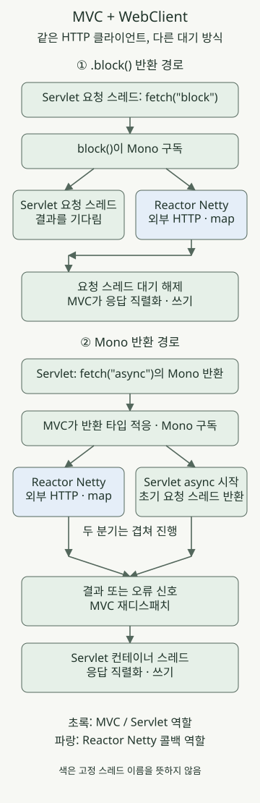

**Spring MVC에서도 WebClient의 HTTP 통신은 논블로킹으로 동작할 수 있습니다. 다만 컨트롤러에서 `.block()`하면 그 결과를 기다리는 MVC 요청 스레드는 멈춰 있습니다.** `Mono`를 그대로 반환하면 MVC가 Servlet 비동기 처리에 연결해 초기 요청 스레드를 돌려줄 수 있습니다. WebClient의 통신 방식과 서버의 요청 처리 방식을 나누어 봐야 하는 이유입니다.

이 글은 **Tomcat 기반 Spring MVC + Reactor Netty 기반 WebClient**를 대상으로 합니다. 다른 HTTP 커넥터를 쓰면 클라이언트의 스레드 이름과 자원 구성이 달라집니다. 예제는 Spring Boot 3.5.16·JDK 21·Gradle 8.14.3으로 재현하며 Boot 최신 계열 전체의 동작을 검증했다는 뜻은 아닙니다.

## WebClient를 추가하면 서버도 WebFlux가 될까?

서버의 MVC와 외부 호출용 WebClient는 역할이 다릅니다. 이 예제에서 Tomcat과 `DispatcherServlet`은 들어오는 요청을 처리하고, WebClient의 Reactor Netty 커넥터는 외부 서버로 나가는 HTTP 통신을 처리합니다.

Boot 3.5에서는 `spring-boot-starter-web`과 `spring-boot-starter-webflux`를 함께 넣으면 기본적으로 MVC가 선택됩니다. WebClient를 쓰기 위해 WebFlux 스타터를 추가하는 경우를 지원하는 동작입니다. 애플리케이션 유형을 명시적으로 바꾸거나 다른 서버 구성을 적용한 경우에는 별도로 확인해야 합니다. [Boot의 MVC·WebFlux 선택 기준](https://docs.spring.io/spring-boot/3.5/reference/web/reactive.html#web.reactive.webflux)

## `.block()`과 `Mono` 반환은 어디서 갈라지나?



그림의 초록은 Servlet·MVC의 역할, 파랑은 Reactor Netty의 역할입니다. 비동기 경로의 두 분기는 겹쳐 진행할 수 있으며 외부 응답이 반드시 초기 요청 스레드 반환 뒤에 도착하는 것은 아닙니다. 그림은 성공 신호의 흐름을 중심으로 그렸고, 코드의 오류 신호는 HTTP 상태 매핑 뒤 MVC 오류 처리로 이어집니다.

| 구간 | `.block()` 후 값 반환 | `Mono` 반환 |
| --- | --- | --- |
| 구독 | `.block()`이 수행 | MVC가 반환 타입을 받아 수행 |
| 외부 HTTP를 기다릴 때 | 요청 스레드가 기다림 | Servlet 비동기 처리로 초기 요청 스레드 반환 가능 |
| 응답 본문 수신 이후 | 클라이언트 콜백이 결과를 전달해 대기를 해제 | 결과 신호를 MVC 비동기 처리로 전달 |
| 최종 HTTP 응답 | MVC가 반환값을 직렬화·쓰기 | MVC 재디스패치 후 직렬화·쓰기 |

`retrieve().bodyToMono(...)`는 요청 파이프라인을 조립합니다. 아래처럼 새로 만든 WebClient 파이프라인은 구독해야 HTTP 요청이 시작됩니다. 같은 파이프라인을 두 번 구독하면 요청도 다시 발생할 수 있으므로 `.block()`으로 한 번 읽고 다시 반환하는 코드는 주의해야 합니다.

MVC의 단일 값 `Mono` 반환은 `DeferredResult`와 유사하게 적응됩니다. 결과가 준비되면 Servlet 컨테이너로 재디스패치해 응답을 마칩니다. 풀에서 같은 스레드를 다시 사용할 수도 있으므로 재디스패치 스레드가 최초 스레드와 반드시 다르다고 가정하지 않습니다. 응답이 열려 있는 동안 연결과 비동기 요청 자원도 남아 있습니다. `Mono` 반환도 Servlet 응답 쓰기 전체를 논블로킹으로 바꾸지는 않습니다. 이 예제는 단일 값 JSON이며 스트리밍·SSE와는 구분합니다. [MVC 비동기 처리와 reactive 반환 타입](https://docs.spring.io/spring-framework/reference/6.2/web/webmvc/mvc-ann-async.html)

## 같은 외부 API를 두 방식으로 호출하기

아래 파일을 같은 프로젝트에 저장합니다. `application` 플러그인으로 실행하며 Boot Gradle 플러그인은 사용하지 않습니다. Java toolchain은 21로 고정합니다. 로컬 검사는 Azul JDK 21.0.1에서 수행했으며, 이 과거 패치 버전을 새 운영 환경에 권장하는 것은 아닙니다.

### `settings.gradle`

```groovy
rootProject.name = 'mvc-webclient-execution'
```

### `build.gradle`

```groovy
plugins {
    id 'java'
    id 'application'
}
repositories { mavenCentral() }
java { toolchain { languageVersion = JavaLanguageVersion.of(21) } }
dependencies {
    implementation platform('org.springframework.boot:spring-boot-dependencies:3.5.16')
    implementation 'org.springframework.boot:spring-boot-starter-web'
    implementation 'org.springframework.boot:spring-boot-starter-webflux'
    testImplementation 'org.springframework.boot:spring-boot-starter-test'
    testRuntimeOnly 'org.junit.platform:junit-platform-launcher'
}
application { mainClass = 'example.DemoApplication' }
test {
    useJUnitPlatform()
    systemProperty 'demo.virtual', providers.gradleProperty('virtual').getOrElse('false')
}
```

### `src/main/resources/application.yml`

```yaml
upstream:
  base-url: http://127.0.0.1:9091
  timeout: 3s
spring:
  mvc:
    async:
      request-timeout: 5s
```

`WebClient`는 빈으로 재사용하고 커넥터를 Reactor Netty로 명시합니다. `callbackThread`는 응답 본문이 만들어진 뒤 실행하는 `map`의 스레드이며, 최종 Servlet 응답 쓰기 스레드를 뜻하지 않습니다. 이 코드에는 `publishOn` 같은 스케줄러 전환을 넣지 않았습니다. [WebClient 커넥터와 공유 자원](https://docs.spring.io/spring-framework/reference/6.2/web/webflux-webclient/client-builder.html)

### `src/main/java/example/DemoApplication.java`

```java
package example;

import java.time.Duration;
import java.util.concurrent.TimeoutException;

import org.springframework.beans.factory.annotation.Value;
import org.springframework.boot.SpringApplication;
import org.springframework.boot.autoconfigure.SpringBootApplication;
import org.springframework.context.annotation.Bean;
import org.springframework.http.HttpStatus;
import org.springframework.http.client.reactive.ReactorClientHttpConnector;
import org.springframework.web.bind.annotation.GetMapping;
import org.springframework.web.bind.annotation.RestController;
import org.springframework.web.reactive.function.client.WebClient;
import org.springframework.web.reactive.function.client.WebClientResponseException;
import org.springframework.web.server.ResponseStatusException;

import reactor.core.publisher.Mono;
import reactor.core.scheduler.Schedulers;
import reactor.netty.http.client.HttpClient;

@SpringBootApplication
public class DemoApplication {
    public static void main(String[] args) {
        SpringApplication.run(DemoApplication.class, args);
    }

    @Bean
    WebClient upstreamClient(WebClient.Builder builder,
                             @Value("${upstream.base-url}") String baseUrl) {
        return builder.baseUrl(baseUrl)
                .clientConnector(new ReactorClientHttpConnector(HttpClient.create()))
                .build();
    }

    public record Observation(String mode, String requestThread, boolean requestVirtual,
                              String callbackThread, boolean callbackVirtual, boolean callbackNonBlocking,
                              String value) {}

    @RestController
    static class DemoController {
        private final WebClient client;
        private final Duration deadline;

        DemoController(WebClient client, @Value("${upstream.timeout}") Duration deadline) {
            this.client = client;
            this.deadline = deadline;
        }

        private Mono<Observation> fetch(String mode) {
            Thread request = Thread.currentThread();
            String name = request.getName();
            boolean virtual = request.isVirtual();
            return client.get().uri("/value").retrieve().bodyToMono(String.class)
                    .timeout(deadline)
                    .map(value -> new Observation(mode, name, virtual,
                            Thread.currentThread().getName(), Thread.currentThread().isVirtual(),
                            Schedulers.isInNonBlockingThread(), value))
                    .onErrorMap(WebClientResponseException.class, error ->
                            new ResponseStatusException(HttpStatus.BAD_GATEWAY,
                                    "upstream HTTP error", error))
                    .onErrorMap(TimeoutException.class, error ->
                            new ResponseStatusException(HttpStatus.GATEWAY_TIMEOUT,
                                    "upstream deadline", error));
        }

        @GetMapping("/block")
        Observation blocking() {
            return fetch("block").block();
        }

        @GetMapping("/async")
        Mono<Observation> asynchronous() {
            return fetch("async");
        }
    }
}
```

`/block`은 동작 비교용 경로입니다. 비동기 반환으로 끝낼 수 있는 컨트롤러라면 `/async`처럼 결과 `Mono`를 반환해 MVC가 구독하도록 할 수 있습니다. 직접 `.subscribe()`를 호출하고 먼저 응답하면 외부 호출의 결과·오류가 원래 HTTP 요청과 분리됩니다. [WebClient 동기 사용과 컨트롤러 반환](https://docs.spring.io/spring-framework/reference/web/webflux-webclient/client-synchronous.html)

예제의 `timeout(3초)`는 구독 후 값이 전달될 때까지의 제한입니다. 커넥션 풀 획득·연결·각 응답 읽기 제한을 각각 설정한 것은 아닙니다. HTTP 오류는 502, 이 파이프라인의 시간 초과는 504로 바꿉니다. 연결 실패·빈 본문·업무 오류의 계약은 별도로 정해야 합니다. `retrieve()`는 기본적으로 HTTP 4xx·5xx를 오류로 처리합니다. [retrieve의 오류 처리](https://docs.spring.io/spring-framework/reference/6.2/web/webflux-webclient/client-retrieve.html)

### 로컬에서 실행하기

외부 서비스 대신 Python 3의 로컬 HTTP 서버를 띄웁니다. `/value`는 0.2초 뒤 `hello`를 돌려줍니다. 이 지연은 동작을 살펴보기 위한 입력이며 성능 측정값이 아닙니다.

### `upstream.py`

```python
from http.server import BaseHTTPRequestHandler, ThreadingHTTPServer
from time import sleep


class Handler(BaseHTTPRequestHandler):
    def do_GET(self):
        if self.path != '/value':
            self.send_error(404)
            return
        sleep(0.2)
        body = b'hello'
        self.send_response(200)
        self.send_header('Content-Type', 'text/plain; charset=utf-8')
        self.send_header('Content-Length', str(len(body)))
        self.end_headers()
        self.wfile.write(body)


ThreadingHTTPServer(('127.0.0.1', 9091), Handler).serve_forever()
```

첫 번째 터미널에서 실행합니다.

```sh
python3 upstream.py
```

두 번째 터미널에서 JDK 21을 선택하고 Gradle 8.14.3으로 실행합니다.

```sh
gradle run
```

세 번째 터미널에서 두 경로를 호출합니다.

```sh
curl --fail --show-error --silent http://127.0.0.1:8080/block
curl --fail --show-error --silent http://127.0.0.1:8080/async
```

둘 다 `hello`를 포함한 JSON을 반환합니다. 일반 요청 스레드 설정에서는 `requestVirtual=false`, 이 예제의 Netty 콜백은 `callbackVirtual=false`, `callbackNonBlocking=true`로 관측했습니다. 정확한 스레드 이름과 번호는 실행마다 달라집니다. 응답 JSON의 `mode`만 보고 기다리는 동안 요청 스레드가 반환됐다고 판단할 수는 없습니다.

## 가상 스레드를 켜면 무엇이 달라질까?

앞의 애플리케이션을 종료한 뒤 같은 코드를 가상 스레드 설정으로 다시 실행합니다.

```sh
gradle run --args='--spring.threads.virtual.enabled=true'
```

이 경우 두 경로의 `requestVirtual`이 `true`로 바뀌었습니다. `.block()` 경로는 여전히 호출한 가상 스레드가 결과를 기다리지만, 일반적인 park 가능한 대기는 carrier 플랫폼 스레드를 계속 붙잡는 것과 다릅니다. pinning과 실행 중인 JDK의 차이는 별도로 확인해야 합니다. [JDK 21 가상 스레드의 스케줄링과 pinning](https://docs.oracle.com/en/java/javase/21/core/virtual-threads.html) **가상 스레드를 켜도 이 예제의 Reactor Netty 콜백은 가상 스레드로 바뀌지 않았습니다.** [Boot 가상 스레드 설정](https://docs.spring.io/spring-boot/3.5/reference/features/spring-application.html#features.spring-application.virtual-threads)

가상 스레드는 외부 서비스의 처리 용량, HTTP 연결 수, DB 커넥션 수를 늘리지 않습니다. 요청이 쌓일 때의 상한은 [DB 세마포어와 입장 제어](/ko/posts/2026-11-03-virtual-threads-db-semaphore/)처럼 별도로 설계해야 합니다.

## 콜백 안에서 JDBC를 호출해도 괜찮을까?

WebClient를 MVC에서 호출했다는 이유만으로 뒤의 `map`도 MVC 요청 스레드에서 실행되는 것은 아닙니다. 이 예제의 `map`에 JDBC 조회나 긴 파일 읽기를 넣으면 Netty 이벤트 루프를 막을 수 있습니다. 반대로 모든 `Mono`가 전용 스레드에서 실행되는 것도 아닙니다. 연산자가 실행되는 위치는 구독·신호·스케줄러 전환에 따라 달라집니다. [Reactor 스레딩과 스케줄러](https://projectreactor.io/docs/core/release/reference/coreFeatures/schedulers.html)

동기 작업이 많은 서비스라면 MVC의 동기 호출 흐름에서 자원 상한을 정해 처리하는 방식과, 비동기 체인을 유지하면서 블로킹 작업을 별도 실행기로 격리하는 방식을 비교하세요. 단순한 동기 HTTP 호출에는 [RestClient와 WebClient의 선택 기준](/ko/posts/2026-10-31-webclient-restclient-comparison/)도 함께 볼 수 있습니다. 스케줄러 전환만으로 DB나 하위 서비스의 과부하 문제가 해결되지는 않습니다.

## 실제로 확인한 범위

[검증 테스트 코드](https://github.com/youdozi/youdozi.github.io/blob/main/.pipeline/drafts/2026-11-09-spring-mvc-webclient-execution/src/test/java/example/ExecutionTest.java)는 임의 포트의 **실제 Tomcat과 로컬 HTTP 서버**로 실행했습니다. 일반 요청 스레드·가상 스레드 설정에서 각각 8개, 총 16개 검사를 통과했습니다.

- 두 스타터가 함께 있을 때 Servlet 컨텍스트·Tomcat·DispatcherServlet 선택
- 파이프라인 조립 시 요청하지 않고, 구독과 재구독 때 요청 발생
- 외부 응답을 보류한 상태에서 `.block()`의 요청 스레드 대기와 `Mono`의 Servlet 비동기 진입
- 요청 스레드의 가상 여부와 응답 콜백의 논블로킹·가상 여부
- 두 경로의 HTTP 오류 502·파이프라인 시간 초과 504 매핑

테스트를 직접 실행하려면 위 검증 코드를 `src/test/java/example/ExecutionTest.java`로 저장한 뒤 실행합니다.

```sh
gradle clean test
gradle test -Pvirtual=true --rerun-tasks
```

테스트는 응답을 보류하는 latch로 상태를 관측합니다. 짧은 실행 시간만 보고 비동기를 판정한 검사가 아닙니다. 처리량 비교, 실제 외부 서비스·DB·TLS, 클라이언트 연결 종료와 원격 부수 효과의 취소는 검증하지 않았습니다. 특히 파이프라인 취소가 원격 서버의 작업 취소나 트랜잭션 롤백을 보장하지는 않습니다.
