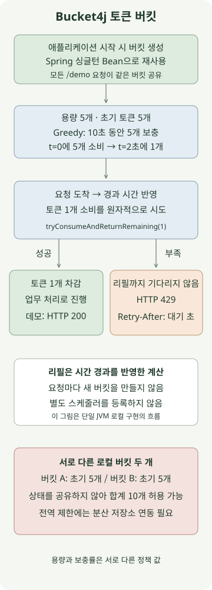

**Bucket4j는 토큰 버킷의 보충·소비 계산과 동시성 제어를 제공하는 Java 요청 제한 라이브러리입니다.** Spring에서 버킷을 공유하고 요청마다 토큰 소비를 시도하면, 짧게 몰리는 요청을 어디까지 허용할지와 이후 보충 속도를 따로 정할 수 있습니다. 다만 로컬 버킷은 JVM마다 독립적이므로, 라이브러리를 추가하는 것만으로 여러 서버의 전역 한도가 생기지는 않습니다.

[앞선 Redis Lua 요청 제한 글](/ko/posts/2026-11-10-redis-lua-rate-limit/)은 첫 허용 요청부터 일정 시간 동안 횟수를 세는 고정 윈도를 구현했습니다. 이 글은 **단일 JVM에서 용량 5개, 10초 동안 5개를 보충하는 토큰 버킷**을 구현하고, Redis 분산 모드로 옮길 때 달라지는 경계를 설명합니다.

재현 환경은 Bucket4j **8.22.0**, Spring Boot 3.5.16, JDK 21, Gradle 8.14.3입니다. Bucket4j 버전은 [공식 릴리스](https://github.com/bucket4j/bucket4j/releases)와 [8.22.0 레퍼런스](https://bucket4j.com/8.22.0/toc.html)를 대조해 고정했습니다. 의존성 이름의 `jdk17`은 JDK 17 계열용 아티팩트를 뜻하며, 예제는 이를 JDK 21에서 실행합니다.

## 용량과 보충률은 무엇이 다를까?

`capacity(5)`는 모아 둘 수 있는 토큰의 상한입니다. 기본 초기 토큰도 5개이므로, 처음에는 5개 요청을 한 번에 허용할 수 있습니다. `refillGreedy(5, Duration.ofSeconds(10))`는 10초에 5개를 보충하는 속도입니다. 요청 하나가 토큰 하나를 소비한다면, `t=0`에 모두 쓴 뒤 `t=2초`에 새 토큰 하나를 쓸 수 있습니다.

따라서 이 설정을 **“임의의 연속 10초 동안 최대 5회”**로 설명하면 잘못됩니다. 초기 버스트 5개와 이후의 보충을 함께 허용하는 정책이기 때문입니다. 장시간 사용하지 않아도 토큰은 용량 5개까지만 쌓입니다.

| 같은 용량·보충량에서 리필 방법 | `refillGreedy(5, 10초)` | `refillIntervally(5, 10초)` |
| --- | --- | --- |
| `t=0`에 5개를 모두 사용 | 0개 남음 | 0개 남음 |
| 이후 소비 없이 `t=2초`에 조회 | 1개 사용 가능 | 0개 |
| 이후 소비 없이 `t=10초`에 조회 | 5개 | 5개 |

Greedy는 경과 시간에 따라 점진적으로, Intervally는 기간이 지난 뒤 묶어서 보충합니다. 위 표는 시간이 0에서 시작하는 제어된 시계로 확인한 결과입니다. 별도 스케줄러가 주기적으로 토큰을 넣는 코드는 필요하지 않습니다. 버킷을 조회하거나 소비할 때 경과 시간이 보충 계산에 반영됩니다. 세부 API는 [Bucket4j 레퍼런스의 리필 설명](https://bucket4j.com/8.22.0/toc.html)을 따릅니다.

## Spring MVC 요청은 어떻게 제한할까?



컨트롤러는 `tryConsumeAndReturnRemaining(1)`의 결과를 사용합니다. 토큰 수를 따로 조회한 뒤 허용 여부를 추정하지 않습니다. 성공 여부와 남은 토큰, 부족할 때의 대기 시간은 같은 소비 시도에 대응하는 `ConsumptionProbe`로 받습니다.

아래 다섯 파일을 같은 프로젝트에 저장합니다. 예제의 `/demo` 요청은 모두 하나의 버킷을 공유합니다. 사용자별 인증·버킷 저장소는 구현하지 않으며, 서버는 로컬 주소에만 바인딩합니다.

### `settings.gradle`

```groovy
rootProject.name = 'bucket4j-token-bucket'
```

### `build.gradle`

```groovy
plugins {
    id 'java'
    id 'application'
}
repositories { mavenCentral() }
java { toolchain { languageVersion = JavaLanguageVersion.of(21) } }
dependencies {
    implementation platform('org.springframework.boot:spring-boot-dependencies:3.5.16')
    implementation 'org.springframework.boot:spring-boot-starter-web'
    implementation 'com.bucket4j:bucket4j_jdk17-core:8.22.0'
    testImplementation 'org.springframework.boot:spring-boot-starter-test'
    testRuntimeOnly 'org.junit.platform:junit-platform-launcher'
}
application { mainClass = 'example.RateLimitApplication' }
test { useJUnitPlatform() }
```

### `src/main/resources/application.yml`

```yaml
server:
  address: 127.0.0.1
```

### `src/main/java/example/BucketPolicy.java`

```java
package example;

import java.time.Duration;
import io.github.bucket4j.Bucket;
import io.github.bucket4j.TimeMeter;

public final class BucketPolicy {
    private BucketPolicy() {}

    public static Bucket local(TimeMeter clock) {
        return Bucket.builder()
                .withCustomTimePrecision(clock)
                .addLimit(limit -> limit.capacity(5).refillGreedy(5, Duration.ofSeconds(10)))
                .build();
    }
}
```

### `src/main/java/example/RateLimitApplication.java`

```java
package example;

import io.github.bucket4j.Bucket;
import io.github.bucket4j.TimeMeter;
import org.springframework.boot.SpringApplication;
import org.springframework.boot.autoconfigure.SpringBootApplication;
import org.springframework.context.annotation.Bean;
import org.springframework.http.ResponseEntity;
import org.springframework.web.bind.annotation.GetMapping;
import org.springframework.web.bind.annotation.RestController;

@SpringBootApplication
public class RateLimitApplication {
    public static void main(String[] args) {
        SpringApplication.run(RateLimitApplication.class, args);
    }

    @Bean
    Bucket demoBucket() {
        return BucketPolicy.local(TimeMeter.SYSTEM_NANOTIME);
    }

    @RestController
    public static class DemoController {
        private final Bucket bucket;

        public DemoController(Bucket bucket) {
            this.bucket = bucket;
        }

        @GetMapping("/demo")
        public ResponseEntity<String> demo() {
            var probe = bucket.tryConsumeAndReturnRemaining(1);
            if (probe.isConsumed()) {
                return ResponseEntity.ok("ok\n");
            }
            long seconds = Math.max(1, Math.ceilDiv(probe.getNanosToWaitForRefill(), 1_000_000_000L));
            return ResponseEntity.status(429)
                    .header("Retry-After", Long.toString(seconds))
                    .body("rate limit exceeded\n");
        }
    }
}
```

`Bucket`을 Spring의 기본 싱글턴 Bean으로 만든 이유는 요청 사이에서 상태를 유지하기 위해서입니다. 컨트롤러 메서드 안에서 매번 `Bucket.builder()`를 호출하면 요청마다 초기 토큰이 다시 생깁니다. 한도를 검사하는 코드가 있어도 실제 제한은 되지 않습니다.

`tryConsumeAndReturnRemaining`은 토큰이 부족하면 리필될 때까지 요청 스레드를 기다리게 하지 않고 거절 결과를 반환합니다. 이것이 MVC 서버 전체를 논블로킹으로 바꾼다는 뜻은 아닙니다. 별도의 대기형 API를 선택하면 스레드 대기와 요청 타임아웃 정책도 다시 고려해야 합니다.

## 실행하면 어떤 응답을 받을까?

JDK 21과 Gradle 8.14.3이 준비되고 8080 포트가 비어 있는 환경에서 실행합니다. Boot Gradle 플러그인이나 별도 Redis 서버는 필요하지 않습니다. 처음 실행할 때 Maven Central 의존성을 내려받습니다.

```sh
gradle run
```

서버가 준비된 뒤 다른 터미널에서 호출합니다. 다른 호출이 없는 새 버킷에서, 아래 여섯 호출이 다음 토큰 보충 전에 끝나는 조건입니다.

```sh
for attempt in 1 2 3 4 5 6; do
  curl -s -o /dev/null -w '%{http_code}\n' http://127.0.0.1:8080/demo
done
curl -i http://127.0.0.1:8080/demo
```

예상 상태 코드는 다음과 같습니다. 실행이 오래 걸리거나 다른 요청이 섞이면 보충·소비 결과가 달라집니다.

```text
200
200
200
200
200
429
```

거절 응답의 `Retry-After`는 `getNanosToWaitForRefill()`을 초로 올림한 값이며 최소 1초입니다. 제어된 시계에서 토큰 5개를 모두 쓴 직후에는 `2`, 1.5초가 지난 시점에는 `1`로 확인했습니다. [HTTP 429의 Retry-After 의미](https://www.rfc-editor.org/rfc/rfc6585#section-4)처럼 다시 시도하기 전에 기다릴 시간을 전달합니다. 다른 요청이 먼저 토큰을 쓸 수 있으므로, 기다렸다는 사실이 다음 허용을 예약하지는 않습니다.

예제 서버는 `gradle run`을 실행한 터미널에서 `Ctrl+C`로 종료합니다.

업무 처리 전에 토큰을 소비하므로, 허용 후 업무가 실패해도 이 코드는 토큰을 돌려주지 않습니다. 요청 시작 횟수 제한과 성공 건수 제한을 구분해야 합니다.

## 동시 요청과 시간 계산은 어떻게 확인했나?

재현 테스트 10개는 실제 Bucket4j 8.22.0을 사용하고, `TimeMeter`에 제어 가능한 시계를 주입했습니다. 시간을 기다리기 위해 `Thread.sleep`을 사용하지 않았습니다. [공식 Intervally 리필 테스트](https://github.com/bucket4j/bucket4j/blob/8.22.0/bucket4j-core/src/test/java/io/github/bucket4j/core_algorithms/FixedIntervalRefillTest.java)에서도 시간 주입 방식을 확인할 수 있습니다.

| 검증 조건 | 확인한 결과 |
| --- | --- |
| 한 버킷에 8개 작업자 스레드로 총 40개 호출, 시계 고정 | 정확히 5개 허용 |
| 5개 소비 후 2초 직전·정각 | 직전 거절, 정각에 1개 허용 |
| 장시간 경과 | 용량 5개를 넘지 않음 |
| Greedy·Intervally에 같은 시간 주입 | 앞의 표와 같은 보충 차이 |
| 거절 뒤 시간 경과 | 거절 때문에 리필 시작 시각이 다시 밀리지 않음 |
| 독립 버킷 두 개 | 각각 5개, 합계 10개 소비 가능 |
| 요청마다 버킷 재생성 | 새 버킷 40개에서 40번 허용되어 제한 우회 재현 |
| 대역폭 제한 두 개를 추가한 별도 버킷 | 두 제한을 모두 만족해야 소비 가능 |
| Spring MVC `MockMvc` 호출 | 200·429와 대기 시간 초 올림 확인 |

`MockMvc` 검사는 실제 네트워크 요청과 구분했습니다. 별도로 패키징한 애플리케이션을 임베디드 Tomcat에서 시작해 실제 HTTP `200` 응답도 확인했습니다. 동시 호출 수는 동작 검증 입력이며 처리량 벤치마크 수치가 아닙니다.

## Redis Lua 방식과 Bucket4j는 언제 선택할까?

| 판단 기준 | 앞선 Redis Lua 예제 | 이 글의 로컬 Bucket4j 예제 |
| --- | --- | --- |
| 제한 정책 | 첫 요청부터 일정 기간의 허용 횟수 | 초기 버스트와 이후 보충률 |
| 상태 공유 | 같은 Redis·키를 사용하는 요청끼리 공유 | 같은 JVM의 같은 버킷 객체를 사용하는 요청끼리 공유 |
| 요청당 외부 저장소 호출 | Redis 실행 필요 | 없음 |
| 서버 증설 영향 | 동일 키의 상태 공유가 전제 | 독립 버킷이 생기면 전체 허용량 증가 |

Redis 자체가 고정 윈도만 지원하거나 Bucket4j가 로컬 모드만 지원한다는 비교는 아닙니다. 앞선 글과 이번 글이 구현한 정책과 저장 위치를 나누어 비교한 것입니다.

전역 제한이 필요하면 Bucket4j의 분산 저장소 연동을 검토합니다. [8.22.0 레퍼런스의 Redis 연동](https://bucket4j.com/8.22.0/toc.html)은 Lettuce 등을 통해 `ProxyManager`와 공통 키의 버킷 상태를 사용합니다. 설명된 CAS 방식은 클라이언트가 상태를 읽고 계산한 뒤 Redis에서 비교·교체하며, 경쟁으로 비교가 실패하면 다시 시도합니다. 버킷 계산 전체를 Redis Lua 한 번에서 수행한 앞선 예제와는 실행 경로가 다릅니다.

분산 상태의 만료도 한도 정책의 일부입니다. 아직 토큰이 부족한 상태를 짧은 TTL로 지우면, 다음 접근에서 초기 토큰을 가진 새 버킷이 만들어져 추가 요청을 허용할 수 있습니다. [공식 만료 전략](https://github.com/bucket4j/bucket4j/blob/8.22.0/bucket4j-core/src/main/java/io/github/bucket4j/distributed/ExpirationAfterWriteStrategy.java)처럼 버킷이 완전히 보충되는 시간과 여유를 고려해야 합니다. 강제 축출·데이터 유실까지 같은 보장이 생기는 것은 아닙니다.

이 글의 `SYSTEM_NANOTIME`은 로컬 버킷용입니다. 이를 임의로 여러 JVM의 분산 시간 기준으로 사용하면 안 됩니다. 분산 구현에서는 해당 연동의 시간 기준·타임아웃·CAS 재시도 설정을 따르고, Redis가 실패했을 때 요청을 차단할지 제한된 로컬 정책으로 잠시 허용할지도 별도로 정해야 합니다. 본문 코드는 Redis 연동이나 장애 조치를 실행한 예제가 아닙니다.

사용자별 제한으로 확장할 때는 인증이 끝난 주체와 정책 범위로 버킷 키를 정합니다. 요청 헤더의 임의 식별자를 그대로 신뢰하면 키를 바꾸어 제한을 피할 수 있습니다. 로컬 `Map`에 사용자별 버킷을 계속 추가하면 메모리가 늘고, 제거·재생성 정책이 부주의하면 초기 토큰이 반복 제공됩니다. 상태를 어디에 얼마나 보관할지까지 함께 정해야 합니다.

요청 시작 빈도를 제한해도 오래 걸리는 작업의 동시 점유 수까지 제한되지는 않습니다. DB 연결이나 외부 API 동시 호출을 보호하려는 목적이라면 별도의 동시성 제한도 함께 설계해야 합니다.
