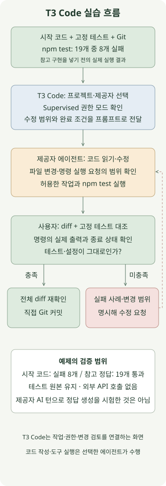

**T3 Code는 컴퓨터에 설치된 코딩 에이전트를 프로젝트·대화·권한·변경 파일 화면으로 연결하는 도구입니다.** 에이전트에게 코드를 맡길 때 필요한 것은 긴 요청보다 작은 작업 범위와 확인 가능한 완료 조건입니다. 이 글에서는 숫자형 `Retry-After` 파서를 고치는 예제로, 수정 요청부터 diff와 테스트 확인까지 이어 보겠습니다.

대상은 [T3 Code 공식 프로젝트](https://github.com/pingdotgg/t3code/tree/v0.1.9)입니다. `create-t3-app`으로 웹 앱을 만드는 T3 Stack과는 별개입니다. 공식 README는 Codex·Claude Code·Cursor 등 기존 제공자를 연결한다고 설명합니다. T3 Code를 설치하는 것과 제공자의 로그인·구독/API 사용 조건은 따로 준비해야 합니다.

기준 버전은 2026년 11월 12일 확인한 [v0.1.9 릴리스](https://github.com/pingdotgg/t3code/releases/tag/v0.1.9)입니다. 아래 예제는 macOS·Node.js 24.13.0·Git에서 확인했고, T3 Code CLI 도움말과 로컬 서버 기동도 점검했습니다. **제공자에게 AI 작업을 보내지는 않았습니다.** 아래 참고 정답은 직접 테스트한 구현이며 T3 Code가 생성한 실제 출력이나 모델 성능 측정값이 아닙니다.

## T3 Code와 제공자는 어떤 역할을 나눌까?

T3 Code는 작업할 프로젝트와 스레드, 제공자 선택, 권한 요청과 변경 내용을 보여 줍니다. 파일을 읽고 수정하거나 명령을 실행하는 일은 연결한 에이전트가 수행합니다. 도구 호출이 보인다고 테스트까지 자동으로 실행·통과한 것은 아닙니다. 실행 명령과 반환 결과를 확인해야 합니다.

[설치 문서](https://github.com/pingdotgg/t3code/blob/v0.1.9/docs/user/install.md)에 따라 사용할 제공자를 설치하고, **T3 Code 서버가 실행되는 컴퓨터**에서 인증을 마쳐 둡니다. 이 실습은 이미 준비된 제공자를 선택하는 단계부터 다룹니다. 로그인 정보나 API 키를 프롬프트에 붙여 넣을 필요는 없습니다.

## 작은 Git 프로젝트와 실패하는 테스트 준비하기



다음 파일 세 개를 새 `t3-code-example` 폴더에 저장합니다. 이 Node 테스트에는 외부 패키지나 API 호출이 없습니다. `Retry-After`의 두 형식 중 **정수 초인 `delay-seconds`만** 지원하는 과제입니다. HTTP-date는 지원 범위 밖이며 `null`을 반환하도록 정했습니다. 헤더의 전체 문법은 [RFC 9110의 Retry-After 정의](https://www.rfc-editor.org/rfc/rfc9110.html#name-retry-after)를 참고하세요.

### `package.json`

```json
{
  "name": "t3-code-retry-after-example",
  "private": true,
  "type": "module",
  "engines": { "node": ">=24" },
  "scripts": { "test": "node --test retry-after.test.mjs" }
}
```

### `retry-after.mjs`

```javascript
export function retryAfterMs(header) {
  const seconds = Number.parseInt(header, 10);
  return Number.isFinite(seconds) ? seconds * 1000 : null;
}
```

### `retry-after.test.mjs`

```javascript
import test from 'node:test';
import assert from 'node:assert/strict';
import { retryAfterMs } from './retry-after.mjs';

const cases = [
  ['2', 2000],
  ['0', 0],
  [' 2 ', 2000],
  ['0002', 2000],
  ['', null],
  ['   ', null],
  [undefined, null],
  [null, null],
  [2, null],
  ['0x10', null],
  ['2x', null],
  ['-1', null],
  ['1.5', null],
  ['1e3', null],
  ['Infinity', null],
  ['Wed, 21 Oct 2015 07:28:00 GMT', null],
  ['9007199254740', 9007199254740000],
  ['9007199254741', null],
  ['9007199254740991', null],
];
for (const [input, expected] of cases) {
  test(`retryAfterMs(${JSON.stringify(input)})`, () => {
    assert.equal(retryAfterMs(input), expected);
  });
}
```

Git 작성자 설정이 준비된 환경에서 프로젝트 폴더 안에서 실행합니다.

```sh
git init -b main
git add package.json retry-after.mjs retry-after.test.mjs
git commit -m "Add Retry-After exercise"
npm test
```

이 시작 코드는 19개 테스트 중 **11개 통과·8개 실패**로 확인했습니다. `parseInt('2x', 10)`처럼 숫자로 시작하는 일부 문자열도 받아들이고, 음수·소수·안전 범위를 벗어난 값을 제대로 처리하지 못합니다. 테스트가 붉게 나오는 상태가 실습의 시작점입니다.

## 프로젝트를 열고 수정 범위를 전달하기

프로젝트 폴더에서 다음 명령으로 버전을 고정해 실행할 수 있습니다. `--host`는 로컬 접근으로 묶고, `--auto-bootstrap-project-from-cwd`는 현재 폴더를 프로젝트로 추가하는 옵션입니다. 처음에는 npm 패키지와 실행 파일을 내려받을 수 있습니다.

```sh
npm exec --yes --package=t3@0.1.9 -- t3 \
  --host 127.0.0.1 --auto-bootstrap-project-from-cwd .
```

CLI는 로컬 서버와 웹 앱을 실행합니다. 이미 T3 Code 서버를 사용 중이면 기존 환경에서 프로젝트를 여세요. 데스크톱 앱 설치와 원격 접속은 [해당 버전 설치 문서](https://github.com/pingdotgg/t3code/blob/v0.1.9/docs/user/install.md)의 별도 경로를 따릅니다. 이 글에서는 백그라운드 서비스나 외부 네트워크 공개를 설정하지 않습니다.

프로젝트 폴더와 스레드를 선택하고, 설치·인증이 준비된 제공자를 고릅니다. [스레드 문서](https://github.com/pingdotgg/t3code/blob/v0.1.9/docs/user/thread-sidebar.md)에 따르면 **New worktree**는 별도 브랜치와 작업 디렉터리를 만듭니다. 이 기본 실습은 준비한 폴더의 기존 작업 디렉터리에서 진행하는 기준입니다. 새 worktree를 선택했다면 이후 Git·npm 명령도 그 worktree 폴더에서 실행해야 합니다. 스레드의 작업 경로와 브랜치를 먼저 확인하세요. 메시지 입력 영역에서 권한을 **Supervised**로 확인합니다. [v0.1.9 권한 문서](https://github.com/pingdotgg/t3code/blob/v0.1.9/docs/user/permission-modes.md)에 따르면 초기 기본값은 Full access이며, Supervised는 명령과 파일 변경 승인을 요청하는 모드입니다. 일부 읽기 동작 등 세부 허용 범위는 제공자에 따라 다릅니다.

다음 프롬프트를 보냅니다.

```text
retry-after.mjs와 retry-after.test.mjs를 먼저 읽어 주세요.
retryAfterMs(header)를 다음 계약에 맞게 고쳐 주세요.

- 문자열의 앞뒤 공백을 제거한 뒤 ASCII 숫자로만 된 음이 아닌 정수 초를 허용합니다.
- 결과는 밀리초이며, 초와 밀리초 모두 Number.isSafeInteger를 만족해야 합니다.
- 빈 값, 문자열이 아닌 값, 음수, 소수, 지수 표기, 숫자 뒤 문자, 안전 범위를 넘는 값은 null입니다.
- HTTP-date 형식은 이번 범위에서 지원하지 않으며 null을 반환합니다.
- retry-after.mjs만 수정하세요. 테스트와 package.json은 바꾸지 마세요.
- 의존성 설치, 네트워크 요청, Git 커밋·푸시·PR 생성은 하지 마세요.

npm test로 확인하고, 변경 이유와 실제 실행한 명령·결과를 알려 주세요.
실행하지 못한 명령은 실행하지 못했다고 명시해 주세요.
```

파일 변경이나 명령 승인이 나오면 이 과제의 수정 파일과 `npm test` 등 필요한 작업인지 확인합니다. 프롬프트의 범위 지시는 도구 권한 설정을 대신하지 않습니다. 예제에서는 에이전트에게 커밋까지 맡기지 않고, 변경과 검증 결과를 받은 뒤 직접 결정하도록 나눴습니다.

## “수정 완료”를 무엇으로 확인할까?

[T3 Code의 변경 검토 문서](https://github.com/pingdotgg/t3code/blob/v0.1.9/docs/user/source-control.md)는 턴별 변경 파일·diff와 브랜치 비교를 구분합니다. 턴 diff는 그 턴의 작업을 보여 주므로, 합치기 전에는 기준 브랜치와의 비교도 확인합니다. 대화에서 테스트 도구 호출을 펼쳐 실제 명령·출력·상태를 확인하고, 터미널에서도 다시 실행할 수 있습니다.

```sh
git rev-parse --show-toplevel
git diff --name-only
git diff -- retry-after.mjs
git diff --exit-code -- retry-after.test.mjs package.json
npm test
```

수정 대상은 `retry-after.mjs` 하나입니다. 세 번째 명령이 변경을 출력하거나 실패한다면 테스트 또는 설정이 바뀐 이유를 먼저 확인합니다. 테스트의 기대값을 낮춰 통과한 결과는 이번 계약을 만족한 수정과 다릅니다. 새 파일까지 확인하려면 `git status --short`도 함께 봅니다.

실행하지 못했다는 답변이면 테스트 통과로 취급하지 말고 직접 `npm test`를 실행합니다. 실패가 남으면 입력과 기대값, 실제 결과를 좁혀 추가로 전달합니다. 예를 들어 “`0`은 0ms여야 하고 `'2x'`는 null이어야 한다. 테스트는 유지하고 이 두 사례를 다시 확인해 달라”처럼 요청할 수 있습니다.

아래는 **직접 검증한 참고 구현**입니다. 실습한 뒤 에이전트가 제안한 변경과 비교하는 데 사용합니다. 실행할 때는 프로젝트 루트의 `retry-after.mjs`에 들어갈 코드입니다.

### `reference/retry-after.mjs`

```javascript
export function retryAfterMs(header) {
  if (typeof header !== 'string') return null;
  const value = header.trim();
  if (!/^[0-9]+$/.test(value)) return null;
  const seconds = Number(value);
  const milliseconds = seconds * 1000;
  return Number.isSafeInteger(seconds) && Number.isSafeInteger(milliseconds)
    ? milliseconds
    : null;
}
```

참고 구현으로 교체한 뒤 같은 테스트 19개가 모두 통과했고, 테스트 파일 원본도 유지됐습니다. 정수의 안전 범위를 확인하는 것과 실제 재시도 대기 상한을 정하는 것은 별개입니다. 이 함수는 대기 실행기나 완전한 HTTP-date 파서가 아니며, 실제 클라이언트의 재시도 횟수·전체 시간 예산은 별도로 정해야 합니다.

diff와 테스트를 확인한 뒤 직접 기록하려면 다음처럼 수정 파일만 커밋합니다.

```sh
git add retry-after.mjs
git commit -m "Validate numeric Retry-After values"
```

실습을 마치면 T3 Code를 실행한 터미널에서 `Ctrl+C`로 포그라운드 서버를 종료합니다.

## 시작이 막히면 어디를 확인할까?

| 증상 | 첫 확인 |
| --- | --- |
| 제공자가 목록에 없거나 실행되지 않음 | 서버 컴퓨터의 설치·PATH와 Settings의 제공자 설정 확인 |
| 인증 오류 | 선택한 제공자의 계정과 서버 컴퓨터의 로그인 상태 확인 |
| 원래 폴더에서 수정 내용이 보이지 않음 | 스레드가 별도 worktree를 쓰는지, 확인 중인 경로가 같은지 확인 |
| diff·브랜치 기능이 안 보임 | 연 폴더가 Git 저장소인지, 프로젝트 경로가 맞는지 확인 |
| 테스트가 초록인데 수정 범위를 벗어남 | 테스트·설정·추가 파일을 포함한 diff와 Git 상태 확인 |

공식 README는 아직 초기 프로젝트이며 버그가 있을 수 있다고 설명합니다. 앱이나 제공자 CLI를 업데이트한 뒤에는 같은 프롬프트라도 결과를 고정된 정답처럼 기대하기보다, 이처럼 작은 계약과 검증 절차를 유지하는 편이 작업을 비교하기 쉽습니다.
