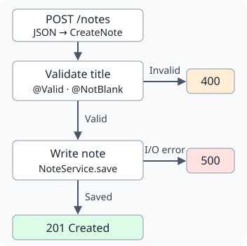

Sending `{}` to a note creation endpoint returned HTTP 500. The JSON was valid, but the service needed a title to save the note. In this synthetic case study, adding `@NotBlank` to the request record and `@Valid` to the controller parameter made the endpoint return 400 before it called the service. A local server run also checked what the API wrote for a valid request and what it returned when storage failed.

## Two causes behind the same 500

These are HTTP responses from embedded Tomcat 10.1.50 in Spring Boot 3.5.10. The service writes one text file per note. Only the last request ran with the storage directory moved out of the way.

| Body sent to `POST /notes` | Storage directory | Before | After |
| --- | --- | ---: | ---: |
| `{}` | Present | 500 | 400 |
| `{"title":null}` | Present | 500 | 400 |
| `{"title":""}` | Present | 500 | 400 |
| `{"title":"   "}` | Present | 500 | 400 |
| `{"title":"Plan"}` | Present | 201 | 201 |
| `{"title":"Plan"}` | Missing | 500 | 500 |

Before the fix, the server logged `IllegalArgumentException: title is required` for the first request. The stack trace pointed to `NoteService.save`. Spring MVC had read the body into a `CreateNote` record, and the controller passed the missing title to the service as `null`. Empty and whitespace-only titles reached the same `Assert.hasText` check. The last request passed that check, then hit a `NoSuchFileException` during file creation. The client could correct the first four requests by supplying a title. [RFC 9110 on 400](https://www.rfc-editor.org/rfc/rfc9110.html#section-15.5.1) · [500](https://www.rfc-editor.org/rfc/rfc9110.html#section-15.6.1)

## Validate the title when MVC reads the request



The service keeps its title check. The fix takes effect earlier, when MVC resolves the controller argument. Add the validation starter to the dependencies in `pom.xml` to supply the validation provider.

```xml
<dependency>
  <groupId>org.springframework.boot</groupId>
  <artifactId>spring-boot-starter-validation</artifactId>
</dependency>
```

```diff
+import jakarta.validation.Valid;
+import jakarta.validation.constraints.NotBlank;

-record CreateNote(String title) {}
+record CreateNote(@NotBlank String title) {}

-    void create(@RequestBody CreateNote note) throws IOException {
+    void create(@Valid @RequestBody CreateNote note) throws IOException {
```

`@NotBlank` requires the title to contain at least one non-whitespace character. Adding `@Valid` to the `@RequestBody` parameter tells MVC to apply that rule. After the change, the server logged a `MethodArgumentNotValidException` with a field error for `title`, and MVC’s default exception resolver returned 400. File writes happen after validation, so a storage failure still produces a 500. [Jakarta Bean Validation on @NotBlank](https://jakarta.ee/specifications/bean-validation/3.0/jakarta-bean-validation-spec-3.0.html#builtinconstraints-notblank) · [Spring MVC on @RequestBody](https://docs.spring.io/spring-framework/reference/6.2/web/webmvc/mvc-controller/ann-methods/requestbody.html)

## Compare both versions on the embedded server

The example ran with Azul JDK 21.0.1 and Maven 3.9.5. Start in an empty project directory, run the command below, and save the following two files.

```sh
mkdir -p src/main/java/example src/test/java/example notes
```

`pom.xml` before the fix

```xml
<project xmlns="http://maven.apache.org/POM/4.0.0">
  <modelVersion>4.0.0</modelVersion>
  <parent>
    <groupId>org.springframework.boot</groupId>
    <artifactId>spring-boot-starter-parent</artifactId>
    <version>3.5.10</version>
  </parent>
  <groupId>example</groupId>
  <artifactId>notes</artifactId>
  <version>1.0</version>
  <properties>
    <java.version>21</java.version>
  </properties>
  <dependencies>
    <dependency>
      <groupId>org.springframework.boot</groupId>
      <artifactId>spring-boot-starter-web</artifactId>
    </dependency>
    <dependency>
      <groupId>org.springframework.boot</groupId>
      <artifactId>spring-boot-starter-test</artifactId>
      <scope>test</scope>
    </dependency>
  </dependencies>
  <build>
    <plugins>
      <plugin>
        <groupId>org.springframework.boot</groupId>
        <artifactId>spring-boot-maven-plugin</artifactId>
      </plugin>
    </plugins>
  </build>
</project>
```

`src/main/java/example/NotesApp.java` before the fix

```java
package example;

import java.io.IOException;
import java.nio.file.Files;
import java.nio.file.Path;

import org.springframework.boot.SpringApplication;
import org.springframework.boot.autoconfigure.SpringBootApplication;
import org.springframework.http.HttpStatus;
import org.springframework.stereotype.Service;
import org.springframework.util.Assert;
import org.springframework.web.bind.annotation.*;

@SpringBootApplication
public class NotesApp {
    public static void main(String[] args) {
        SpringApplication.run(NotesApp.class, args);
    }
}

record CreateNote(String title) {}

@RestController
class NotesController {
    private final NoteService notes;

    NotesController(NoteService notes) {
        this.notes = notes;
    }

    @PostMapping("/notes")
    @ResponseStatus(HttpStatus.CREATED)
    void create(@RequestBody CreateNote note) throws IOException {
        notes.save(note.title());
    }
}

@Service
class NoteService {
    void save(String title) throws IOException {
        Assert.hasText(title, "title is required");
        Path note = Files.createTempFile(Path.of("notes"), "note-", ".txt");
        Files.writeString(note, title);
    }
}
```

Start the server from the project root.

```sh
mvn -DskipTests package
java -jar target/notes-1.0.jar --server.address=127.0.0.1 --server.port=18081
```

Once the server starts, run the following commands from the same project root in a second terminal. The last two requests send the same title. Moving the directory isolates the server-side failure. The successful request wrote `Plan` into a file matching `notes/note-*.txt`.

```sh
post() {
  curl -sS -o /dev/null -w '%{http_code}\n' -H 'Content-Type: application/json' \
    --data "$1" http://127.0.0.1:18081/notes
}
for body in '{}' '{"title":null}' '{"title":""}' '{"title":"   "}' '{"title":"Plan"}'; do
  post "$body"
done
mv notes notes.off
post '{"title":"Plan"}'
mv notes.off notes
```

Stop the server with Ctrl+C in the first terminal. Apply the dependency and annotation changes shown above, then repeat the build, launch, and requests to compare the two columns in the table.

## Use MockMvc to check whether the service was called

Save this test as `src/test/java/example/NotesControllerTest.java` and run `mvn test` from the project root on each version. An assertion on the status alone could pass even if the controller tried to save the note before returning an error. The test checks that the four invalid requests never reach the service and that the valid request calls it once with the original title.

```java
package example;

import org.junit.jupiter.api.Test;
import org.junit.jupiter.params.ParameterizedTest;
import org.junit.jupiter.params.provider.ValueSource;
import org.springframework.beans.factory.annotation.Autowired;
import org.springframework.boot.test.autoconfigure.web.servlet.WebMvcTest;
import org.springframework.test.context.bean.override.mockito.MockitoBean;
import org.springframework.test.web.servlet.MockMvc;

import static org.mockito.Mockito.*;
import static org.springframework.http.MediaType.APPLICATION_JSON;
import static org.springframework.test.web.servlet.request.MockMvcRequestBuilders.post;
import static org.springframework.test.web.servlet.result.MockMvcResultMatchers.status;

@WebMvcTest(NotesController.class)
class NotesControllerTest {
    @Autowired MockMvc mvc;
    @MockitoBean NoteService notes;

    @ParameterizedTest
    @ValueSource(strings = {"{}", "{\"title\":null}", "{\"title\":\"\"}", "{\"title\":\"   \"}"})
    void rejectsInvalidTitle(String body) throws Exception {
        mvc.perform(post("/notes").contentType(APPLICATION_JSON).content(body))
                .andExpect(status().isBadRequest());
        verifyNoInteractions(notes);
    }

    @Test
    void createsNote() throws Exception {
        mvc.perform(post("/notes").contentType(APPLICATION_JSON).content("{\"title\":\"Plan\"}"))
                .andExpect(status().isCreated());
        verify(notes).save("Plan");
    }
}
```

Before the fix, four of the five tests failed with `expected:<400> but was:<201>`. The mocked service returned normally, allowing the controller to finish. The Tomcat requests above measured the HTTP status a client actually received when the real service threw an exception. After the fix, all five tests passed unchanged. [How Spring’s MockMvc works](https://docs.spring.io/spring-framework/reference/6.2/testing/mockmvc/overview.html)
