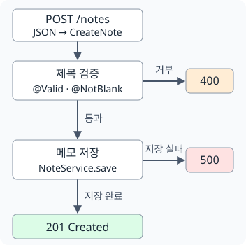

메모 생성 API에 `{}`를 보내면 HTTP 500이 돌아왔다. JSON 문법은 맞았지만 메모를 저장하는 서비스에는 제목이 필요했다. 이 합성 예제에서는 요청 객체에 `@NotBlank`, 컨트롤러에 `@Valid`를 적용해 서비스 호출 전에 400을 반환하도록 고쳤다. 정상 요청으로 만든 파일과 저장에 실패했을 때의 응답까지 로컬에서 확인했다.

## 같은 500에서 원인 두 가지 찾기

아래는 Spring Boot 3.5.10의 내장 Tomcat 10.1.50에 같은 요청을 수정 전후로 보낸 결과다. 메모 하나를 텍스트 파일 하나로 저장하며, 마지막 행에서만 저장 디렉터리를 잠시 옮겼다.

| `POST /notes` 요청 본문 | 저장 디렉터리 | 수정 전 | 수정 후 |
| --- | --- | ---: | ---: |
| `{}` | 있음 | 500 | 400 |
| `{"title":null}` | 있음 | 500 | 400 |
| `{"title":""}` | 있음 | 500 | 400 |
| `{"title":"   "}` | 있음 | 500 | 400 |
| `{"title":"Plan"}` | 있음 | 201 | 201 |
| `{"title":"Plan"}` | 없음 | 500 | 500 |

수정 전 첫 요청에서 서버 로그에는 `IllegalArgumentException: title is required`와 호출 위치 `NoteService.save`가 찍혔다. Spring MVC는 본문을 `CreateNote`로 읽었고, 컨트롤러는 누락된 제목을 `null`인 채로 서비스에 넘겼다. 빈 문자열이나 공백도 같은 경로를 거쳐 서비스의 `Assert.hasText`에서 실패했다. 반면 마지막 요청은 제목 검사를 통과한 뒤 파일 생성 중 `NoSuchFileException`이 발생했다. 클라이언트가 제목을 고쳐 해결할 수 있는 경우는 앞의 네 행이다. [RFC 9110의 400](https://www.rfc-editor.org/rfc/rfc9110.html#section-15.5.1) · [500](https://www.rfc-editor.org/rfc/rfc9110.html#section-15.6.1)

## 제목 검사를 요청을 받는 곳으로 옮기기



서비스의 제목 검사도 그대로 둔다. 달라지는 곳은 컨트롤러의 인자를 만드는 단계다. `pom.xml`의 `dependencies`에 검증 구현을 제공하는 스타터를 추가한다.

```xml
<dependency>
  <groupId>org.springframework.boot</groupId>
  <artifactId>spring-boot-starter-validation</artifactId>
</dependency>
```

```diff
+import jakarta.validation.Valid;
+import jakarta.validation.constraints.NotBlank;

-record CreateNote(String title) {}
+record CreateNote(@NotBlank String title) {}

-    void create(@RequestBody CreateNote note) throws IOException {
+    void create(@Valid @RequestBody CreateNote note) throws IOException {
```

`@NotBlank`는 제목에 공백이 아닌 문자가 하나 이상 있어야 한다는 규칙을 선언한다. `@Valid`가 붙은 `@RequestBody` 인자에 MVC가 그 규칙을 적용한다. 수정 후 로그에는 `title`의 필드 오류와 `MethodArgumentNotValidException`이 기록됐고, MVC의 기본 예외 처리기가 400으로 응답했다. 파일을 쓰다가 발생한 예외는 이 검사를 이미 통과한 뒤에 생기므로 기존 500 처리를 유지한다. [Jakarta Bean Validation의 @NotBlank](https://jakarta.ee/specifications/bean-validation/3.0/jakarta-bean-validation-spec-3.0.html#builtinconstraints-notblank) · [Spring MVC의 @RequestBody](https://docs.spring.io/spring-framework/reference/6.2/web/webmvc/mvc-controller/ann-methods/requestbody.html)

## 내장 서버에서 두 버전 비교하기

검증 환경은 Azul JDK 21.0.1과 Maven 3.9.5다. 빈 프로젝트 디렉터리에서 다음 명령을 실행하고 아래 두 파일을 저장한다.

```sh
mkdir -p src/main/java/example src/test/java/example notes
```

`pom.xml` (수정 전)

```xml
<project xmlns="http://maven.apache.org/POM/4.0.0">
  <modelVersion>4.0.0</modelVersion>
  <parent>
    <groupId>org.springframework.boot</groupId>
    <artifactId>spring-boot-starter-parent</artifactId>
    <version>3.5.10</version>
  </parent>
  <groupId>example</groupId>
  <artifactId>notes</artifactId>
  <version>1.0</version>
  <properties>
    <java.version>21</java.version>
  </properties>
  <dependencies>
    <dependency>
      <groupId>org.springframework.boot</groupId>
      <artifactId>spring-boot-starter-web</artifactId>
    </dependency>
    <dependency>
      <groupId>org.springframework.boot</groupId>
      <artifactId>spring-boot-starter-test</artifactId>
      <scope>test</scope>
    </dependency>
  </dependencies>
  <build>
    <plugins>
      <plugin>
        <groupId>org.springframework.boot</groupId>
        <artifactId>spring-boot-maven-plugin</artifactId>
      </plugin>
    </plugins>
  </build>
</project>
```

`src/main/java/example/NotesApp.java` (수정 전)

```java
package example;

import java.io.IOException;
import java.nio.file.Files;
import java.nio.file.Path;

import org.springframework.boot.SpringApplication;
import org.springframework.boot.autoconfigure.SpringBootApplication;
import org.springframework.http.HttpStatus;
import org.springframework.stereotype.Service;
import org.springframework.util.Assert;
import org.springframework.web.bind.annotation.*;

@SpringBootApplication
public class NotesApp {
    public static void main(String[] args) {
        SpringApplication.run(NotesApp.class, args);
    }
}

record CreateNote(String title) {}

@RestController
class NotesController {
    private final NoteService notes;

    NotesController(NoteService notes) {
        this.notes = notes;
    }

    @PostMapping("/notes")
    @ResponseStatus(HttpStatus.CREATED)
    void create(@RequestBody CreateNote note) throws IOException {
        notes.save(note.title());
    }
}

@Service
class NoteService {
    void save(String title) throws IOException {
        Assert.hasText(title, "title is required");
        Path note = Files.createTempFile(Path.of("notes"), "note-", ".txt");
        Files.writeString(note, title);
    }
}
```

프로젝트 루트에서 서버를 띄운다.

```sh
mvn -DskipTests package
java -jar target/notes-1.0.jar --server.address=127.0.0.1 --server.port=18081
```

서버가 시작되면 다른 터미널에서 같은 프로젝트 루트로 이동해 아래 명령을 실행한다. 마지막 두 요청은 제목이 같다. 디렉터리 유무만 바꿔 서버 쪽 원인을 분리했다. 정상 저장 후 `notes/note-*.txt` 파일에 기록된 내용은 `Plan`이었다.

```sh
post() {
  curl -sS -o /dev/null -w '%{http_code}\n' -H 'Content-Type: application/json' \
    --data "$1" http://127.0.0.1:18081/notes
}
for body in '{}' '{"title":null}' '{"title":""}' '{"title":"   "}' '{"title":"Plan"}'; do
  post "$body"
done
mv notes notes.off
post '{"title":"Plan"}'
mv notes.off notes
```

첫 터미널에서 Ctrl+C로 종료한 뒤 앞의 의존성과 애너테이션 변경을 적용한다. 같은 빌드·실행 명령으로 서버를 다시 띄우고 요청을 반복하면 표의 두 열을 비교할 수 있다.

## MockMvc로 서비스 호출 경계 고정하기

`src/test/java/example/NotesControllerTest.java`에 다음 테스트를 저장하고 프로젝트 루트에서 각 버전의 `mvn test`를 실행한다. 응답 코드만 검사하면 컨트롤러가 저장을 시도한 뒤 오류를 반환하는 회귀를 놓칠 수 있다. 그래서 잘못된 요청 네 건은 서비스 호출이 없었는지, 정상 요청은 원래 제목으로 한 번 호출했는지도 확인한다.

```java
package example;

import org.junit.jupiter.api.Test;
import org.junit.jupiter.params.ParameterizedTest;
import org.junit.jupiter.params.provider.ValueSource;
import org.springframework.beans.factory.annotation.Autowired;
import org.springframework.boot.test.autoconfigure.web.servlet.WebMvcTest;
import org.springframework.test.context.bean.override.mockito.MockitoBean;
import org.springframework.test.web.servlet.MockMvc;

import static org.mockito.Mockito.*;
import static org.springframework.http.MediaType.APPLICATION_JSON;
import static org.springframework.test.web.servlet.request.MockMvcRequestBuilders.post;
import static org.springframework.test.web.servlet.result.MockMvcResultMatchers.status;

@WebMvcTest(NotesController.class)
class NotesControllerTest {
    @Autowired MockMvc mvc;
    @MockitoBean NoteService notes;

    @ParameterizedTest
    @ValueSource(strings = {"{}", "{\"title\":null}", "{\"title\":\"\"}", "{\"title\":\"   \"}"})
    void rejectsInvalidTitle(String body) throws Exception {
        mvc.perform(post("/notes").contentType(APPLICATION_JSON).content(body))
                .andExpect(status().isBadRequest());
        verifyNoInteractions(notes);
    }

    @Test
    void createsNote() throws Exception {
        mvc.perform(post("/notes").contentType(APPLICATION_JSON).content("{\"title\":\"Plan\"}"))
                .andExpect(status().isCreated());
        verify(notes).save("Plan");
    }
}
```

수정 전에는 테스트 다섯 건 중 네 건이 `expected:<400> but was:<201>`로 실패했다. 이 테스트의 모의 서비스는 아무 작업 없이 반환하므로 컨트롤러가 정상 종료한 것이다. 실제 서비스의 예외가 클라이언트에게 어떤 HTTP 상태로 보이는지는 앞의 Tomcat 요청으로 확인했다. 수정 후 같은 테스트 다섯 건이 모두 통과했다. [Spring의 MockMvc 동작 방식](https://docs.spring.io/spring-framework/reference/6.2/testing/mockmvc/overview.html)
