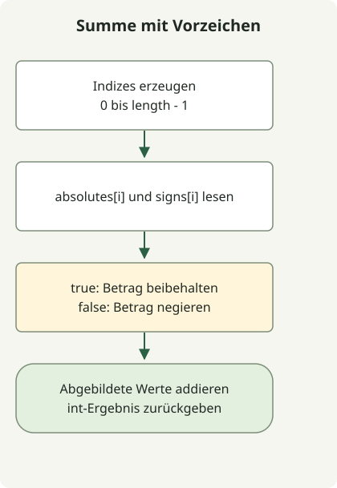

Wenn Beträge und Vorzeichen getrennt vorliegen, wird vor dem Addieren das Vorzeichen am jeweiligen gemeinsamen Index angewendet. `signs[i]` bedeutet bei true positiv und bei false negativ. Ein bedingter Ausdruck rekonstruiert daher jeden Wert.

Die [Aufgabe](https://school.programmers.co.kr/learn/courses/30/lessons/76501) garantiert gleiche Arraylängen von 1 bis 1.000 und Beträge von 1 bis 1.000. Ein separates Sortieren der Vorzeichen würde ihre Zuordnung zu den ursprünglichen Werten zerstören; die Arrays sind in der vorgegebenen Reihenfolge zu verarbeiten.

## Ablauf



Denselben Index in beiden Arrays lesen, das Vorzeichen anwenden und anschließend die vorzeichenbehafteten Werte addieren.

## Zugehörige Indizes gemeinsam lesen

Diese vollständige Klasse als `Solution.java` speichern. Sie wurde für Java 11 kompiliert und auf JDK 17 ausgeführt.

```java
import java.util.stream.IntStream;

public class Solution {
    public int solution(int[] absolutes, boolean[] signs) {
        return IntStream.range(0, absolutes.length)
                .map(i -> signs[i] ? absolutes[i] : -absolutes[i])
                .sum();
    }
}
```

[`IntStream.range`](https://docs.oracle.com/en/java/javase/17/docs/api/java.base/java/util/stream/IntStream.html) schließt Index 0 ein und `absolutes.length` aus. `map` wendet das Vorzeichen auf jeden Betrag an, und `sum` addiert die entstandenen Werte. Die Methode verändert weder die Eingabe noch erzeugt sie ein separates Array vorzeichenbehafteter Werte.

| Betrag | Vorzeichen | Tatsächlicher Wert |
| --- | --- | --- |
| 4 | true | 4 |
| 7 | false | -7 |
| 12 | true | 12 |

Diese Werte ergeben zusammen 9. Die Eingabe `[1,2,3]` mit `[false,false,true]` hebt sich zu 0 auf. Nur die positiven und negativen Flags zu zählen reicht nicht: Auch der **Betrag** jedes Summanden ist entscheidend.

## Ganzzahlgrenzen und Vertrag

Es gibt höchstens 1.000 Summanden mit einem Betrag von jeweils höchstens 1.000. Der Absolutwert der Summe ist daher durch 1.000.000 begrenzt. Selbst die Grenzfälle mit ausschließlich positiven oder negativen Werten passen in int. Die Laufzeit beträgt O(n), der zusätzliche Speicherbedarf O(1).

Die Methode setzt die gültigen Beträge und gleichen Längen der Aufgabe voraus. Sie ersetzt keine Prüfungen auf null, Längen und Werte bei beliebigen Anwendungseingaben. Bei größeren Grenzen müssen sowohl der Typ der Summanden als auch der des Akkumulators neu bewertet werden.

Zum Vergleich dienen [Array-Skalarprodukte](/en/posts/2021-07-22-dot-product/) als weitere Berechnung mit zwei Arrays und [eine Folge mit Abstand x unter Verwendung von long](/en/posts/2021-07-29-interval-num/) für Ergebnisse außerhalb des int-Bereichs. Der [Leitfaden zu Java-Programmieraufgaben](/en/categories/coding-test/) bietet einen Lernpfad.
