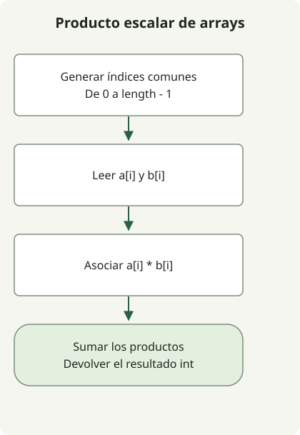

El producto escalar de dos arrays es la suma de los productos de los elementos situados en los mismos índices. Sumar primero los elementos, o multiplicar las sumas de los dos arrays, calcula algo distinto.

El [ejercicio](https://school.programmers.co.kr/learn/courses/30/lessons/70128) proporciona arrays de enteros de igual longitud, de 1 a 1.000 elementos, con valores entre -1.000 y 1.000. Dentro de esos límites, un resultado de tipo `int` es suficiente.

## Flujo del procesamiento



Asocia cada índice común a un producto y suma esos productos. Los límites del ejercicio permiten usar int.

## Sumar los productos por índice

Guarda esta clase completa como `Solution.java`. Se compiló para Java 11 y presupone el contrato de entrada de arrays de igual longitud.

```java
import java.util.stream.IntStream;

public class Solution {
    public int solution(int[] a, int[] b) {
        return IntStream.range(0, a.length)
                .map(i -> a[i] * b[i])
                .sum();
    }
}
```

[`IntStream.range(0, a.length)`](https://docs.oracle.com/en/java/javase/17/docs/api/java.base/java/util/stream/IntStream.html) excluye el índice final. Asocia cada índice a `a[i] * b[i]` y combina los productos con `sum()`. El flujo de índices de tipo primitivo no requiere construir una lista de objetos Integer mediante boxing.

Para `[1, 2, 3, 4]` y `[-3, -1, 0, 2]`, los productos son `-3, -2, 0, 8`, y el resultado es 3. Conserva los signos negativos: tomar valores absolutos cambia el producto escalar.

## Cuándo basta con int

Cada producto tiene un valor absoluto máximo de 1.000.000 y hay como máximo 1.000 términos. Por tanto, el valor absoluto de la suma está acotado por 1.000.000.000, dentro del rango de int en Java. Las comprobaciones de límites también cubren las sumas positiva y negativa de mayor valor absoluto para 1.000 términos.

Para entradas mayores, cambiar solo el acumulador a long puede no ser suficiente. `(long) (a[i] * b[i])` convierte el resultado después de que la multiplicación de int ya se haya desbordado. Amplía el tipo **antes** de multiplicar con `(long) a[i] * b[i]`, y diseña también la suma y el tipo de retorno como long. El método presentado aquí mantiene el contrato de int del ejercicio.

El tiempo es O(n) y el espacio adicional es O(1). No es una biblioteca vectorial general que valide longitudes diferentes, arrays null o elementos fuera del rango permitido.

Para convertir nombres de cifras fijos en inglés a un entero, consulta [palabras de cifras y cadenas numéricas](/en/posts/2021-07-23-number-word/).
