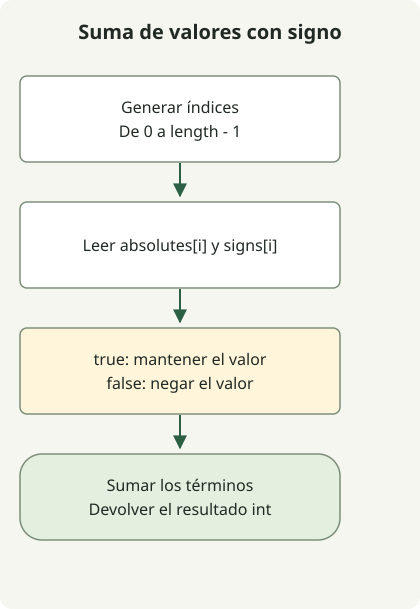

Cuando los valores absolutos y los signos llegan por separado, aplica el signo en cada índice correspondiente antes de sumar. `signs[i]` significa positivo si es true y negativo si es false, por lo que una expresión condicional reconstruye cada valor.

El [ejercicio](https://school.programmers.co.kr/learn/courses/30/lessons/76501) garantiza arrays de igual longitud, de 1 a 1.000, y valores absolutos de 1 a 1.000. Ordenar los signos por separado rompería su asociación con los valores originales; procesa los arrays en el orden dado.

## Flujo del procesamiento



Lee el mismo índice en los dos arrays, aplica su signo y suma los valores con signo.

## Leer juntos los índices correspondientes

Guarda esta clase completa como `Solution.java`. Se compiló para Java 11 y se ejecutó en JDK 17.

```java
import java.util.stream.IntStream;

public class Solution {
    public int solution(int[] absolutes, boolean[] signs) {
        return IntStream.range(0, absolutes.length)
                .map(i -> signs[i] ? absolutes[i] : -absolutes[i])
                .sum();
    }
}
```

[`IntStream.range`](https://docs.oracle.com/en/java/javase/17/docs/api/java.base/java/util/stream/IntStream.html) incluye el índice 0 y excluye `absolutes.length`. `map` aplica el signo a cada valor absoluto y `sum` suma los valores resultantes. El método no modifica la entrada ni crea un array separado de valores con signo.

| Valor absoluto | Signo | Valor real |
| --- | --- | --- |
| 4 | true | 4 |
| 7 | false | -7 |
| 12 | true | 12 |

Estos valores suman 9. La entrada `[1,2,3]` con `[false,false,true]` se cancela hasta dar 0. No basta con contar los indicadores positivos y negativos: también importa el **valor absoluto** de cada término.

## Límites de enteros y contrato

Hay como máximo 1.000 términos, cada uno con un valor absoluto máximo de 1.000, así que el valor absoluto de la suma está acotado por 1.000.000. Incluso los límites con todos los valores positivos o todos negativos caben en int. El tiempo es O(n), con O(1) de espacio adicional.

El método presupone los valores absolutos válidos y las longitudes iguales del ejercicio. No sustituye la validación de null, longitud y valores para entradas arbitrarias de una aplicación. Unos límites mayores requieren reconsiderar tanto el tipo de los términos como el del acumulador.

Compara con los [productos escalares de arrays](/en/posts/2021-07-22-dot-product/) para otro cálculo con dos arrays y con [una secuencia con intervalo x usando long](/en/posts/2021-07-29-interval-num/) para resultados que superan int. La [guía de ejercicios de Java](/en/categories/coding-test/) ofrece un itinerario de aprendizaje.
