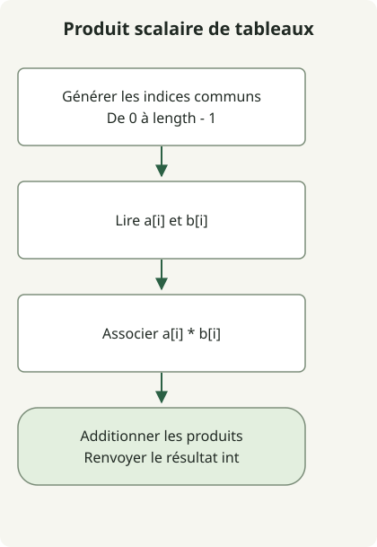

Le produit scalaire de deux tableaux est la somme des produits des éléments de même indice. Additionner d’abord les éléments, ou multiplier les sommes des deux tableaux, donne un autre résultat.

L’[exercice](https://school.programmers.co.kr/learn/courses/30/lessons/70128) fournit des tableaux d’entiers de même longueur, de 1 à 1 000 éléments, dont les valeurs vont de -1 000 à 1 000. Dans ces limites, le type `int` suffit pour le résultat.

## Déroulement du traitement



Associez à chaque indice commun un produit, puis additionnez ces produits. Les limites de l’exercice permettent d’utiliser int.

## Additionner les produits par indice

Enregistrez cette classe complète dans `Solution.java`. Elle a été compilée pour Java 11 et suppose que les tableaux d’entrée ont la même longueur, conformément au contrat.

```java
import java.util.stream.IntStream;

public class Solution {
    public int solution(int[] a, int[] b) {
        return IntStream.range(0, a.length)
                .map(i -> a[i] * b[i])
                .sum();
    }
}
```

[`IntStream.range(0, a.length)`](https://docs.oracle.com/en/java/javase/17/docs/api/java.base/java/util/stream/IntStream.html) exclut l’indice de fin. Transformez chaque indice en `a[i] * b[i]`, puis regroupez les produits avec `sum()`. Ce flux d’indices de type primitif ne nécessite pas de créer une liste d’objets Integer par boxing.

Pour `[1, 2, 3, 4]` et `[-3, -1, 0, 2]`, les produits sont `-3, -2, 0, 8`, soit un résultat de 3. Conservez les signes négatifs : prendre les valeurs absolues change le produit scalaire.

## Quand int suffit

Chaque produit a une valeur absolue d’au plus 1 000 000 et il y a au plus 1 000 termes. La valeur absolue de la somme est donc bornée par 1 000 000 000, dans l’intervalle du type int de Java. Les vérifications aux limites couvrent aussi les sommes positive et négative de plus grande valeur absolue sur 1 000 termes.

Pour des entrées plus grandes, passer uniquement l’accumulateur en long peut ne pas suffire. `(long) (a[i] * b[i])` effectue la conversion après le débordement de la multiplication en int. Élargissez le type **avant** la multiplication avec `(long) a[i] * b[i]`, et prévoyez également une somme et un type de retour en long. La méthode soumise ici conserve le contrat en int de l’exercice.

Le temps de calcul est O(n) et l’espace supplémentaire O(1). Il ne s’agit pas d’une bibliothèque vectorielle générale qui vérifierait les longueurs différentes, les tableaux null ou les éléments hors limites.

Pour convertir des noms de chiffres anglais prédéfinis en entier, consultez [les chiffres écrits en lettres et les chaînes numériques](/en/posts/2021-07-23-number-word/).
