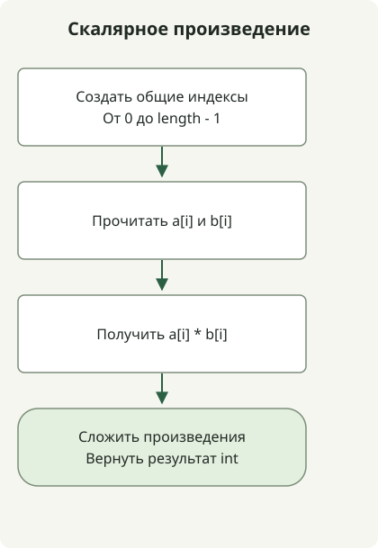

Скалярное произведение двух массивов — это сумма произведений элементов с одинаковыми индексами. Если сначала сложить элементы или перемножить суммы двух массивов, получится другое значение.

В [задаче](https://school.programmers.co.kr/learn/courses/30/lessons/70128) даны целочисленные массивы одинаковой длины от 1 до 1 000 элементов со значениями от -1 000 до 1 000. При этих ограничениях для результата достаточно `int`.

## Порядок обработки



Каждому общему индексу сопоставляем произведение, затем складываем произведения. При ограничениях задачи результат помещается в int.

## Суммируем произведения по индексам

Сохраните этот полный класс в `Solution.java`. Он был скомпилирован для Java 11 и предполагает, что входные массивы имеют одинаковую длину согласно контракту.

```java
import java.util.stream.IntStream;

public class Solution {
    public int solution(int[] a, int[] b) {
        return IntStream.range(0, a.length)
                .map(i -> a[i] * b[i])
                .sum();
    }
}
```

[`IntStream.range(0, a.length)`](https://docs.oracle.com/en/java/javase/17/docs/api/java.base/java/util/stream/IntStream.html) не включает конечный индекс. Каждому индексу сопоставляем `a[i] * b[i]`, затем объединяем произведения с помощью `sum()`. Поток индексов примитивного типа не требует создания списка объектов Integer с упаковкой значений.

Для `[1, 2, 3, 4]` и `[-3, -1, 0, 2]` произведения равны `-3, -2, 0, 8`, а результат — 3. Сохраняйте отрицательные знаки: переход к абсолютным значениям меняет скалярное произведение.

## Когда достаточно int

Абсолютное значение каждого произведения не превышает 1 000 000, а число слагаемых — 1 000. Поэтому абсолютное значение суммы ограничено 1 000 000 000 и укладывается в диапазон int в Java. Проверки граничных случаев охватывают также наибольшие по модулю положительную и отрицательную суммы для 1 000 слагаемых.

При больших входных значениях может быть недостаточно изменить на long только тип накопителя. `(long) (a[i] * b[i])` выполняет преобразование уже после переполнения при умножении int. Расширяйте тип **до** умножения с помощью `(long) a[i] * b[i]`, а сумму и возвращаемое значение также проектируйте с типом long. Приведённый метод сохраняет контракт задачи с типом int.

Время работы — O(n), дополнительная память — O(1). Это не универсальная библиотека векторов с проверками разной длины, массивов null или элементов вне допустимого диапазона.

Преобразование фиксированных английских названий цифр в целое число описано в статье [о названиях цифр и числовых строках](/en/posts/2021-07-23-number-word/).
