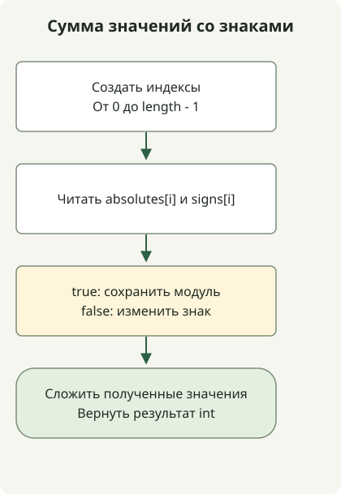

Если абсолютные значения и знаки поступают отдельно, перед суммированием примените знак по каждому соответствующему индексу. `signs[i]` означает положительный знак при true и отрицательный при false, поэтому каждое значение можно восстановить одним условным выражением.

[Задача](https://school.programmers.co.kr/learn/courses/30/lessons/76501) гарантирует одинаковую длину массивов от 1 до 1 000 и абсолютные значения от 1 до 1 000. Отдельная сортировка знаков нарушит их соответствие исходным значениям; обрабатывайте массивы в заданном порядке.

## Порядок обработки



Прочитайте элементы обоих массивов с одним индексом, примените знак, затем сложите полученные значения со знаками.

## Читаем соответствующие индексы вместе

Сохраните этот полный класс в `Solution.java`. Он был скомпилирован для Java 11 и выполнен на JDK 17.

```java
import java.util.stream.IntStream;

public class Solution {
    public int solution(int[] absolutes, boolean[] signs) {
        return IntStream.range(0, absolutes.length)
                .map(i -> signs[i] ? absolutes[i] : -absolutes[i])
                .sum();
    }
}
```

[`IntStream.range`](https://docs.oracle.com/en/java/javase/17/docs/api/java.base/java/util/stream/IntStream.html) включает индекс 0 и исключает `absolutes.length`. `map` применяет знак к каждому абсолютному значению, а `sum` складывает результаты. Метод не меняет входные данные и не создаёт отдельный массив значений со знаками.

| Абсолютное значение | Знак | Фактическое значение |
| --- | --- | --- |
| 4 | true | 4 |
| 7 | false | -7 |
| 12 | true | 12 |

Сумма этих значений равна 9. Для входных данных `[1,2,3]` и `[false,false,true]` слагаемые взаимно сокращаются до 0. Недостаточно подсчитать только положительные и отрицательные флаги: важна и **абсолютная величина** каждого слагаемого.

## Границы целых чисел и контракт

Всего не более 1 000 слагаемых с абсолютным значением не более 1 000, поэтому абсолютное значение суммы ограничено 1 000 000. Даже граничные случаи со всеми положительными или всеми отрицательными значениями укладываются в int. Время работы — O(n), дополнительная память — O(1).

Метод предполагает допустимые абсолютные значения и одинаковую длину массивов по условиям задачи. Он не заменяет проверку null, длины и значений для произвольных входных данных приложения. При расширении границ нужно пересмотреть типы и слагаемых, и накопителя.

Для другого вычисления с двумя массивами см. [скалярное произведение массивов](/en/posts/2021-07-22-dot-product/), а для результатов за пределами int — [последовательность с шагом x и типом long](/en/posts/2021-07-29-interval-num/). Порядок изучения представлен в [руководстве по задачам на Java](/en/categories/coding-test/).
