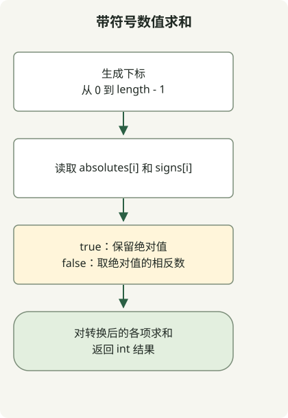

当绝对值与符号分别给出时，先在相同下标处应用符号，再求和。`signs[i]` 为 true 表示正数，为 false 表示负数，因此一个条件表达式就能还原每个值。

这道[练习题](https://school.programmers.co.kr/learn/courses/30/lessons/76501)保证两个数组长度相同，长度为 1 到 1000，绝对值为 1 到 1000。单独对符号排序会破坏它们与原始数值的对应关系；应按给定顺序处理数组。

## 处理流程



读取两个数组相同下标处的元素，应用对应符号，再对带符号的数值求和。

## 一起读取对应下标

将以下完整类保存为 `Solution.java`。它已按 Java 11 编译，并在 JDK 17 上执行。

```java
import java.util.stream.IntStream;

public class Solution {
    public int solution(int[] absolutes, boolean[] signs) {
        return IntStream.range(0, absolutes.length)
                .map(i -> signs[i] ? absolutes[i] : -absolutes[i])
                .sum();
    }
}
```

[`IntStream.range`](https://docs.oracle.com/en/java/javase/17/docs/api/java.base/java/util/stream/IntStream.html)包含下标 0，但不包含 `absolutes.length`。`map` 将符号应用到每个绝对值，`sum` 将得到的数值相加。该方法既不修改输入，也不创建单独的带符号数值数组。

| 绝对值 | 符号 | 实际值 |
| --- | --- | --- |
| 4 | true | 4 |
| 7 | false | -7 |
| 12 | true | 12 |

这些数值的和为 9。输入 `[1,2,3]` 配合 `[false,false,true]` 时，正负抵消后为 0。仅统计正负标记的数量是不够的：每一项的**绝对值**同样重要。

## 整数范围与输入约定

最多有 1000 项，每项的绝对值最多为 1000，因此总和的绝对值不超过 1000000。即使全部为正或全部为负，边界值也在 int 范围内。时间复杂度为 O(n)，额外空间复杂度为 O(1)。

该方法以绝对值合法且数组等长为前提。这不能替代对任意应用输入进行的 null、长度和数值校验。如果范围扩大，需要重新考虑每一项和累加器的类型。

可对照[数组点积](/en/posts/2021-07-22-dot-product/)了解另一种双数组计算；对于超出 int 范围的结果，可参阅[使用 long 生成间隔为 x 的数列](/en/posts/2021-07-29-interval-num/)。[Java 编程练习指南](/en/categories/coding-test/)提供了学习路径。
