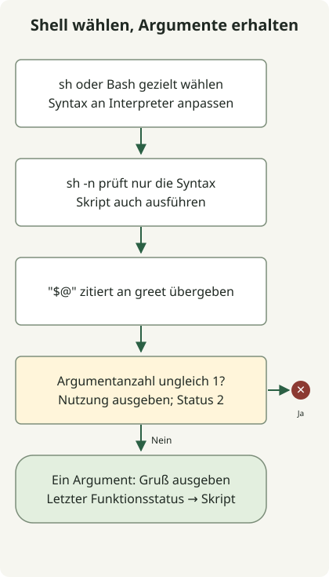

In einem Skript mit `#!/bin/sh` wird eine Funktion als `hello() { ...; }` ohne das Schlüsselwort `function` deklariert. Benötigt das Skript Bash-Syntax, muss Bash gewählt und entsprechend aufgerufen werden. Ein Aufruf mit `sh script.sh` richtet sich nicht nach einer Bash-Shebang in der Datei.

[ShellCheck SC2112](https://www.shellcheck.net/wiki/SC2112) erläutert, dass `function` keine POSIX-sh-Syntax ist. Dass eine bestimmte `/bin/sh`-Implementierung sie akzeptiert, belegt keine Portabilität.

## Ablauf



Der aufgerufene Interpreter parst die Funktion. Das Beispiel prüft, ob genau ein Argument vorliegt, und erhält Leerzeichen und Platzhalterzeichen durch Anführungszeichen.

## Eine Funktion für die gewählte Shell schreiben

Als `greet.sh` speichern. Die Anführungszeichen in `"$1"` und `"$@"` erhalten Leerzeichen und Platzhalterzeichen in Argumenten.

### `greet.sh`

```sh
#!/bin/sh
set -eu

greet() {
    if [ "$#" -ne 1 ]; then
        printf '%s\n' 'usage: greet.sh NAME' >&2
        return 2
    fi
    printf 'Hello, %s\n' "$1"
}

greet "$@"
```

```sh
sh -n greet.sh
sh greet.sh 'Ada Lovelace'
sh greet.sh 'Ada *'
```

Die Ausgaben sind `Hello, Ada Lovelace` und `Hello, Ada *`. `sh -n` prüft nur die Syntax; das Skript muss deshalb auch ausgeführt werden. Fehlende oder überzählige Argumente führen zu einem Nutzungshinweis auf stderr und zum Exitstatus 2. Bei einem gültigen Argument ist der Status 0.

## Shebang und ausdrücklich aufgerufenen Interpreter unterscheiden

| Aufruf | Wahl des Interpreters |
| --- | --- |
| `sh greet.sh NAME` | Das aufgerufene `sh` liest die Datei. |
| `bash greet.sh NAME` | Bash liest die Datei. |
| `chmod +x greet.sh`, dann `./greet.sh NAME` | Bei dieser Ausführung gilt die Shebang der Datei. |

Für Bash-Arrays oder `[[ ... ]]` wird `#!/usr/bin/env bash` verwendet und das Skript mit `bash script.sh` oder als ausführbare Datei `./script.sh` gestartet. Bei `sh script.sh` darf keine Bash-Syntax vorausgesetzt werden. Siehe [ShellChecks Erklärung zur Shell-Auswahl](https://www.shellcheck.net/wiki/SC2112).

`return` einer Funktion gibt die Kontrolle und einen Status an den Aufrufer zurück. `exit` beendet die laufende Shell. Hier ist der Funktionsaufruf das letzte Kommando, daher wird sein Status zum Exitstatus des Skripts.

Das Beispiel wurde mit Argumenten mit Leerzeichen und Platzhalterzeichen sowie ungültigen Argumentanzahlen geprüft. `/bin/sh`-Implementierungen unterscheiden sich; deshalb auch auf der Shell des Zielsystems testen. Als nächsten Automatisierungsschritt bieten sich der [numerische Versionsvergleich](/en/posts/2023-11-17-linux-shellscript-version-compare/) oder die [GitHub-Release-Abfrage](/en/posts/2023-09-23-linux-shellscript-github-latest/) an, bei denen Eingaben und Fehlerstatus ebenfalls wichtig sind.
