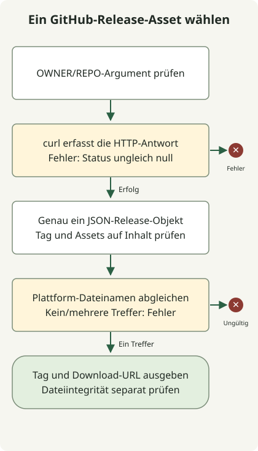

Mit `curl` das neueste GitHub-Release abrufen und mit `jq` genau ein Download-Asset für das benötigte Betriebssystem, die CPU und das Format auswählen. Das folgende Skript stoppt bei HTTP-Fehlern, ungültigem JSON sowie fehlenden oder mehrfachen Treffern. Es liefert Metadaten, ohne die Datei herunterzuladen.

Der Endpunkt `releases/latest` berechnet nicht das numerisch größte Git-Tag. Die [Release-API-Dokumentation](https://docs.github.com/en/rest/releases/releases#get-the-latest-release) unterscheidet gewöhnliche Tags, Entwürfe, Vorabversionen und veröffentlichte Releases.

Das Beispiel fragt im öffentlichen Repository `adoptium/temurin17-binaries` Metadaten für ein Linux-x64-HotSpot-JDK im Format tar.gz ab. Es benötigt weder ein Token noch einen tatsächlichen Dateidownload. Ohne Repositoryargument gilt dieser Standardwert; ein ausdrücklich leeres Argument wird zurückgewiesen.

## Ablauf



Ein HTTP-Fehler beendet das Skript vor dem JSON-Parsen. Ein gültiges Release-Objekt muss genau ein passendes Asset enthalten. Die Auswahl seiner URL prüft nicht die heruntergeladene Datei.

## HTTP-Fehler von Fehlern bei der JSON-Auswahl trennen

Das Skript benötigt `curl`, `jq` und POSIX sh. Als `latest-release.sh` speichern.

### `latest-release.sh`

```sh
#!/bin/sh
set -eu
if [ "$#" -gt 1 ]; then
    printf '%s\n' 'usage: latest-release.sh OWNER/REPO' >&2
    exit 2
fi
repo=${1-adoptium/temurin17-binaries}
case "$repo" in
    */*/*|/*|*/|*[!A-Za-z0-9_./-]*) printf '%s\n' 'usage: latest-release.sh OWNER/REPO' >&2; exit 2 ;;
esac
case "$repo" in
    */*) ;;
    *) printf '%s\n' 'usage: latest-release.sh OWNER/REPO' >&2; exit 2 ;;
esac
api=${GITHUB_API_URL:-https://api.github.com}
response=$(curl --fail --silent --show-error --location --max-time 20 \
    --header 'Accept: application/vnd.github+json' \
    --header 'X-GitHub-Api-Version: 2026-03-10' \
    "$api/repos/$repo/releases/latest") || exit 1
printf '%s' "$response" | jq --slurp --exit-status '
    if length != 1 or (.[0] | type) != "object" then
        error("expected one release object")
    else .[0] end
    | . as $release
    | if (.tag_name | type) != "string" or (.tag_name | length) == 0
         or (.assets | type) != "array" then
        error("missing release tag or assets")
      else . end
    | [.assets[] | select(.name | test("^OpenJDK17U-jdk_x64_linux_hotspot_.*\\.tar\\.gz$"))] as $assets
    | if ($assets | length) != 1 then
        error("expected exactly one Linux x64 JDK tar.gz asset")
      elif ($assets[0].browser_download_url | type) != "string"
           or ($assets[0].browser_download_url | length) == 0 then
        error("missing asset download URL")
      else {tag_name: $release.tag_name, download_url: $assets[0].browser_download_url} end
'
```

```sh
sh latest-release.sh adoptium/temurin17-binaries
```

Bei Erfolg entsteht ein JSON-Objekt mit `tag_name` und `download_url`. Die Werte hängen vom Release zum Anfragezeitpunkt ab. Das folgende Beispiel enthält Testdaten zur Darstellung der Struktur, keine Aussage über das derzeit neueste Release:

```json
{"tag_name":"jdk-17.0.8.1+1","download_url":"https://github.com/adoptium/temurin17-binaries/releases/download/example/OpenJDK17U-jdk_x64_linux_hotspot_example.tar.gz"}
```

`curl --fail` behandelt zuerst HTTP-Fehler. Wird die Antwort vor dem Parsen erfasst, kann das letzte Kommando einer Pipeline einen Netzwerkfehler nicht verdecken. Siehe [curl-Optionen](https://curl.se/docs/manpage.html).

`jq --slurp` liest die gesamte Eingabe in ein Array. Die Forderung nach genau einem JSON-Wert weist auch eine leere Antwort zurück. Anschließend prüft der Filter Release-Objekt, Tag und Asset-Array und gibt nur dann ein Ergebnis aus, wenn genau ein Dateiname passt. Siehe [jq-Handbuch](https://jqlang.org/manual/).

## Ergebnisse für die Automatisierung

| Bedingung | Ergebnis |
| --- | --- |
| Gültige Antwort und genau ein passendes Asset | JSON-Ausgabe, Status 0. |
| HTTP403/404 oder Verbindungsfehler | Status ungleich null. |
| Leerer Antwortkörper oder fehlerhaftes JSON | Status ungleich null. |
| Kein oder mehrere passende Assets | Abbruch statt willkürlicher Auswahl. |
| Ungültige Syntax des Repositoryarguments | Nutzungshinweis, Status 2. |

Mit lokalen HTTP-Antworten wurden Erfolg, HTTP-Fehler, ungültiges JSON, fehlende Assets und Duplikate geprüft. `GITHUB_API_URL` verweist standardmäßig auf die öffentliche API und kann auf einen Testserver mit demselben Antwortvertrag gesetzt werden.

Das Lesen öffentlicher Ressourcen erfordert keine Authentifizierung. Bei einer Erweiterung um authentifizierte Anfragen dürfen Tokens weder im Quellcode noch in Shell-Tracing-Logs stehen. Die Rate-Limit-Antwortheader und [GitHubs Dokumentation zu Rate Limits](https://docs.github.com/en/rest/using-the-rest-api/rate-limits-for-the-rest-api) prüfen.

Das Skript wählt eine URL aus, prüft aber nicht die Integrität der Installationsdatei. Die Installationsautomatisierung benötigt weiterhin Prüfsummen oder Signaturen des Anbieters und die Zielplattform. Vor der Übergabe eines Tags an den [numerischen Versionsvergleich](/en/posts/2023-11-17-linux-shellscript-version-compare/) muss geprüft werden, ob es dessen Eingabevertrag erfüllt.
