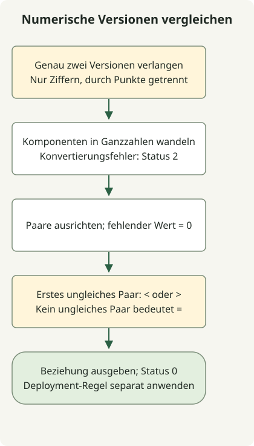

`1.10` und `1.2` dürfen nicht als Zeichenfolgen oder Dezimalzahlen verglichen werden. Stattdessen die ganzzahligen Komponenten von links nach rechts vergleichen und fehlende Endkomponenten mit null auffüllen; dadurch sind `1.2` und `1.2.0` gleich. Das Beispiel setzt diese Regel nur für numerische Punktversionen um.

Es weist `v1.2`, `1.2-rc1` und `1.2+build` zurück. Für die Rangfolge von Vorabversionen nach [SemVer](https://semver.org/) ist ein Parser für diese Spezifikation zu verwenden. Das blinde Entfernen von Suffixen kann die Bedeutung verändern.

## Ablauf



Den Vertrag ausschließlich numerischer Eingaben prüfen, fehlende Komponenten mit null auffüllen und beim ersten ungleichen Paar entscheiden. Auch ein Kleiner-als-Ergebnis ist ein erfolgreich ausgeführter Vergleich.

## Ein ausführbares Vergleichsskript

Python 3 ist erforderlich. Als `version-compare.sh` speichern und mit `sh` aufrufen.

### `version-compare.sh`

```sh
#!/bin/sh
set -eu
python3 - "$@" <<'PYTHON'
import re
import sys
from itertools import zip_longest

if len(sys.argv) != 3 or any(not re.fullmatch(r"[0-9]+(?:\.[0-9]+)*", value) for value in sys.argv[1:]):
    print("usage: version-compare.sh CURRENT LATEST (numeric dotted versions)", file=sys.stderr)
    raise SystemExit(2)
current, latest = sys.argv[1:]
try:
    left = [int(part) for part in current.split('.')]
    right = [int(part) for part in latest.split('.')]
except ValueError:
    print("numeric component exceeds this Python runtime's conversion limit", file=sys.stderr)
    raise SystemExit(2)
comparison = 0
for a, b in zip_longest(left, right, fillvalue=0):
    if a != b:
        comparison = -1 if a < b else 1
        break
operator = '<' if comparison < 0 else '>' if comparison > 0 else '='
print(f"{current} {operator} {latest}")
PYTHON
```

```sh
sh version-compare.sh 1.10.5 1.3.1
sh version-compare.sh 1.2 1.2.0
sh version-compare.sh 1.1000 2.0
```

Die Ausgaben sind `1.10.5 > 1.3.1`, `1.2 = 1.2.0` und `1.1000 < 2.0`. Ein gültiger Vergleich liefert unabhängig von der Beziehung Status 0. Eine ungültige Argumentanzahl, nicht unterstützte Syntax oder Grenzen der Zahlenkonvertierung führen zu einer Erklärung auf stderr und Status 2.

| Eingaben | Ergebnis |
| --- | --- |
| `1.2.0.0.1` und `1.2` | `1.2.0.0.1 > 1.2` |
| `01.002` und `1.2` | `01.002 = 1.2` |
| `1.2-rc1` und `1.2` | Nicht unterstütztes Format, Status 2 |
| `1..2` und `1.2` | Nicht unterstütztes Format, Status 2 |

## Warum keine Zahlen mit fester Breite verketten?

Eine Breite wie `%03d` in awk ist eine Mindestanzeigebreite und keine maximale Komponentenlänge. Werden diese Felder in eine Shell-Ganzzahl gepackt, kann bei großen Werten oder zusätzlichen Komponenten die ursprüngliche Reihenfolge verloren gehen.

Dieses Beispiel wandelt jede Komponente in eine Python-Ganzzahl um und gleicht die Längen mit [`zip_longest(..., fillvalue=0)`](https://docs.python.org/3/library/itertools.html#itertools.zip_longest) an. Verweigert eine Laufzeitumgebung die Zahlenkonvertierung, gilt das nicht als erfolgreicher Vergleich.

In der Deployment-Automatisierung sind Vergleich und Kommandoerfolg getrennte Entscheidungen. Das Skript schlägt nicht allein deshalb fehl, weil die aktuelle Version niedriger ist; zuerst die Beziehung aus stdout lesen und dann die eigene Richtlinie anwenden. [GitHub-Release-Tags](/en/posts/2023-09-23-linux-shellscript-github-latest/) müssen nicht dieser numerischen Syntax folgen und dürfen daher nicht ungeprüft übergeben werden. Zur Interpreterwahl siehe das [POSIX-sh-Funktionsbeispiel](/en/posts/2023-09-20-linux-shellscript-function-error/).
