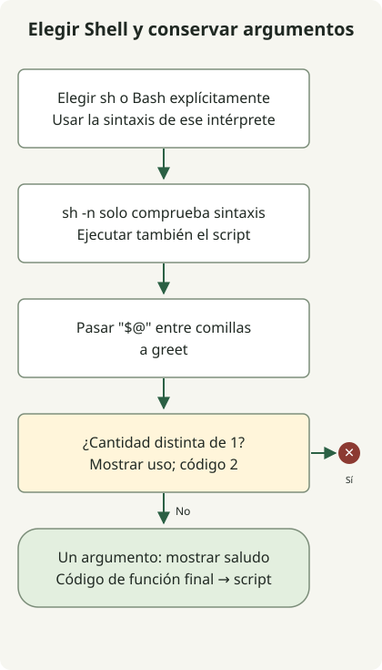

En un script `#!/bin/sh`, declara una función como `hello() { ...; }`, sin la palabra clave `function`. Si el script necesita sintaxis de Bash, elige Bash e invócalo de la forma correspondiente. La llamada `sh script.sh` no sigue el shebang de Bash del archivo.

[ShellCheck SC2112](https://www.shellcheck.net/wiki/SC2112) explica que `function` no es sintaxis de POSIX sh. Que una implementación concreta de `/bin/sh` la acepte no demuestra portabilidad.

## Flujo del procesamiento



El intérprete invocado analiza la función. El ejemplo comprueba que haya un solo argumento y conserva espacios y caracteres comodín mediante comillas.

## Escribir una función para el Shell elegido

Guarda el código como `greet.sh`. Las comillas de `"$1"` y `"$@"` conservan los espacios y los caracteres comodín de los argumentos.

### `greet.sh`

```sh
#!/bin/sh
set -eu

greet() {
    if [ "$#" -ne 1 ]; then
        printf '%s\n' 'usage: greet.sh NAME' >&2
        return 2
    fi
    printf 'Hello, %s\n' "$1"
}

greet "$@"
```

```sh
sh -n greet.sh
sh greet.sh 'Ada Lovelace'
sh greet.sh 'Ada *'
```

Las salidas son `Hello, Ada Lovelace` y `Hello, Ada *`. `sh -n` solo comprueba la sintaxis, por lo que también hay que ejecutar el script. Los argumentos ausentes o adicionales producen un mensaje de uso en stderr y un código de salida 2. Un argumento válido produce el código 0.

## Distinguir el shebang de un intérprete explícito

| Invocación | Selección del intérprete |
| --- | --- |
| `sh greet.sh NAME` | El `sh` invocado lee el archivo. |
| `bash greet.sh NAME` | Bash lo lee. |
| `chmod +x greet.sh`, después `./greet.sh NAME` | Esta ejecución usa el shebang del archivo. |

Para arrays de Bash o `[[ ... ]]`, usa `#!/usr/bin/env bash` y ejecuta `bash script.sh` o el archivo ejecutable `./script.sh`. No esperes sintaxis de Bash al invocar `sh script.sh`. Consulta la [explicación de ShellCheck sobre la elección del Shell](https://www.shellcheck.net/wiki/SC2112).

El `return` de una función devuelve el control y un código a quien la llama. `exit` termina el Shell en ejecución. Aquí la llamada a la función es el último comando, por lo que su código se convierte en el código de salida del script.

El ejemplo se comprobó con argumentos con espacios y comodines y con cantidades de argumentos no válidas. Las implementaciones de `/bin/sh` difieren, así que prueba también con el Shell de despliegue. Para el siguiente paso de automatización, consulta la [comparación de versiones numéricas](/en/posts/2023-11-17-linux-shellscript-version-compare/) o la [consulta de releases de GitHub](/en/posts/2023-09-23-linux-shellscript-github-latest/), donde las entradas y los códigos de error también importan.
