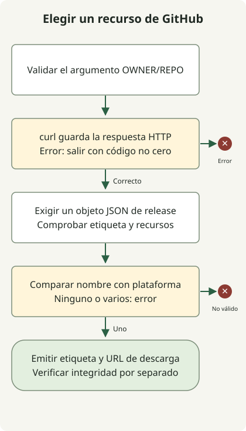

Usa `curl` para obtener la última release de GitHub y `jq` para elegir exactamente un recurso de descarga para el sistema, la CPU y el formato necesarios. El script se detiene ante errores HTTP, JSON no válido y coincidencias ausentes o duplicadas; devuelve metadatos sin descargar el archivo.

El endpoint `releases/latest` no calcula la etiqueta Git de mayor valor numérico. La [documentación de la API de releases](https://docs.github.com/en/rest/releases/releases#get-the-latest-release) distingue entre etiquetas normales, borradores, versiones preliminares y releases publicadas.

Este ejemplo consulta en el repositorio público `adoptium/temurin17-binaries` los metadatos de un JDK HotSpot Linux x64 en formato tar.gz. No necesita un token ni descargar realmente el archivo. Si se omite el argumento del repositorio, se usa ese valor predeterminado; un argumento explícitamente vacío se rechaza.

## Flujo del procesamiento



Un error HTTP detiene el script antes de analizar JSON. Un objeto de release válido debe contener exactamente un recurso coincidente; seleccionar su URL no verifica el archivo descargado.

## Separar los errores HTTP de los errores de selección JSON

El script requiere `curl`, `jq` y POSIX sh. Guárdalo como `latest-release.sh`.

### `latest-release.sh`

```sh
#!/bin/sh
set -eu
if [ "$#" -gt 1 ]; then
    printf '%s\n' 'usage: latest-release.sh OWNER/REPO' >&2
    exit 2
fi
repo=${1-adoptium/temurin17-binaries}
case "$repo" in
    */*/*|/*|*/|*[!A-Za-z0-9_./-]*) printf '%s\n' 'usage: latest-release.sh OWNER/REPO' >&2; exit 2 ;;
esac
case "$repo" in
    */*) ;;
    *) printf '%s\n' 'usage: latest-release.sh OWNER/REPO' >&2; exit 2 ;;
esac
api=${GITHUB_API_URL:-https://api.github.com}
response=$(curl --fail --silent --show-error --location --max-time 20 \
    --header 'Accept: application/vnd.github+json' \
    --header 'X-GitHub-Api-Version: 2026-03-10' \
    "$api/repos/$repo/releases/latest") || exit 1
printf '%s' "$response" | jq --slurp --exit-status '
    if length != 1 or (.[0] | type) != "object" then
        error("expected one release object")
    else .[0] end
    | . as $release
    | if (.tag_name | type) != "string" or (.tag_name | length) == 0
         or (.assets | type) != "array" then
        error("missing release tag or assets")
      else . end
    | [.assets[] | select(.name | test("^OpenJDK17U-jdk_x64_linux_hotspot_.*\\.tar\\.gz$"))] as $assets
    | if ($assets | length) != 1 then
        error("expected exactly one Linux x64 JDK tar.gz asset")
      elif ($assets[0].browser_download_url | type) != "string"
           or ($assets[0].browser_download_url | length) == 0 then
        error("missing asset download URL")
      else {tag_name: $release.tag_name, download_url: $assets[0].browser_download_url} end
'
```

```sh
sh latest-release.sh adoptium/temurin17-binaries
```

Un resultado correcto es un objeto JSON con `tag_name` y `download_url`. Los valores dependen de la release en el momento de la petición. Este ejemplo contiene datos de prueba que muestran la estructura, no una afirmación sobre la última release actual:

```json
{"tag_name":"jdk-17.0.8.1+1","download_url":"https://github.com/adoptium/temurin17-binaries/releases/download/example/OpenJDK17U-jdk_x64_linux_hotspot_example.tar.gz"}
```

`curl --fail` trata primero los errores HTTP. Capturar la respuesta antes de analizarla impide que el último comando de una tubería oculte un fallo de red. Consulta las [opciones de curl](https://curl.se/docs/manpage.html).

`jq --slurp` lee toda la entrada en un array. Exigir exactamente un valor JSON también rechaza una respuesta vacía. Después, el filtro comprueba el objeto de release, la etiqueta y el array de recursos, y solo emite un resultado cuando coincide exactamente un nombre de archivo. Consulta el [manual de jq](https://jqlang.org/manual/).

## Resultados que debe tratar la automatización

| Condición | Resultado |
| --- | --- |
| Respuesta válida y un único recurso coincidente | Salida JSON, código 0. |
| HTTP403/404 o fallo de conexión | Código distinto de cero. |
| Cuerpo vacío o JSON mal formado | Código distinto de cero. |
| Ningún recurso coincidente o varios | Fallar en lugar de elegir arbitrariamente. |
| Sintaxis del argumento del repositorio no válida | Mensaje de uso, código 2. |

Se usaron respuestas HTTP locales para comprobar el éxito, los errores HTTP, el JSON no válido, los recursos ausentes y los duplicados. `GITHUB_API_URL` apunta por defecto a la API pública y puede dirigirse a un servidor de prueba que implemente el mismo contrato de respuesta.

Leer recursos públicos no requiere autenticación. Si amplías el script para peticiones autenticadas, mantén los tokens fuera del código fuente y de los registros de trazado del Shell. Comprueba las cabeceras de límites de peticiones y la [documentación de GitHub sobre esos límites](https://docs.github.com/en/rest/using-the-rest-api/rate-limits-for-the-rest-api).

El script selecciona una URL; no verifica la integridad del archivo de instalación. La automatización de la instalación sigue necesitando las sumas de comprobación o firmas del proveedor y la plataforma de destino. Antes de pasar una etiqueta al [comparador de versiones numéricas](/en/posts/2023-11-17-linux-shellscript-version-compare/), comprueba que cumpla el contrato de entrada de ese script.
