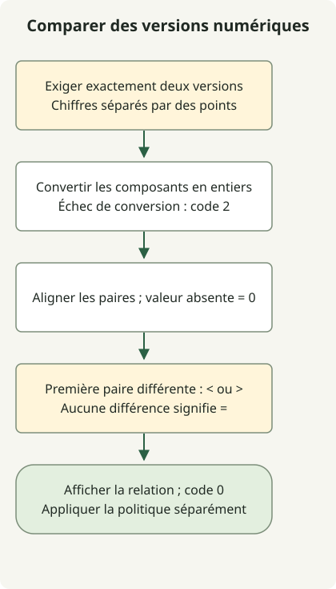

Ne comparez pas `1.10` et `1.2` comme des chaînes ou des nombres décimaux. Comparez les composants entiers de gauche à droite et complétez les composants finaux manquants par zéro : `1.2` est ainsi égal à `1.2.0`. Cet exemple applique cette règle uniquement aux versions numériques séparées par des points.

Il rejette `v1.2`, `1.2-rc1` et `1.2+build`. Pour l’ordre de priorité des préversions [SemVer](https://semver.org/), utilisez un analyseur conforme à cette spécification. Supprimer aveuglément les suffixes peut modifier le sens.

## Déroulement du traitement



Vérifiez le contrat d’entrée exclusivement numérique, alignez les composants manquants avec zéro et arrêtez-vous à la première paire différente. Un résultat inférieur reste une comparaison réussie.

## Un script de comparaison exécutable

Python 3 est requis. Enregistrez le code dans `version-compare.sh` et invoquez-le avec `sh`.

### `version-compare.sh`

```sh
#!/bin/sh
set -eu
python3 - "$@" <<'PYTHON'
import re
import sys
from itertools import zip_longest

if len(sys.argv) != 3 or any(not re.fullmatch(r"[0-9]+(?:\.[0-9]+)*", value) for value in sys.argv[1:]):
    print("usage: version-compare.sh CURRENT LATEST (numeric dotted versions)", file=sys.stderr)
    raise SystemExit(2)
current, latest = sys.argv[1:]
try:
    left = [int(part) for part in current.split('.')]
    right = [int(part) for part in latest.split('.')]
except ValueError:
    print("numeric component exceeds this Python runtime's conversion limit", file=sys.stderr)
    raise SystemExit(2)
comparison = 0
for a, b in zip_longest(left, right, fillvalue=0):
    if a != b:
        comparison = -1 if a < b else 1
        break
operator = '<' if comparison < 0 else '>' if comparison > 0 else '='
print(f"{current} {operator} {latest}")
PYTHON
```

```sh
sh version-compare.sh 1.10.5 1.3.1
sh version-compare.sh 1.2 1.2.0
sh version-compare.sh 1.1000 2.0
```

Les sorties sont `1.10.5 > 1.3.1`, `1.2 = 1.2.0` et `1.1000 < 2.0`. Une comparaison valide renvoie le code 0, quelle que soit la relation. Un nombre d’arguments incorrect, une syntaxe non prise en charge ou une limite de conversion numérique entraînent une explication sur stderr et le code 2.

| Entrées | Résultat |
| --- | --- |
| `1.2.0.0.1` et `1.2` | `1.2.0.0.1 > 1.2` |
| `01.002` et `1.2` | `01.002 = 1.2` |
| `1.2-rc1` et `1.2` | Format non pris en charge, code 2 |
| `1..2` et `1.2` | Format non pris en charge, code 2 |

## Pourquoi ne pas concaténer des nombres de largeur fixe ?

Une largeur telle que `%03d` dans awk est une largeur minimale d’affichage, pas une longueur maximale de composant. Regrouper ces champs dans un entier du Shell peut perdre l’ordre d’origine pour de grandes valeurs ou des composants supplémentaires.

Cet exemple convertit chaque composant en entier Python et utilise [`zip_longest(..., fillvalue=0)`](https://docs.python.org/3/library/itertools.html#itertools.zip_longest) pour aligner les longueurs. Le refus de la conversion numérique par l’environnement d’exécution n’est pas considéré comme une comparaison réussie.

Dans l’automatisation du déploiement, la comparaison et la réussite de la commande sont deux décisions distinctes. Le script n’échoue pas simplement parce que la version actuelle est inférieure : lisez la relation sur stdout avant d’appliquer votre politique. Les [tags de release GitHub](/en/posts/2023-09-23-linux-shellscript-github-latest/) ne suivent pas nécessairement cette syntaxe numérique ; ne les transmettez pas sans vérification. Pour choisir l’interpréteur, consultez l’[exemple de fonction POSIX sh](/en/posts/2023-09-20-linux-shellscript-function-error/).
