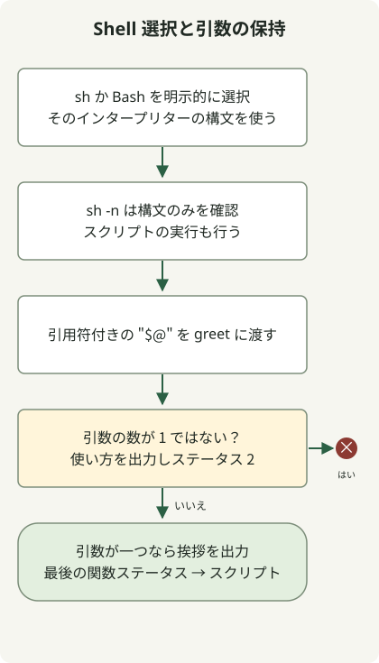

`#!/bin/sh` のスクリプトでは、`function` キーワードを使わず `hello() { ...; }` として関数を宣言します。Bash の構文が必要なら Bash を選び、それに合わせて実行します。`sh script.sh` として呼び出しても、ファイル内の Bash の shebang は適用されません。

[ShellCheck SC2112](https://www.shellcheck.net/wiki/SC2112) は、`function` が POSIX sh の構文ではないことを説明しています。ある `/bin/sh` の実装で受け付けられても、移植性が保証されるわけではありません。

## 処理の流れ



実際に呼び出したインタープリターが関数を解析します。この例では引数が一つであることを確認し、引用符によって空白とワイルドカードを保持します。

## 選んだ Shell に合わせて関数を書く

`greet.sh` として保存します。`"$1"` と `"$@"` を引用符で囲むことで、引数内の空白とワイルドカードを保持できます。

### `greet.sh`

```sh
#!/bin/sh
set -eu

greet() {
    if [ "$#" -ne 1 ]; then
        printf '%s\n' 'usage: greet.sh NAME' >&2
        return 2
    fi
    printf 'Hello, %s\n' "$1"
}

greet "$@"
```

```sh
sh -n greet.sh
sh greet.sh 'Ada Lovelace'
sh greet.sh 'Ada *'
```

出力は `Hello, Ada Lovelace` と `Hello, Ada *` です。`sh -n` は構文しか確認しないため、スクリプトの実行も行います。引数が不足または過剰な場合は使い方を stderr に出力し、終了ステータス 2 を返します。有効な引数の場合はステータス 0 です。

## shebang と明示したインタープリターを区別する

| 呼び出し | インタープリターの選択 |
| --- | --- |
| `sh greet.sh NAME` | 呼び出された `sh` がファイルを読みます。 |
| `bash greet.sh NAME` | Bash が読みます。 |
| `chmod +x greet.sh`、その後 `./greet.sh NAME` | この実行ではファイルの shebang が使われます。 |

Bash の配列や `[[ ... ]]` を使う場合は、`#!/usr/bin/env bash` とし、`bash script.sh` または実行可能な `./script.sh` で起動します。`sh script.sh` の呼び出しで Bash の構文が使えると考えないでください。[ShellCheck による Shell 選択の説明](https://www.shellcheck.net/wiki/SC2112)も参照してください。

関数の `return` は呼び出し元に制御とステータスを返します。`exit` は実行中の Shell を終了します。ここでは関数呼び出しが最後のコマンドなので、そのステータスがスクリプトの終了ステータスになります。

この例では空白とワイルドカードを含む引数、および不正な引数の数を確認しています。`/bin/sh` の実装には違いがあるため、デプロイ先の Shell でもテストしてください。次の自動化の手順として、入力と失敗時のステータスが同様に重要な[数値バージョンの比較](/en/posts/2023-11-17-linux-shellscript-version-compare/)や [GitHub リリースの検索](/en/posts/2023-09-23-linux-shellscript-github-latest/)を参照できます。
