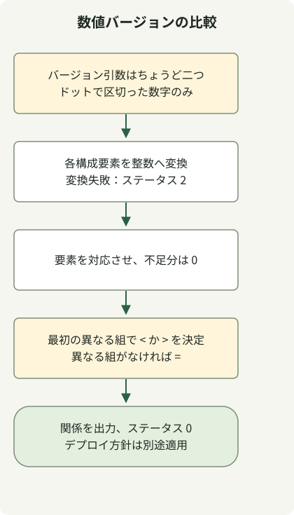

`1.10` と `1.2` を文字列や小数として比較してはいけません。整数の構成要素を左から右へ比較し、足りない末尾の要素をゼロで補います。このため `1.2` と `1.2.0` は等しくなります。この例は数値だけのドット区切りバージョンに限って、この規則を実装します。

`v1.2`、`1.2-rc1`、`1.2+build` は拒否します。[SemVer](https://semver.org/) のプレリリースの優先順位を扱う場合は、その仕様に対応したパーサーを使ってください。接尾辞を無条件に取り除くと意味が変わることがあります。

## 処理の流れ



数値のみという入力契約を検証し、不足する構成要素をゼロでそろえ、最初に異なる組で比較を確定します。小さいという結果も正常な比較です。

## 実行できる比較スクリプト

Python 3 が必要です。`version-compare.sh` として保存し、`sh` で呼び出します。

### `version-compare.sh`

```sh
#!/bin/sh
set -eu
python3 - "$@" <<'PYTHON'
import re
import sys
from itertools import zip_longest

if len(sys.argv) != 3 or any(not re.fullmatch(r"[0-9]+(?:\.[0-9]+)*", value) for value in sys.argv[1:]):
    print("usage: version-compare.sh CURRENT LATEST (numeric dotted versions)", file=sys.stderr)
    raise SystemExit(2)
current, latest = sys.argv[1:]
try:
    left = [int(part) for part in current.split('.')]
    right = [int(part) for part in latest.split('.')]
except ValueError:
    print("numeric component exceeds this Python runtime's conversion limit", file=sys.stderr)
    raise SystemExit(2)
comparison = 0
for a, b in zip_longest(left, right, fillvalue=0):
    if a != b:
        comparison = -1 if a < b else 1
        break
operator = '<' if comparison < 0 else '>' if comparison > 0 else '='
print(f"{current} {operator} {latest}")
PYTHON
```

```sh
sh version-compare.sh 1.10.5 1.3.1
sh version-compare.sh 1.2 1.2.0
sh version-compare.sh 1.1000 2.0
```

出力は `1.10.5 > 1.3.1`、`1.2 = 1.2.0`、`1.1000 < 2.0` です。有効な比較は大小関係によらずステータス 0 を返します。不正な引数の数、未対応の構文、数値変換の制限に該当する場合は、stderr に説明を出力してステータス 2 を返します。

| 入力 | 結果 |
| --- | --- |
| `1.2.0.0.1` と `1.2` | `1.2.0.0.1 > 1.2` |
| `01.002` と `1.2` | `01.002 = 1.2` |
| `1.2-rc1` と `1.2` | 未対応の形式、ステータス 2 |
| `1..2` と `1.2` | 未対応の形式、ステータス 2 |

## 固定幅の数値を連結しない理由

awk の `%03d` のような幅は最小表示幅であり、構成要素の最大桁数ではありません。そのフィールドを Shell の整数に詰め込むと、大きな値や構成要素の追加によって元の順序関係が失われることがあります。

この例では各構成要素を Python の整数に変換し、[`zip_longest(..., fillvalue=0)`](https://docs.python.org/3/library/itertools.html#itertools.zip_longest) で長さをそろえます。実行環境が数値変換を拒否した場合は、比較の成功として扱いません。

デプロイの自動化では、比較結果とコマンドの成功は別々に判断します。このスクリプトは、現在のバージョンが低いというだけでは失敗しません。stdout から大小関係を読み取ってから、運用の方針を適用してください。[GitHub のリリースタグ](/en/posts/2023-09-23-linux-shellscript-github-latest/)がこの数値構文に従うとは限らないため、無条件に渡してはいけません。インタープリターの選択については、[POSIX sh の関数例](/en/posts/2023-09-20-linux-shellscript-function-error/)を参照してください。
