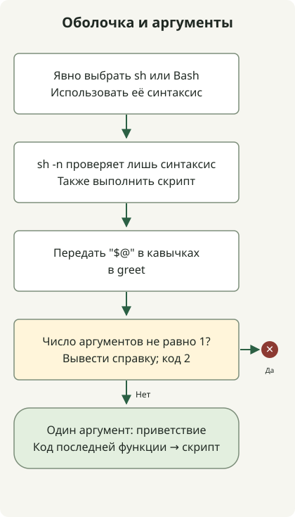

В скрипте с `#!/bin/sh` объявляйте функцию как `hello() { ...; }`, без ключевого слова `function`. Если нужна синтаксическая конструкция Bash, выберите Bash и вызывайте скрипт соответствующим образом. Вызов `sh script.sh` не следует shebang для Bash, указанному в файле.

[ShellCheck SC2112](https://www.shellcheck.net/wiki/SC2112) объясняет, что `function` не относится к синтаксису POSIX sh. Поддержка этого слова конкретной реализацией `/bin/sh` не доказывает переносимость.

## Порядок обработки



Функцию разбирает вызванный интерпретатор. Пример проверяет наличие ровно одного аргумента и сохраняет пробелы и символы подстановки с помощью кавычек.

## Пишем функцию для выбранной оболочки

Сохраните код в `greet.sh`. Кавычки в `"$1"` и `"$@"` сохраняют пробелы и символы подстановки в аргументах.

### `greet.sh`

```sh
#!/bin/sh
set -eu

greet() {
    if [ "$#" -ne 1 ]; then
        printf '%s\n' 'usage: greet.sh NAME' >&2
        return 2
    fi
    printf 'Hello, %s\n' "$1"
}

greet "$@"
```

```sh
sh -n greet.sh
sh greet.sh 'Ada Lovelace'
sh greet.sh 'Ada *'
```

Вывод: `Hello, Ada Lovelace` и `Hello, Ada *`. Команда `sh -n` проверяет только синтаксис, поэтому скрипт нужно также выполнить. При отсутствии аргумента или лишних аргументах сообщение об использовании выводится в stderr, а код завершения равен 2. Для допустимого аргумента код равен 0.

## Отличаем shebang от явно указанного интерпретатора

| Вызов | Выбор интерпретатора |
| --- | --- |
| `sh greet.sh NAME` | Файл читает вызванный `sh`. |
| `bash greet.sh NAME` | Его читает Bash. |
| `chmod +x greet.sh`, затем `./greet.sh NAME` | При таком запуске используется shebang файла. |

Для массивов Bash или `[[ ... ]]` используйте `#!/usr/bin/env bash` и запускайте `bash script.sh` либо исполняемый `./script.sh`. Не рассчитывайте на синтаксис Bash при вызове `sh script.sh`. См. [пояснение ShellCheck о выборе оболочки](https://www.shellcheck.net/wiki/SC2112).

`return` функции возвращает управление и код вызывающей стороне. `exit` завершает работающую оболочку. Здесь вызов функции — последняя команда, поэтому её код становится кодом завершения скрипта.

Пример проверен с аргументами, содержащими пробелы и символы подстановки, а также с недопустимым числом аргументов. Реализации `/bin/sh` различаются, поэтому проверяйте и в оболочке целевой среды. Следующий шаг автоматизации — [сравнение числовых версий](/en/posts/2023-11-17-linux-shellscript-version-compare/) или [поиск релиза GitHub](/en/posts/2023-09-23-linux-shellscript-github-latest/), где также важны входные данные и коды ошибок.
