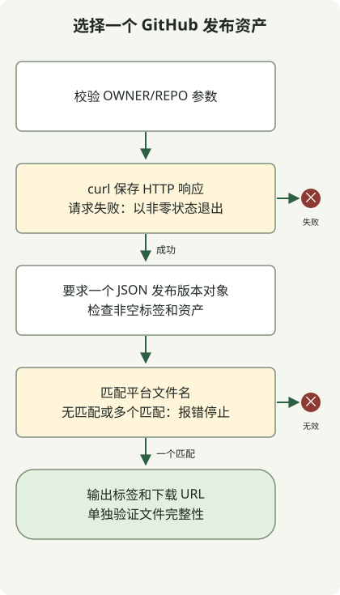

用 `curl` 获取 GitHub 最新发布版本，再用 `jq` 为所需操作系统、CPU 和格式选择恰好一个下载资产。下方脚本遇到 HTTP 错误、无效 JSON、无匹配或重复匹配时会停止；它返回元数据，不下载文件。

`releases/latest` 端点不会计算数值最大的 Git 标签。[发布版本 API 文档](https://docs.github.com/en/rest/releases/releases#get-the-latest-release)区分了普通标签、草稿、预发布版本和已发布版本。

本示例从公开的 `adoptium/temurin17-binaries` 仓库查询 Linux x64 HotSpot JDK tar.gz 的元数据。它既不需要令牌，也不会实际下载文件。省略仓库参数时使用该默认值；显式传入空参数则会被拒绝。

## 处理流程



HTTP 失败会在解析 JSON 前终止脚本。有效的发布版本对象必须恰好包含一个匹配资产；选出其 URL 不等于验证下载的文件。

## 区分 HTTP 失败与 JSON 选择失败

脚本需要 `curl`、`jq` 和 POSIX sh。将它保存为 `latest-release.sh`。

### `latest-release.sh`

```sh
#!/bin/sh
set -eu
if [ "$#" -gt 1 ]; then
    printf '%s\n' 'usage: latest-release.sh OWNER/REPO' >&2
    exit 2
fi
repo=${1-adoptium/temurin17-binaries}
case "$repo" in
    */*/*|/*|*/|*[!A-Za-z0-9_./-]*) printf '%s\n' 'usage: latest-release.sh OWNER/REPO' >&2; exit 2 ;;
esac
case "$repo" in
    */*) ;;
    *) printf '%s\n' 'usage: latest-release.sh OWNER/REPO' >&2; exit 2 ;;
esac
api=${GITHUB_API_URL:-https://api.github.com}
response=$(curl --fail --silent --show-error --location --max-time 20 \
    --header 'Accept: application/vnd.github+json' \
    --header 'X-GitHub-Api-Version: 2026-03-10' \
    "$api/repos/$repo/releases/latest") || exit 1
printf '%s' "$response" | jq --slurp --exit-status '
    if length != 1 or (.[0] | type) != "object" then
        error("expected one release object")
    else .[0] end
    | . as $release
    | if (.tag_name | type) != "string" or (.tag_name | length) == 0
         or (.assets | type) != "array" then
        error("missing release tag or assets")
      else . end
    | [.assets[] | select(.name | test("^OpenJDK17U-jdk_x64_linux_hotspot_.*\\.tar\\.gz$"))] as $assets
    | if ($assets | length) != 1 then
        error("expected exactly one Linux x64 JDK tar.gz asset")
      elif ($assets[0].browser_download_url | type) != "string"
           or ($assets[0].browser_download_url | length) == 0 then
        error("missing asset download URL")
      else {tag_name: $release.tag_name, download_url: $assets[0].browser_download_url} end
'
```

```sh
sh latest-release.sh adoptium/temurin17-binaries
```

成功结果是带有 `tag_name` 和 `download_url` 的 JSON 对象。具体值取决于请求时的发布版本。以下示例是展示结构的测试数据，并非对当前最新发布版本的断言：

```json
{"tag_name":"jdk-17.0.8.1+1","download_url":"https://github.com/adoptium/temurin17-binaries/releases/download/example/OpenJDK17U-jdk_x64_linux_hotspot_example.tar.gz"}
```

`curl --fail` 首先处理 HTTP 错误。在解析前先保存响应，可避免管道中的最后一条命令掩盖网络失败。参阅 [curl 选项](https://curl.se/docs/manpage.html)。

`jq --slurp` 将全部输入读入数组。要求恰好一个 JSON 值，也能拒绝空响应。过滤器随后检查发布版本对象、标签和资产数组，只有恰好一个文件名匹配时才输出结果。参阅 [jq 手册](https://jqlang.org/manual/)。

## 自动化需要处理的结果

| 条件 | 结果 |
| --- | --- |
| 响应有效且恰好一个资产匹配 | 输出 JSON，状态 0。 |
| HTTP403/404 或连接失败 | 非零状态。 |
| 响应体为空或 JSON 格式错误 | 非零状态。 |
| 无匹配资产或存在多个匹配资产 | 报错，不随意选择。 |
| 仓库参数语法无效 | 输出用法说明，状态 2。 |

示例使用本地 HTTP 响应检查了成功、HTTP 错误、无效 JSON、资产缺失和重复匹配。`GITHUB_API_URL` 默认为公开 API，也可设为实现同一响应约定的测试服务器。

读取公开资源不要求认证。如果扩展为带认证的请求，应避免将令牌写入源码或 Shell 跟踪日志。检查速率限制响应头，并参阅 [GitHub 的速率限制文档](https://docs.github.com/en/rest/using-the-rest-api/rate-limits-for-the-rest-api)。

脚本只选择 URL，并不验证安装文件的完整性。安装自动化仍需处理提供方的校验和或签名，以及目标平台。在把标签交给[数字版本比较器](/en/posts/2023-11-17-linux-shellscript-version-compare/)之前，应检查它是否满足该脚本的输入约定。
