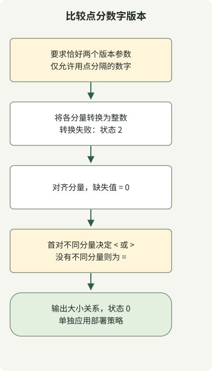

不要把 `1.10` 和 `1.2` 当作字符串或小数比较。应从左到右比较整数分量，并用零补齐末尾缺失的分量；因此 `1.2` 等于 `1.2.0`。本示例仅对点分数字版本实现这条规则。

它拒绝 `v1.2`、`1.2-rc1` 和 `1.2+build`。若需要 [SemVer](https://semver.org/) 的预发布版本优先级，应使用遵循该规范的解析器。盲目删除后缀可能改变含义。

## 处理流程



校验输入是否符合纯数字约定，用零对齐缺失分量，并在遇到首对不同分量时停止比较。小于的结果仍然属于成功完成的比较。

## 可运行的比较脚本

需要 Python 3。将代码保存为 `version-compare.sh`，并用 `sh` 调用。

### `version-compare.sh`

```sh
#!/bin/sh
set -eu
python3 - "$@" <<'PYTHON'
import re
import sys
from itertools import zip_longest

if len(sys.argv) != 3 or any(not re.fullmatch(r"[0-9]+(?:\.[0-9]+)*", value) for value in sys.argv[1:]):
    print("usage: version-compare.sh CURRENT LATEST (numeric dotted versions)", file=sys.stderr)
    raise SystemExit(2)
current, latest = sys.argv[1:]
try:
    left = [int(part) for part in current.split('.')]
    right = [int(part) for part in latest.split('.')]
except ValueError:
    print("numeric component exceeds this Python runtime's conversion limit", file=sys.stderr)
    raise SystemExit(2)
comparison = 0
for a, b in zip_longest(left, right, fillvalue=0):
    if a != b:
        comparison = -1 if a < b else 1
        break
operator = '<' if comparison < 0 else '>' if comparison > 0 else '='
print(f"{current} {operator} {latest}")
PYTHON
```

```sh
sh version-compare.sh 1.10.5 1.3.1
sh version-compare.sh 1.2 1.2.0
sh version-compare.sh 1.1000 2.0
```

输出为 `1.10.5 > 1.3.1`、`1.2 = 1.2.0` 和 `1.1000 < 2.0`。有效比较无论大小关系如何，均返回状态 0。参数数量错误、语法不受支持或触及数字转换限制时，会向 stderr 解释原因并返回状态 2。

| 输入 | 结果 |
| --- | --- |
| `1.2.0.0.1` 和 `1.2` | `1.2.0.0.1 > 1.2` |
| `01.002` 和 `1.2` | `01.002 = 1.2` |
| `1.2-rc1` 和 `1.2` | 格式不受支持，状态 2 |
| `1..2` 和 `1.2` | 格式不受支持，状态 2 |

## 为什么不拼接固定宽度的数字？

awk 的 `%03d` 这类宽度表示最小显示宽度，并非分量长度的上限。把这些字段拼进 Shell 整数，在数值较大或分量较多时可能丢失原本的顺序关系。

本示例将各分量转换为 Python 整数，并用 [`zip_longest(..., fillvalue=0)`](https://docs.python.org/3/library/itertools.html#itertools.zip_longest)对齐长度。运行时拒绝数字转换时，不会将其视为比较成功。

在部署自动化中，大小比较与命令执行成功是两个独立判断。该脚本不会仅因当前版本较低就报错；应先从 stdout 读取大小关系，再应用自己的策略。[GitHub 发布版本标签](/en/posts/2023-09-23-linux-shellscript-github-latest/)不一定采用这种数字语法，因此不能未经检查就直接传入。解释器的选择可参阅 [POSIX sh 函数示例](/en/posts/2023-09-20-linux-shellscript-function-error/)。
