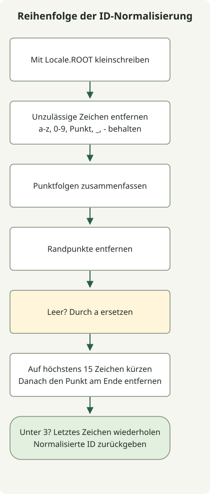

Die ID-Normalisierung hängt von der Reihenfolge der Umformungen ab. Entfernen Sie insbesondere nach der Kürzung auf 15 Zeichen erneut einen abschließenden Punkt. Das frühere Entfernen des ursprünglichen abschließenden Punkts verhindert nicht, dass die Kürzung einen weiteren freilegt.

Die [Aufgabenregeln](https://school.programmers.co.kr/learn/courses/30/lessons/72410) normalisieren die ASCII-Groß-/Kleinschreibung, behalten zulässige Zeichen und behandeln danach Punkte, leere Ergebnisse und Länge in dieser Reihenfolge. Beide Lösungen setzen die von der Aufgabe garantierte nicht-null Eingabe voraus. Die Optional-Lösung verwendet `repeat()` aus Java 11; beide lassen sich für Java 11 kompilieren. Speichern Sie eine der Lösungen als `Solution.java`, statt beide Klassen in eine Datei zu schreiben.

## Ablauf



Das Diagramm folgt der Optional-Version. Die Schleife kombiniert Filterung und Punktzusammenfassung unter Beibehaltung derselben Regeln.

## Schritte mit Optional verbinden

```java
import java.util.Locale;
import java.util.Optional;

public class Solution {
    public String solution(String new_id) {
        return Optional.of(new_id)
                .map(s -> s.toLowerCase(Locale.ROOT))
                .map(s -> s.replaceAll("[^a-z0-9._-]", ""))
                .map(s -> s.replaceAll("[.]+", "."))
                .map(s -> s.replaceAll("^[.]|[.]$", ""))
                .map(s -> s.isEmpty() ? "a" : s)
                .map(s -> s.length() > 15 ? s.substring(0, 15) : s)
                .map(s -> s.replaceAll("[.]$", ""))
                .map(s -> s.length() < 3
                        ? s + s.substring(s.length() - 1).repeat(3 - s.length()) : s)
                .orElseThrow();
    }
}
```

`Locale.ROOT` verhindert, dass die Kleinschreibung von der Standard-Locale abhängt. Das Zeichenmuster behält nur kleine ASCII-Buchstaben, Ziffern, Punkte, Unterstriche und Bindestriche. Fassen Sie Punktfolgen zusammen und entfernen Sie Randpunkte. Ersetzen Sie ein leeres Ergebnis durch `a`, kürzen Sie auf 15 Zeichen, entfernen Sie den neu freigelegten Punkt am Ende und wiederholen Sie das letzte Zeichen bis zur Länge 3.

Optional verbindet Umformungen, ist aber keine vorgeschriebene Datenstruktur. `Optional.of` weist null zurück, statt es stillschweigend als leere ID zu behandeln.

## Dieselben Regeln mit einer Schleife anwenden

Diese Lösung kombiniert das Filtern zulässiger Zeichen und das Entfernen aufeinanderfolgender Punkte in einem Durchlauf. Nur ASCII-Großbuchstaben umzuwandeln entspricht dem Eingabebereich der Aufgabe; dies ist keine allgemeine Unicode-Namensnormalisierung.

```java
import java.util.Objects;

public class Solution {
    public String solution(String new_id) {
        Objects.requireNonNull(new_id);
        StringBuilder result = new StringBuilder();
        for (char input : new_id.toCharArray()) {
            char c = input >= 'A' && input <= 'Z' ? (char) (input + 32) : input;
            boolean allowed = (c >= 'a' && c <= 'z') || (c >= '0' && c <= '9')
                    || c == '-' || c == '_' || c == '.';
            if (!allowed || (c == '.' && (result.length() == 0
                    || result.charAt(result.length() - 1) == '.'))) continue;
            result.append(c);
        }
        if (result.length() > 0 && result.charAt(result.length() - 1) == '.') {
            result.setLength(result.length() - 1);
        }
        if (result.length() == 0) result.append('a');
        if (result.length() > 15) result.setLength(15);
        if (result.charAt(result.length() - 1) == '.') result.setLength(result.length() - 1);
        while (result.length() < 3) result.append(result.charAt(result.length() - 1));
        return result.toString();
    }
}
```

| Eingabe | Ergebnis | Geprüfte Regel |
| --- | --- | --- |
| `=.=` | `aaa` | Ersatz und Auffüllen beim leeren Ergebnis |
| `z-+.^.` | `z--` | Zulässige Zeichen und Entfernen des abschließenden Punkts |
| `I` | `iii` | Kleinschreibung unabhängig von der Standard-Locale |
| `abcdefghijklmn.op` | `abcdefghijklmn` | Entfernung des durch Kürzung freigelegten Punkts |

Beide Lösungen benötigen O(n) Zeit in der Eingabelänge n und O(n) zusätzlichen Speicher. Die Regex-Version kann mehrere Zwischenzeichenketten anlegen, während die Schleife einen StringBuilder verwendet. Ohne Messungen folgt daraus nicht, dass eine Variante immer schneller ist. Details zu Ersetzung, Kleinschreibung und Wiederholung stehen in der [String-API](https://docs.oracle.com/en/java/javase/11/docs/api/java.base/java/lang/String.html).

Für wörtliche Ziffernwortersetzungen siehe [replace und replaceAll](/en/posts/2021-07-23-number-word/). Für Locale-unabhängige Cacheschlüssel siehe [das LRU-Cache-Beispiel](/en/posts/2021-08-17-cache/).
