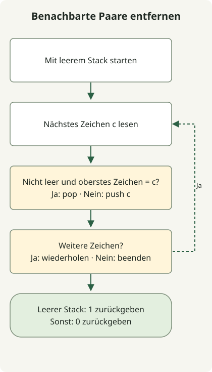

Ein Stack entfernt benachbarte gleiche Zeichenpaare in einem Durchlauf, indem er das reduzierte Ergebnis des bereits gelesenen Präfixes aufbewahrt. Entspricht das nächste Zeichen dem obersten Element, wird das Paar entfernt; andernfalls wird es auf den Stack gelegt.

Die [Aufgabe](https://school.programmers.co.kr/learn/courses/30/lessons/12973) akzeptiert 1–1.000.000 englische Kleinbuchstaben und liefert 1, wenn alles entfernt werden kann, sonst 0. Gerade Gesamtanzahlen je Zeichen reichen nicht aus, weil die Entfernung von der Nachbarschaft abhängt.

## Ablauf



Der Stack enthält das reduzierte Präfix. Jedes neue Zeichen entfernt das gleiche oberste Element oder wird selbst zum obersten Element.

## Das reduzierte Präfix behalten

Speichern Sie die vollständige Klasse als `Solution.java`. Der Code des Ausgangsartikels wurde für Java 11 kompiliert und auf JDK 17 ausgeführt.

```java
import java.util.ArrayDeque;
import java.util.Deque;

public class Solution {
    public int solution(String s) {
        Deque<Character> stack = new ArrayDeque<>();
        for (int i = 0; i < s.length(); i++) {
            char c = s.charAt(i);
            if (!stack.isEmpty() && stack.peek() == c) stack.pop();
            else stack.push(c);
        }
        return stack.isEmpty() ? 1 : 0;
    }
}
```

Der Stack enthält das verarbeitete Präfix ohne verbleibende benachbarte gleiche Paare. Ein passendes nächstes Zeichen erzeugt an der Grenze ein entfernbares Paar: also pop. Ein anderes Zeichen erzeugt kein solches Paar: also push. Danach gilt dieselbe Invariante für den nächsten Schritt.

| Gelesenes Zeichen | Stack: unten → oben |
| --- | --- |
| b | b |
| a | ba |
| a | b |
| b | leer |
| a | a |
| a | leer |

Damit liefert `baabaa` den Wert 1. Dagegen liefert `abab` trotz gerader Anzahlen beider Zeichen 0: Gleiche Zeichen sind nicht benachbart. Der Stack verarbeitet die durch Entfernen freigelegten Grenzen, ohne wiederholt die gesamte Zeichenkette zu ersetzen.

## ArrayDeque und Komplexität

Verwenden Sie [`ArrayDeque`](https://docs.oracle.com/en/java/javase/17/docs/api/java.base/java/util/ArrayDeque.html) über die Deque-Operationen `push`, `peek` und `pop`. Weil `c` ein primitiver char ist, entpackt `stack.peek() == c` Character für den Vergleich; es vergleicht nicht die Objektidentität.

Jedes Zeichen wird höchstens einmal auf den Stack gelegt und höchstens einmal entfernt. Mit amortisierten Deque-Operationen beträgt die Laufzeit O(n); der zusätzliche Speicherbedarf ist im schlimmsten Fall O(n), wenn Zeichen verbleiben. Die Ausführungsprüfungen des Ausgangsartikels umfassen eine Million gleiche Zeichen und eine Million abwechselnde Zeichen ohne entfernbare Paare. Dies sind Grenzprüfungen, keine Geschwindigkeitsbenchmarks oder Speichergarantie für jede Umgebung.

Was aufbewahrt werden muss, hängt von der Aufgabe ab: [Die Aufgabe zum fehlenden Läufer](/en/posts/2021-07-23-unsuccessful-runner/) benötigt Namenshäufigkeiten statt der Nachbarschaftsreihenfolge.
