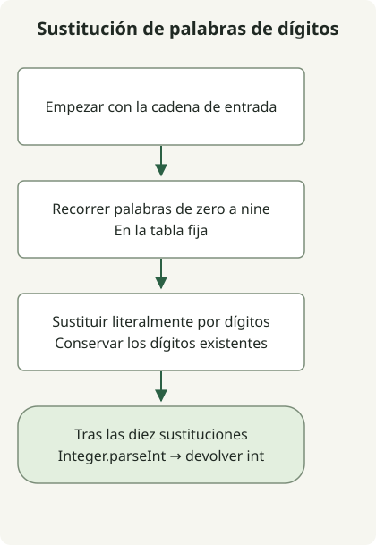

Para una entrada válida que mezcla dígitos y palabras de dígitos, sustituye las palabras fijas de `zero` a `nine` por dígitos y analiza el entero resultante. Los términos de búsqueda son literales, así que basta con `String.replace`, sin `replaceAll`.

El [ejercicio](https://school.programmers.co.kr/learn/courses/30/lessons/81301) garantiza palabras válidas en minúsculas y dígitos, un resultado de 1 a 2 000 000 000 y ningún cero inicial. No es un analizador de expresiones numéricas generales en inglés.

## Flujo de procesamiento



Sustituye literalmente las palabras fijas de zero a nine por dígitos y después analiza la cadena decimal resultante.

## Sustituir las diez palabras fijas

Guarda la clase completa como `Solution.java`. No hacen falta imports adicionales; el código del artículo original se compiló y ejecutó con Java 11 como objetivo.

```java
public class Solution {
    public int solution(String s) {
        String[] words = {"zero", "one", "two", "three", "four",
                "five", "six", "seven", "eight", "nine"};
        for (int digit = 0; digit < words.length; digit++) {
            s = s.replace(words[digit], Integer.toString(digit));
        }
        return Integer.parseInt(s);
    }
}
```

[`String.replace(CharSequence, CharSequence)`](https://docs.oracle.com/en/java/javase/11/docs/api/java.base/java/lang/String.html) realiza sustitución literal. `replaceAll` interpreta su primer argumento como una expresión regular. Ninguna de las diez palabras necesita aquí sintaxis de expresiones regulares.

Por ejemplo, `one4seveneight` se convierte en `1478` y `23four5six7` en `234567`. Una entrada que ya contiene solo dígitos, como `123`, sigue dando 123. `two` seguido de nueve palabras `zero` produce 2 000 000 000, dentro del rango de int.

Los dígitos de sustitución no pueden introducir otra palabra de dígito, y ninguna de las diez palabras contiene otra del conjunto, por lo que este orden funciona. Las palabras inválidas, espacios, mayúsculas y números fuera de rango quedan fuera de las garantías del ejercicio. Este método no repara un fallo de análisis de una entrada arbitraria convirtiéndolo en un entero válido.

Con diez palabras fijas, el tiempo es O(n) respecto a la longitud de entrada. Las cadenas son inmutables y pueden asignarse cadenas intermedias durante las sustituciones; el espacio adicional es O(n). Ningún benchmark demuestra que este método sea más rápido que otros analizadores para estas entradas pequeñas.

Compara la [normalización de un nuevo ID](/en/posts/2021-07-19-new-id/) para una transformación donde las expresiones regulares resultan útiles.
