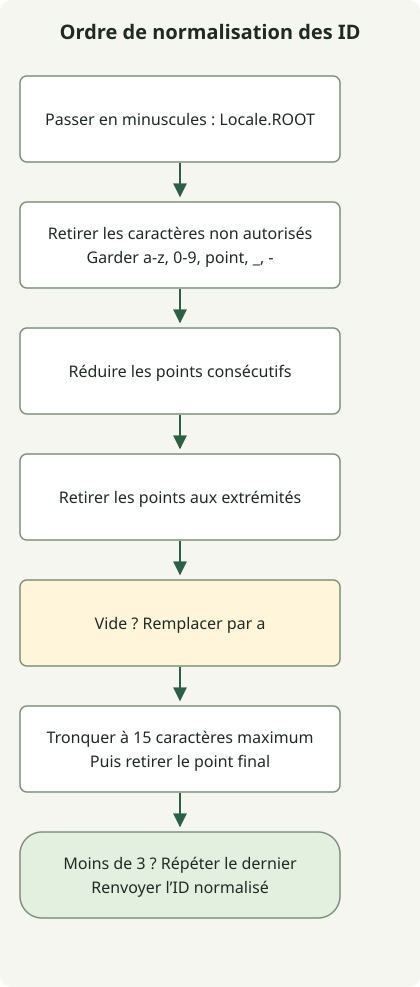

La normalisation d’un identifiant dépend de l’ordre des transformations. En particulier, retirez de nouveau le point final après la troncature à 15 caractères. Retirer plus tôt le point final d’origine n’empêche pas la troncature d’en exposer un autre.

Les [règles de l’exercice](https://school.programmers.co.kr/learn/courses/30/lessons/72410) normalisent la casse ASCII, conservent les caractères autorisés, puis traitent dans l’ordre les points, le résultat vide et la longueur. Les deux solutions supposent l’entrée non null garantie par l’exercice. La solution Optional utilise `repeat()` de Java 11 et les deux se compilent pour Java 11. Enregistrez l’une des solutions dans `Solution.java`, sans mettre les deux classes dans un même fichier.

## Déroulement



Le schéma suit la version Optional. La boucle combine filtrage et réduction des points consécutifs en préservant les mêmes règles.

## Relier les étapes avec Optional

```java
import java.util.Locale;
import java.util.Optional;

public class Solution {
    public String solution(String new_id) {
        return Optional.of(new_id)
                .map(s -> s.toLowerCase(Locale.ROOT))
                .map(s -> s.replaceAll("[^a-z0-9._-]", ""))
                .map(s -> s.replaceAll("[.]+", "."))
                .map(s -> s.replaceAll("^[.]|[.]$", ""))
                .map(s -> s.isEmpty() ? "a" : s)
                .map(s -> s.length() > 15 ? s.substring(0, 15) : s)
                .map(s -> s.replaceAll("[.]$", ""))
                .map(s -> s.length() < 3
                        ? s + s.substring(s.length() - 1).repeat(3 - s.length()) : s)
                .orElseThrow();
    }
}
```

`Locale.ROOT` évite de faire dépendre la conversion en minuscules de la locale par défaut. Le motif conserve uniquement les lettres ASCII minuscules, chiffres, points, traits de soulignement et traits d’union. Réduisez les suites de points et retirez ceux des extrémités. Remplacez un résultat vide par `a`, tronquez à 15 caractères, retirez le point final nouvellement exposé, puis répétez le dernier caractère jusqu’à une longueur de 3.

Optional sert à relier les transformations, sans être une structure de données imposée. `Optional.of` rejette null au lieu de le traiter silencieusement comme un identifiant vide.

## Appliquer les mêmes règles avec une boucle

Cette solution combine en un seul passage le filtrage des caractères autorisés et la suppression des points consécutifs. Convertir uniquement les majuscules ASCII repose sur la plage d’entrée de l’exercice ; ce n’est pas une normalisation générale des noms Unicode.

```java
import java.util.Objects;

public class Solution {
    public String solution(String new_id) {
        Objects.requireNonNull(new_id);
        StringBuilder result = new StringBuilder();
        for (char input : new_id.toCharArray()) {
            char c = input >= 'A' && input <= 'Z' ? (char) (input + 32) : input;
            boolean allowed = (c >= 'a' && c <= 'z') || (c >= '0' && c <= '9')
                    || c == '-' || c == '_' || c == '.';
            if (!allowed || (c == '.' && (result.length() == 0
                    || result.charAt(result.length() - 1) == '.'))) continue;
            result.append(c);
        }
        if (result.length() > 0 && result.charAt(result.length() - 1) == '.') {
            result.setLength(result.length() - 1);
        }
        if (result.length() == 0) result.append('a');
        if (result.length() > 15) result.setLength(15);
        if (result.charAt(result.length() - 1) == '.') result.setLength(result.length() - 1);
        while (result.length() < 3) result.append(result.charAt(result.length() - 1));
        return result.toString();
    }
}
```

| Entrée | Résultat | Règle vérifiée |
| --- | --- | --- |
| `=.=` | `aaa` | Valeur de repli et remplissage du résultat vide |
| `z-+.^.` | `z--` | Caractères autorisés et suppression du point final |
| `I` | `iii` | Minuscules indépendantes de la locale par défaut |
| `abcdefghijklmn.op` | `abcdefghijklmn` | Suppression du point exposé par la troncature |

Les deux solutions prennent O(n) en temps pour une entrée de longueur n et O(n) d’espace supplémentaire. La version regex peut allouer plusieurs chaînes intermédiaires, tandis que la boucle utilise un StringBuilder. Sans mesures, cela ne prouve pas qu’une version est toujours plus rapide. Consultez l’[API String](https://docs.oracle.com/en/java/javase/11/docs/api/java.base/java/lang/String.html) pour le remplacement, la conversion en minuscules et la répétition.

Pour le remplacement littéral des mots de chiffres, consultez [replace et replaceAll](/en/posts/2021-07-23-number-word/). Pour des clés de cache indépendantes de la locale, consultez [l’exemple de cache LRU](/en/posts/2021-08-17-cache/).
