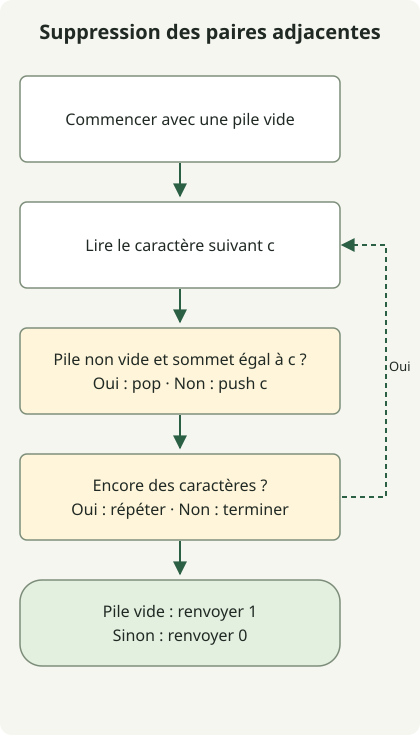

Une pile supprime les paires de caractères identiques adjacents en un seul parcours, en conservant le résultat réduit du préfixe déjà lu. Si le caractère suivant correspond au sommet, supprimez la paire ; sinon, empilez-le.

L’[exercice](https://school.programmers.co.kr/learn/courses/30/lessons/12973) accepte 1–1 000 000 lettres anglaises minuscules et renvoie 1 si tout peut être supprimé, ou 0 sinon. Des nombres totaux pairs pour chaque caractère ne suffisent pas, car la suppression dépend de l’adjacence.

## Déroulement



La pile conserve le préfixe réduit. Chaque nouveau caractère supprime le sommet identique ou devient le nouveau sommet.

## Conserver le préfixe réduit

Enregistrez la classe complète dans `Solution.java`. Le code de l’article source a été compilé pour Java 11 et exécuté sur JDK 17.

```java
import java.util.ArrayDeque;
import java.util.Deque;

public class Solution {
    public int solution(String s) {
        Deque<Character> stack = new ArrayDeque<>();
        for (int i = 0; i < s.length(); i++) {
            char c = s.charAt(i);
            if (!stack.isEmpty() && stack.peek() == c) stack.pop();
            else stack.push(c);
        }
        return stack.isEmpty() ? 1 : 0;
    }
}
```

La pile contient le préfixe traité sans aucune paire identique adjacente restante. Un caractère suivant identique crée une paire supprimable à la frontière : on dépile. Un caractère différent ne crée pas cette paire : on l’empile. Le même invariant vaut alors pour l’étape suivante.

| Caractère lu | Pile : bas → sommet |
| --- | --- |
| b | b |
| a | ba |
| a | b |
| b | vide |
| a | a |
| a | vide |

Ainsi, `baabaa` renvoie 1. À l’inverse, `abab` renvoie 0 malgré les nombres pairs des deux caractères : aucun caractère identique n’est adjacent. La pile gère les frontières exposées par la suppression sans remplacer le texte de toute la chaîne à répétition.

## ArrayDeque et complexité

Utilisez [`ArrayDeque`](https://docs.oracle.com/en/java/javase/17/docs/api/java.base/java/util/ArrayDeque.html) avec les opérations `push`, `peek` et `pop` de Deque. Comme `c` est un char primitif, `stack.peek() == c` déballe Character pour la comparaison ; il ne compare pas l’identité des objets.

Chaque caractère est empilé au plus une fois et dépilé au plus une fois. Avec les opérations amorties de la deque, le temps est O(n) et l’espace supplémentaire au pire est O(n) lorsque des caractères restent. Les vérifications d’exécution de l’article source incluent un million de caractères répétés et un million de caractères alternés sans paires supprimables. Ce sont des vérifications aux limites, pas un benchmark de vitesse ni une garantie mémoire pour tout environnement.

L’information à conserver dépend du problème : [l’exercice du coureur manquant](/en/posts/2021-07-23-unsuccessful-runner/) nécessite des fréquences de noms plutôt que l’ordre adjacent.
