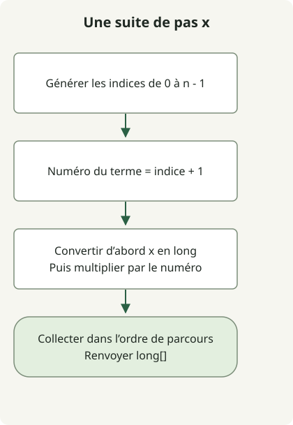

Les n valeurs à partir de x vont de `x × 1` à `x × n`. Comme les résultats peuvent dépasser la plage de int, le tableau de résultat et **la multiplication elle-même** doivent utiliser long.

L’[exercice](https://school.programmers.co.kr/learn/courses/30/lessons/12954) borne x entre -10 000 000 et 10 000 000, et n entre 1 et 1 000. La valeur absolue du dernier terme peut donc atteindre 10 000 000 000, ce qui nécessite un tableau de long.

## Déroulement



Transformer les indices commençant à zéro en numéros de termes, convertir x en long avant la multiplication, puis collecter dans l’ordre.

## Transformer un indice en numéro de terme

Enregistrez cette classe complète dans `Solution.java`. Le code de l’article source a été compilé pour Java 11 et exécuté sur JDK 17.

```java
import java.util.stream.IntStream;

public class Solution {
    public long[] solution(int x, int n) {
        return IntStream.range(0, n)
                .mapToLong(i -> (long) x * (i + 1))
                .toArray();
    }
}
```

[`IntStream.range(0, n)`](https://docs.oracle.com/en/java/javase/17/docs/api/java.base/java/util/stream/IntStream.html) génère les indices de 0 à n-1. Multiplier par `i + 1` donne x comme première valeur et x×n comme dernière. Commencer à x×0 changerait la suite demandée.

| x | n | Résultat |
| --- | --- | --- |
| 2 | 5 | `[2,4,6,8,10]` |
| -4 | 2 | `[-4,-8]` |
| 0 | 3 | `[0,0,0]` |

Un x négatif produit des valeurs décroissantes, tandis que x=0 ne produit que des zéros. Préservez l’ordre des termes : ce n’est pas un problème de tri.

## mapToLong seul ne protège pas le produit

Même dans `mapToLong`, évaluer d’abord `x * (i + 1)` effectue une multiplication de int, car les deux opérandes sont des int. `(long) (x * (i + 1))` convertit également après le dépassement.

L’exemple élargit d’abord un opérande avec `(long) x * (i + 1)`. Les vérifications de l’article source comparent les tableaux de référence complets se terminant par 10 000 000 000 et -10 000 000 000 aux bornes positive et négative. Des entrées positives, négatives et nulles plus petites sont aussi comparées à des tableaux construits par additions répétées.

Le temps est O(n) et l’espace, tableau retourné compris, est O(n). Cette implémentation respecte les conditions de l’exercice ; elle ne valide pas de manière générale la taille de la suite ou des entrées d’API arbitraires.

Comparez les [sommes signées](/en/posts/2021-07-22-plus-minus/) et les [produits scalaires de tableaux](/en/posts/2021-07-22-dot-product/) pour des calculs qui tiennent dans int selon leurs bornes. Le [parcours d’exercices Java](/en/categories/coding-test/) relie les calculs sur les tableaux aux chaînes et collections.
