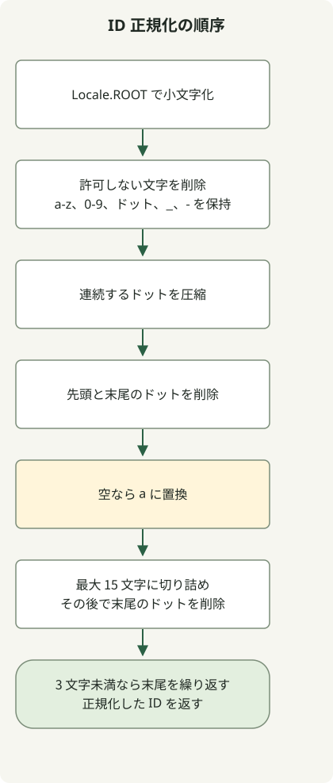

ID の正規化は変換順序に依存します。特に 15 文字に切り詰めた後、末尾のドットをもう一度削除します。元の末尾のドットを先に削除しても、切り詰めによって別のドットが末尾に現れることは防げません。

[問題の規則](https://school.programmers.co.kr/learn/courses/30/lessons/72410)では、ASCII 文字の大小を正規化し、許可された文字を残してから、ドット・空の結果・長さを順番に処理します。両解法とも、問題が保証する非 null の入力を前提とします。Optional 版は Java 11 の `repeat()` を使い、両方とも Java 11 向けにコンパイルできます。どちらかを `Solution.java` として保存し、二つのクラスを同じファイルに入れないでください。

## 処理の流れ



図は Optional 版の流れです。ループ版はフィルターと連続するドットの圧縮をまとめ、同じ規則を保ちます。

## Optional で手順をつなぐ

```java
import java.util.Locale;
import java.util.Optional;

public class Solution {
    public String solution(String new_id) {
        return Optional.of(new_id)
                .map(s -> s.toLowerCase(Locale.ROOT))
                .map(s -> s.replaceAll("[^a-z0-9._-]", ""))
                .map(s -> s.replaceAll("[.]+", "."))
                .map(s -> s.replaceAll("^[.]|[.]$", ""))
                .map(s -> s.isEmpty() ? "a" : s)
                .map(s -> s.length() > 15 ? s.substring(0, 15) : s)
                .map(s -> s.replaceAll("[.]$", ""))
                .map(s -> s.length() < 3
                        ? s + s.substring(s.length() - 1).repeat(3 - s.length()) : s)
                .orElseThrow();
    }
}
```

`Locale.ROOT` により、小文字化が既定のロケールに依存しなくなります。許可文字のパターンは、小文字の ASCII 文字、数字、ドット、アンダースコア、ハイフンだけを残します。連続するドットをまとめ、両端のドットを削除します。空なら `a` に置換し、15 文字に切り詰め、新たに末尾に現れたドットを削除してから、長さが 3 になるまで最後の文字を繰り返します。

Optional は変換をつなぐ手段であり、必須のデータ構造ではありません。`Optional.of` は null を空の ID として黙って扱わず、拒否します。

## ループで同じ規則を適用する

この解法は、許可文字のフィルターと連続するドットの削除を一度の走査にまとめます。ASCII の大文字だけを変換するのは問題の入力範囲に基づくもので、一般的な Unicode 名の正規化ではありません。

```java
import java.util.Objects;

public class Solution {
    public String solution(String new_id) {
        Objects.requireNonNull(new_id);
        StringBuilder result = new StringBuilder();
        for (char input : new_id.toCharArray()) {
            char c = input >= 'A' && input <= 'Z' ? (char) (input + 32) : input;
            boolean allowed = (c >= 'a' && c <= 'z') || (c >= '0' && c <= '9')
                    || c == '-' || c == '_' || c == '.';
            if (!allowed || (c == '.' && (result.length() == 0
                    || result.charAt(result.length() - 1) == '.'))) continue;
            result.append(c);
        }
        if (result.length() > 0 && result.charAt(result.length() - 1) == '.') {
            result.setLength(result.length() - 1);
        }
        if (result.length() == 0) result.append('a');
        if (result.length() > 15) result.setLength(15);
        if (result.charAt(result.length() - 1) == '.') result.setLength(result.length() - 1);
        while (result.length() < 3) result.append(result.charAt(result.length() - 1));
        return result.toString();
    }
}
```

| 入力 | 結果 | 確認する規則 |
| --- | --- | --- |
| `=.=` | `aaa` | 空の結果の代替と補完 |
| `z-+.^.` | `z--` | 許可文字と末尾のドットの削除 |
| `I` | `iii` | 既定のロケールに依存しない小文字化 |
| `abcdefghijklmn.op` | `abcdefghijklmn` | 切り詰めで末尾に現れたドットの削除 |

どちらも入力長 n に対して時間計算量 O(n)、追加領域 O(n) です。正規表現版は複数の中間文字列を割り当てることがあり、ループ版は StringBuilder を使います。測定なしに一方が常に速いとはいえません。置換、小文字化、繰り返しの動作は [String API](https://docs.oracle.com/en/java/javase/11/docs/api/java.base/java/lang/String.html) を参照してください。

数字名のリテラル置換は [replace と replaceAll](/en/posts/2021-07-23-number-word/)を、ロケールに依存しないキャッシュキーは [LRU キャッシュの例](/en/posts/2021-08-17-cache/)を参照してください。
