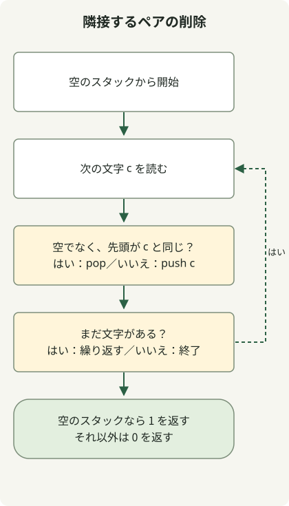

スタックは、読み終えた接頭辞を縮約した結果を保持することで、一度の走査で隣接する同一文字のペアを削除できます。次の文字が先頭要素と同じならペアを削除し、違えばプッシュします。

[問題](https://school.programmers.co.kr/learn/courses/30/lessons/12973)は 1–1,000,000 文字の英小文字を受け取り、すべて削除できれば 1、それ以外は 0 を返します。削除には隣接関係が必要なので、各文字の総数が偶数というだけでは不十分です。

## 処理の流れ



スタックは処理済みの接頭辞を縮約した結果を保持します。新しい文字は同じ先頭要素を削除するか、新しい先頭要素になります。

## 縮約した接頭辞を保持する

完全なクラスを `Solution.java` として保存します。原文のコードは Java 11 向けにコンパイルされ、JDK 17 で実行されています。

```java
import java.util.ArrayDeque;
import java.util.Deque;

public class Solution {
    public int solution(String s) {
        Deque<Character> stack = new ArrayDeque<>();
        for (int i = 0; i < s.length(); i++) {
            char c = s.charAt(i);
            if (!stack.isEmpty() && stack.peek() == c) stack.pop();
            else stack.push(c);
        }
        return stack.isEmpty() ? 1 : 0;
    }
}
```

スタックには、隣接する同一文字のペアが残っていない処理済みの接頭辞が入ります。次の文字が同じなら境界に削除可能なペアができるためポップします。違うならそのようなペアはできないためプッシュします。次の手順でも同じ不変条件が保たれます。

| 読んだ文字 | スタック：底 → 先頭 |
| --- | --- |
| b | b |
| a | ba |
| a | b |
| b | 空 |
| a | a |
| a | 空 |

したがって `baabaa` は 1 を返します。一方、`abab` は両文字の個数が偶数でも 0 です。同じ文字が隣り合っていないためです。スタックなら、文字列全体の置換を繰り返さずに、削除で新たに現れた境界を処理できます。

## ArrayDeque と計算量

[`ArrayDeque`](https://docs.oracle.com/en/java/javase/17/docs/api/java.base/java/util/ArrayDeque.html) を Deque の `push`、`peek`、`pop` で使います。`c` はプリミティブな char なので、`stack.peek() == c` は Character をアンボクシングして比較し、オブジェクトの同一性を比較しません。

各文字は高々一度プッシュされ、高々一度ポップされます。デック操作の償却計算量に基づく時間計算量は O(n)、文字が残る最悪の場合の追加領域は O(n) です。原文の実行検証には、百万文字の同一文字列と、削除できない百万文字の交互列が含まれます。境界の検証であり、速度のベンチマークや、すべての環境でのメモリー保証ではありません。

保持すべき情報は問題によります。[未完走者の問題](/en/posts/2021-07-23-unsuccessful-runner/)では、隣接順序ではなく名前ごとの頻度が必要です。
