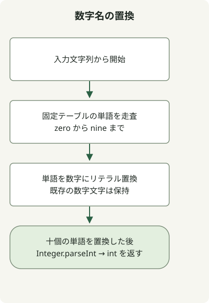

数字と数字名が混在する有効な入力では、`zero` から `nine` までの固定単語を数字に置換し、その結果を整数として解析します。検索対象はリテラルなので、`replaceAll` を使わず `String.replace` で十分です。

[問題](https://school.programmers.co.kr/learn/courses/30/lessons/81301)は、有効な小文字の数字名と数字、1 から 2,000,000,000 の結果、先頭にゼロがないことを保証しています。一般的な英語の数値表現を解析するパーサーではありません。

## 処理の流れ



zero から nine の固定単語を数字文字にリテラル置換し、得られた十進数文字列を解析します。

## 十個の固定単語を置換する

完全なクラスを `Solution.java` として保存します。追加の import は不要です。原文のコードは Java 11 をターゲットとしてコンパイル・実行されています。

```java
public class Solution {
    public int solution(String s) {
        String[] words = {"zero", "one", "two", "three", "four",
                "five", "six", "seven", "eight", "nine"};
        for (int digit = 0; digit < words.length; digit++) {
            s = s.replace(words[digit], Integer.toString(digit));
        }
        return Integer.parseInt(s);
    }
}
```

[`String.replace(CharSequence, CharSequence)`](https://docs.oracle.com/en/java/javase/11/docs/api/java.base/java/lang/String.html) はリテラル置換を行います。`replaceAll` は最初の引数を正規表現として解釈します。ここでは十個の単語のいずれにも正規表現の構文は必要ありません。

例えば、`one4seveneight` は `1478`、`23four5six7` は `234567` になります。`123` のように初めから数字だけの入力でも結果は 123 です。`two` の後に九個の `zero` を続けると、int の範囲内の 2,000,000,000 になります。

置換後の数字は別の数字名を生まず、この十個の単語には集合内の別の単語を含むものもないため、この順序で処理できます。無効な単語、空白、大文字、範囲外の数値は問題の保証外です。任意の入力で解析に失敗しても、このメソッドが有効な整数へ修復するわけではありません。

固定単語が十個なので、時間計算量は入力長に対して O(n) です。文字列は不変のため、置換途中の文字列が割り当てられることがあり、追加領域は O(n) です。この小さな入力でほかのパーサーより速いことを示すベンチマークはありません。

正規表現が役立つ変換は、[新しい ID の正規化](/en/posts/2021-07-19-new-id/)と比較してください。
