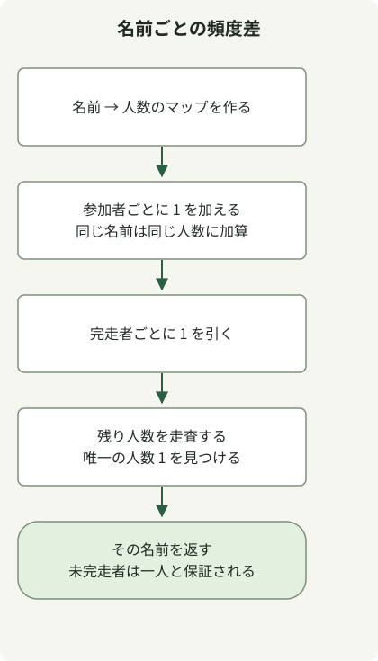

未完走者を見つけるには、名前の有無だけでなく名前ごとの人数を数えます。参加者の頻度から完走者の頻度を引くと、問題の保証により、残り人数が 1 の名前がちょうど一つ残ります。

[入力条件](https://school.programmers.co.kr/learn/courses/30/lessons/42576)では参加者は最大 100,000 人、完走者は一人少なく、同じ名前も許されます。名前は 1–20 文字の英小文字です。完走者の配列は、有効な参加者一覧から一人を除いたものと仮定します。

## 処理の流れ



参加者を全員数え、完走者を一人ずつ差し引き、残り人数が一人の名前を返します。

## 人数の差を保存する

完全なクラスを `Solution.java` として保存します。原文のコードは Java 11 向けにコンパイルされ、JDK 17 で実行されています。

```java
import java.util.HashMap;
import java.util.Map;

public class Solution {
    public String solution(String[] participant, String[] completion) {
        Map<String, Integer> counts = new HashMap<>();
        for (String name : participant) counts.merge(name, 1, Integer::sum);
        for (String name : completion) counts.put(name, counts.get(name) - 1);
        for (Map.Entry<String, Integer> entry : counts.entrySet()) {
            if (entry.getValue() == 1) return entry.getKey();
        }
        throw new IllegalArgumentException("Expected exactly one missing runner");
    }
}
```

`merge(name, 1, Integer::sum)` は新しい名前を 1 から数え、既存の名前の人数を増やします。完走者ごとにその人数を一人減らします。参加者が `[ana, bob, ana]`、完走者が `[bob, ana]` なら、ana は `2 - 1 = 1` 残ります。

Set の差を取ると、ana という名前の人が二人いた事実を失います。人数なら重複を保ち、一人の未完走者を表せます。完走者配列の順序を変えても結果は変わりません。

## HashMap の順序に依存しない

[`HashMap`](https://docs.oracle.com/en/java/javase/17/docs/api/java.base/java/util/HashMap.html) は反復順序を保証しません。最初の正の要素を返してよいのは、有効な入力でそのような要素が一つだけ残るためであり、特定の順序があるからではありません。コードは残り人数が 1 の名前を返します。

最後の例外は完全な入力検証ではありません。汎用的な照合 API では、不明な完走者や複数の未完走者に対する方針と検証が別途必要です。

名前の長さが最大 20、ハッシュ操作が平均定数時間なら、時間計算量は O(n)、異なる名前 u 個に対する追加領域は O(u) です。ストリームかループのどちらかが常に速いことを示すベンチマークはありません。

異なる種類だけが重要なら Set で十分です。[Ponketmon 問題の選択上限](/en/posts/2021-07-29-ponkemon/)と比較してください。
