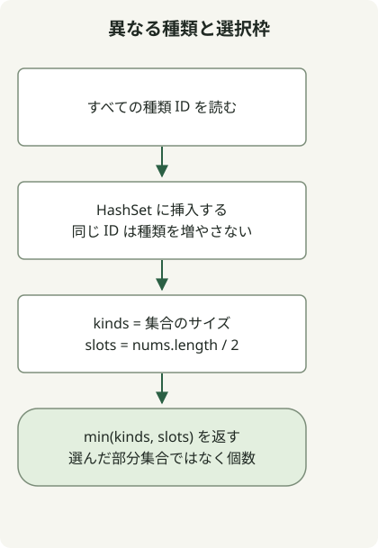

N 個から N/2 個を選び、異なる種類を最大化する場合、答えは `min(distinct types, N/2)` です。選ぶ個数より多くの種類は選べず、入力にない種類を作ることもできません。

[Ponketmon の問題](https://school.programmers.co.kr/learn/courses/30/lessons/1845)では正の偶数 N≤10,000 と、1 から 200,000 の種類 ID が与えられます。求めるのは最大個数であり、特定の選択ではありません。

## 処理の流れ



異なる種類の数と N/2 の選択制限は、どちらも上限です。問題の条件では、その小さい方を達成できます。

## HashSet で種類を数える

完全なクラスを `Solution.java` として保存します。原文のコードは Java 11 向けにコンパイルされ、JDK 17 で実行されています。

```java
import java.util.HashSet;
import java.util.Set;

public class Solution {
    public int solution(int[] nums) {
        Set<Integer> kinds = new HashSet<>();
        for (int kind : nums) kinds.add(kind);
        return Math.min(kinds.size(), nums.length / 2);
    }
}
```

[`HashSet`](https://docs.oracle.com/en/java/javase/17/docs/api/java.base/java/util/HashSet.html) は各 ID を一度だけ保持します。そのサイズが種類数 u、k=`nums.length / 2` が選べる枠の数です。ここでは種類ごとの頻度は不要です。

## 上限を達成できることを示す

u≥k なら、異なる k 種類から一つずつ選びます。u<k なら、各種類から一つずつ選び、残りの k-u 枠をほかの要素で埋めます。N 個のうち u 個しか使っておらず、k≤N なので残りは十分あります。したがって上限 `min(u, k)` は達成できます。

| 入力 | 種類 u | 枠 k | 答え |
| --- | --- | --- | --- |
| `[3,1,2,3]` | 3 | 2 | 2 |
| `[3,3,3,2,2,2]` | 2 | 3 | 2 |
| `[7,7]` | 1 | 1 | 1 |

ハッシュが適切に分散するとき、期待時間計算量は O(N)、追加領域は O(u) です。選んだ添字を返すには別の構築処理が必要で、このメソッドは問題で求められる個数だけを計算します。

小さな入力では、N/2 個の位置を選ぶ全組み合わせの列挙と比較しています。最大長の検証は、10,000 個の異なる種類と、同じ種類の 10,000 個を対象にしています。結果を検証するもので、ハッシュ実装の速度のベンチマークではありません。

重複の**数**が重要な例は、[未完走者の名前ごとの頻度](/en/posts/2021-07-23-unsuccessful-runner/)と比較してください。
