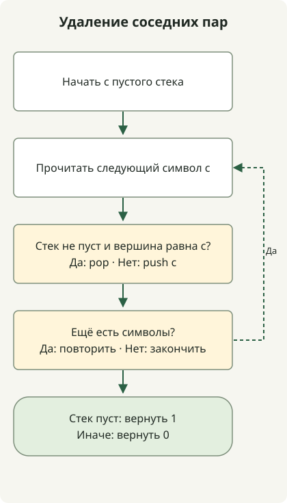

Стек удаляет соседние пары одинаковых символов за один обход, храня сокращённый результат уже прочитанного префикса. Если следующий символ совпадает с вершиной, удаляем пару; иначе помещаем его в стек.

[Задача](https://school.programmers.co.kr/learn/courses/30/lessons/12973) принимает 1–1 000 000 строчных английских букв и возвращает 1, если можно удалить всё, иначе 0. Чётного общего количества каждой буквы недостаточно, поскольку удаление зависит от соседства.

## Ход обработки



Стек хранит сокращённый префикс. Каждый новый символ удаляет совпадающую вершину или становится новой вершиной.

## Хранение сокращённого префикса

Сохраните полный класс в `Solution.java`. Код исходной статьи скомпилирован для Java 11 и выполнен на JDK 17.

```java
import java.util.ArrayDeque;
import java.util.Deque;

public class Solution {
    public int solution(String s) {
        Deque<Character> stack = new ArrayDeque<>();
        for (int i = 0; i < s.length(); i++) {
            char c = s.charAt(i);
            if (!stack.isEmpty() && stack.peek() == c) stack.pop();
            else stack.push(c);
        }
        return stack.isEmpty() ? 1 : 0;
    }
}
```

Стек содержит обработанный префикс без оставшихся соседних одинаковых пар. Совпадающий следующий символ создаёт на границе удаляемую пару — выполняем pop. Другой символ такой пары не создаёт — выполняем push. Тот же инвариант сохраняется для следующего шага.

| Прочитанный символ | Стек: дно → вершина |
| --- | --- |
| b | b |
| a | ba |
| a | b |
| b | пусто |
| a | a |
| a | пусто |

Поэтому `baabaa` возвращает 1. Напротив, `abab` возвращает 0, хотя количества обеих букв чётные: одинаковых соседних символов нет. Стек обрабатывает границы, открытые удалением, без повторных замен по всей строке.

## ArrayDeque и сложность

Используйте [`ArrayDeque`](https://docs.oracle.com/en/java/javase/17/docs/api/java.base/java/util/ArrayDeque.html) через операции Deque `push`, `peek` и `pop`. Поскольку `c` — примитивный char, `stack.peek() == c` распаковывает Character для сравнения, а не сравнивает идентичность объектов.

Каждый символ помещается в стек не более одного раза и извлекается не более одного раза. При амортизированных операциях дека время — O(n), а дополнительная память в худшем случае — O(n), когда символы остаются. Проверки выполнения исходной статьи включают миллион повторяющихся символов и миллион чередующихся символов без удаляемых пар. Это граничные проверки, а не бенчмарк скорости и не гарантия расхода памяти для любой среды.

Сохраняемая информация зависит от задачи: [задаче об участнике, не завершившем забег](/en/posts/2021-07-23-unsuccessful-runner/), нужны частоты имён, а не порядок соседства.
