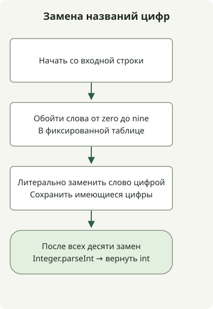

Для допустимого входа со смесью цифр и их названий замените фиксированные слова от `zero` до `nine` цифрами и разберите полученное целое число. Искомые слова — литералы, поэтому достаточно `String.replace` без `replaceAll`.

[Задача](https://school.programmers.co.kr/learn/courses/30/lessons/81301) гарантирует допустимые названия цифр в нижнем регистре и цифры, результат от 1 до 2 000 000 000 и отсутствие ведущего нуля. Это не разборщик произвольных английских числовых выражений.

## Ход обработки



Литерально заменяем фиксированные слова от zero до nine цифрами, затем разбираем полученную десятичную строку.

## Замена десяти фиксированных слов

Сохраните полный класс в `Solution.java`. Дополнительные импорты не нужны; код исходной статьи скомпилирован и выполнен с целевой версией Java 11.

```java
public class Solution {
    public int solution(String s) {
        String[] words = {"zero", "one", "two", "three", "four",
                "five", "six", "seven", "eight", "nine"};
        for (int digit = 0; digit < words.length; digit++) {
            s = s.replace(words[digit], Integer.toString(digit));
        }
        return Integer.parseInt(s);
    }
}
```

[`String.replace(CharSequence, CharSequence)`](https://docs.oracle.com/en/java/javase/11/docs/api/java.base/java/lang/String.html) выполняет литеральную замену. `replaceAll` интерпретирует первый аргумент как регулярное выражение. Здесь ни одному из десяти слов не нужен синтаксис регулярных выражений.

Например, `one4seveneight` превращается в `1478`, а `23four5six7` — в `234567`. Вход только из цифр, например `123`, по-прежнему даёт 123. `two` с девятью следующими словами `zero` даёт 2 000 000 000, что помещается в int.

Цифры после замены не могут породить другое название цифры, а ни одно из десяти слов не содержит другого слова из набора, поэтому этот порядок работает. Некорректные слова, пробелы, верхний регистр и числа вне диапазона не входят в гарантии задачи. Ошибка разбора произвольного входа не исправляется этим методом до допустимого целого числа.

При десяти фиксированных словах время — O(n) по длине входа. Строки неизменяемы, поэтому могут выделяться промежуточные строки; дополнительная память — O(n). Нет бенчмарка, который подтверждал бы, что на этих малых входах метод быстрее других разборщиков.

Для преобразования, где полезны регулярные выражения, сравните [нормализацию нового ID](/en/posts/2021-07-19-new-id/).
