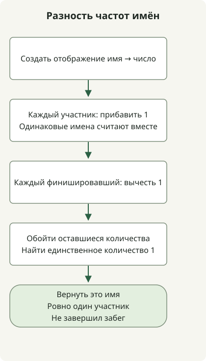

Чтобы найти участника, не завершившего забег, считайте людей по имени, а не только наличие имени. Вычтите частоты финишировавших из частот участников; задача гарантирует, что ровно у одного имени останется количество 1.

[Условия входа](https://school.programmers.co.kr/learn/courses/30/lessons/42576) допускают до 100 000 участников, на одного меньше финишировавших и повторяющиеся имена. Имена содержат 1–20 строчных английских букв. Предполагается, что список финишировавших — допустимый список участников, из которого удалён один человек.

## Ход обработки



Считаем всех участников, вычитаем каждого финишировавшего и возвращаем имя с одним оставшимся человеком.

## Хранение разности количеств

Сохраните полный класс в `Solution.java`. Код исходной статьи скомпилирован для Java 11 и выполнен на JDK 17.

```java
import java.util.HashMap;
import java.util.Map;

public class Solution {
    public String solution(String[] participant, String[] completion) {
        Map<String, Integer> counts = new HashMap<>();
        for (String name : participant) counts.merge(name, 1, Integer::sum);
        for (String name : completion) counts.put(name, counts.get(name) - 1);
        for (Map.Entry<String, Integer> entry : counts.entrySet()) {
            if (entry.getValue() == 1) return entry.getKey();
        }
        throw new IllegalArgumentException("Expected exactly one missing runner");
    }
}
```

`merge(name, 1, Integer::sum)` начинает новое имя с 1 и увеличивает количество для существующих имён. Каждый финишировавший уменьшает количество для своего имени на одного. При участниках `[ana, bob, ana]` и финишировавших `[bob, ana]` для ana остаётся `2 - 1 = 1`.

Разность Set потеряла бы факт, что ana звали двух человек. Количества сохраняют кратность и тем самым представляют одного отсутствующего человека. Изменение порядка массива финишировавших не меняет результат.

## Не полагайтесь на порядок HashMap

[`HashMap`](https://docs.oracle.com/en/java/javase/17/docs/api/java.base/java/util/HashMap.html) не гарантирует порядок обхода. Возврат первой положительной записи работает потому, что допустимый вход оставляет ровно одну такую запись, а не из-за определённого порядка. Код возвращает имя с остатком 1.

Исключение в конце не является полной проверкой входа. Универсальному API сверки потребовались бы дополнительные правила и проверки для неизвестных финишировавших или нескольких отсутствующих людей.

При длине имени не более 20 и среднем постоянном времени хеш-операций время — O(n), дополнительная память для u разных имён — O(u). Нет бенчмарка, доказывающего, что потоки или циклы всегда быстрее.

Когда важны только разные виды, достаточно Set; сравните [границу выбора в задаче Ponketmon](/en/posts/2021-07-29-ponkemon/).
