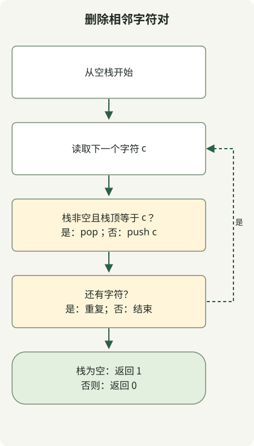

栈保留已读前缀消除后的结果，因此只需一次遍历即可删除相邻相同字符对。如果下一个字符等于栈顶，就移除这一对；否则将其压栈。

[题目](https://school.programmers.co.kr/learn/courses/30/lessons/12973)接受 1–1,000,000 个小写英文字母，若能全部删除则返回 1，否则返回 0。每个字符的总数都是偶数也不够，因为删除取决于相邻关系。

## 处理流程



栈保存已处理前缀消除后的结果。每个新字符要么移除相同的栈顶，要么成为新的栈顶。

## 保留消除后的前缀

将完整类保存为 `Solution.java`。原文中的代码已按 Java 11 目标编译，并在 JDK 17 上执行。

```java
import java.util.ArrayDeque;
import java.util.Deque;

public class Solution {
    public int solution(String s) {
        Deque<Character> stack = new ArrayDeque<>();
        for (int i = 0; i < s.length(); i++) {
            char c = s.charAt(i);
            if (!stack.isEmpty() && stack.peek() == c) stack.pop();
            else stack.push(c);
        }
        return stack.isEmpty() ? 1 : 0;
    }
}
```

栈包含已处理的前缀，其中不再存在相邻相同字符对。若下一个字符相同，就在边界处形成可删除的字符对，因此弹出栈顶；若不同，就不会形成这样的字符对，因此压栈。下一步仍保持同一个不变式。

| 读入的字符 | 栈：底部 → 顶部 |
| --- | --- |
| b | b |
| a | ba |
| a | b |
| b | 空 |
| a | a |
| a | 空 |

因此，`baabaa` 返回 1。相反，`abab` 返回 0，尽管两个字符的数量都是偶数：没有相同字符相邻。栈可以处理删除后出现的新边界，无需反复对整个字符串进行替换。

## ArrayDeque 与复杂度

通过 Deque 的 `push`、`peek` 和 `pop` 操作使用 [`ArrayDeque`](https://docs.oracle.com/en/java/javase/17/docs/api/java.base/java/util/ArrayDeque.html)。由于 `c` 是基本类型 char，`stack.peek() == c` 会将 Character 拆箱后比较，而不是比较对象标识。

每个字符最多入栈一次、出栈一次。使用摊销复杂度的双端队列操作时，时间复杂度为 O(n)；当字符保留下来时，最坏额外空间为 O(n)。原文的执行检查包括一百万个重复字符，以及一百万个无法消除的交替字符。这些是边界检查，并非速度基准测试，也不保证所有环境下的内存需求。

需要保留的信息取决于问题：[未完成比赛的选手题目](/en/posts/2021-07-23-unsuccessful-runner/)需要姓名频次，而非相邻顺序。
