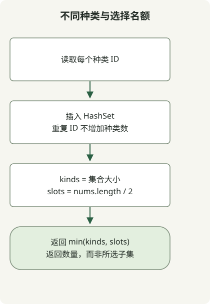

从 N 个元素中选 N/2 个并最大化不同种类数时，答案是 `min(distinct types, N/2)`。选出的种类数不能超过元素数，也不能凭空产生输入中不存在的种类。

[Ponketmon 题目](https://school.programmers.co.kr/learn/courses/30/lessons/1845)给出正偶数 N≤10,000，种类 ID 范围为 1 到 200,000。要求返回一个最大数量，而非具体的选择方案。

## 处理流程



不同种类数和 N/2 选择限制都是上限。在题目约束下，可以达到两者的最小值。

## 用 HashSet 统计种类

将完整类保存为 `Solution.java`。原文中的代码已按 Java 11 目标编译，并在 JDK 17 上执行。

```java
import java.util.HashSet;
import java.util.Set;

public class Solution {
    public int solution(int[] nums) {
        Set<Integer> kinds = new HashSet<>();
        for (int kind : nums) kinds.add(kind);
        return Math.min(kinds.size(), nums.length / 2);
    }
}
```

[`HashSet`](https://docs.oracle.com/en/java/javase/17/docs/api/java.base/java/util/HashSet.html)只保留每个 ID 一次。其大小是不同种类数 u，k=`nums.length / 2` 则是可用的选择名额。这里不需要各个种类的频次。

## 证明上限可以达到

若 u≥k，从 k 个不同种类中各选一个。若 u<k，先从每种中选一个，再用其他元素填满剩余 k-u 个名额。N 个元素中只使用了 u 个，而 k≤N，所以剩余元素足够。因此，上限 `min(u, k)` 可以达到。

| 输入 | 种类 u | 名额 k | 答案 |
| --- | --- | --- | --- |
| `[3,1,2,3]` | 3 | 2 | 2 |
| `[3,3,3,2,2,2]` | 2 | 3 | 2 |
| `[7,7]` | 1 | 1 | 1 |

在哈希值适当分散的条件下，期望时间复杂度为 O(N)，额外空间为 O(u)。若要返回所选下标，还需要额外的构造过程；该方法只计算题目要求的数量。

对于较小输入，原文中的检查将结果与枚举所有 N/2 个位置的选择进行比较。最大长度检查覆盖 10,000 个互不相同的种类，以及同一种类的 10,000 个副本。这些检查验证结果，没有对哈希实现的速度进行基准测试。

对于重复的**数量**会影响结果的情况，可对照[未完成比赛的选手的姓名频次](/en/posts/2021-07-23-unsuccessful-runner/)。
