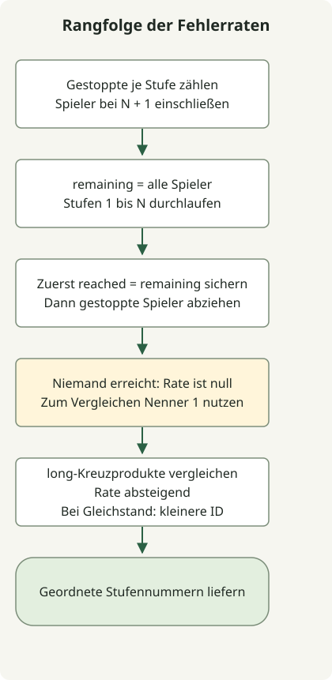

Der Nenner einer Stufenfehlerrate ist die Zahl der Spieler, die diese Stufe erreicht haben, nicht die Gesamtzahl. Zählen Sie die gestoppten Spieler, aktualisieren Sie die verbleibenden erreichten Spieler und sortieren Sie nach absteigender Rate und aufsteigender Stufennummer.

Die [Aufgabe](https://school.programmers.co.kr/learn/courses/30/lessons/42889) begrenzt die Stufen N auf 500 und die Spieler M auf 200.000. N+1 kennzeichnet Spieler, die alle Stufen geschafft haben, und ist selbst keine zu sortierende Stufe. Eine von niemandem erreichte Stufe hat Fehlerrate 0.

## Ablauf



Die erreichten Spieler vor dem Abziehen der gestoppten speichern. Raten mit long-Kreuzprodukten vergleichen, bei Gleichstand nach Stufennummer aufsteigend ordnen.

## Gestoppte und erreichte Spieler zählen

Speichern Sie die vollständige Klasse als `Solution.java`. Der Code des Ausgangsartikels wurde für Java 11 kompiliert und auf JDK 17 ausgeführt.

```java
import java.util.Arrays;
import java.util.stream.IntStream;

public class Solution {
    public int[] solution(int N, int[] stages) {
        long[] stopped = new long[N + 2];
        for (int stage : stages) stopped[stage]++;
        long[] reached = new long[N + 1];
        long remaining = stages.length;
        for (int stage = 1; stage <= N; stage++) {
            reached[stage] = remaining;
            remaining -= stopped[stage];
        }
        Integer[] order = IntStream.rangeClosed(1, N).boxed().toArray(Integer[]::new);
        Arrays.sort(order, (a, b) -> {
            long denominatorA = reached[a] == 0 ? 1 : reached[a];
            long denominatorB = reached[b] == 0 ? 1 : reached[b];
            int byRate = Long.compare(stopped[b] * denominatorA, stopped[a] * denominatorB);
            return byRate != 0 ? byRate : Integer.compare(a, b);
        });
        return Arrays.stream(order).mapToInt(Integer::intValue).toArray();
    }
}
```

`remaining` zählt die Spieler, die die aktuelle Stufe erreicht haben. Speichern Sie `reached[stage]` **vor** dem Abziehen der dort gestoppten Spieler. Der aktualisierte Wert ist dann der Nenner der nächsten Stufe. Spieler bei N+1 bleiben durchgehend im Nenner.

Für N=5 und `[2,1,2,6,2,4,3,3]` ergeben sich diese Raten:

| Stufe | Gestoppt | Erreicht | Fehlerrate |
| --- | --- | --- | --- |
| 1 | 1 | 8 | 1/8 |
| 2 | 3 | 7 | 3/7 |
| 3 | 2 | 4 | 2/4 |
| 4 | 1 | 2 | 1/2 |
| 5 | 0 | 1 | 0/1 |

Stufen 3 und 4 liegen gleichauf, daher kommt die kleinere Nummer zuerst. Die endgültige Reihenfolge ist `[3,4,2,1,5]`.

## Verhältnisse innerhalb numerischer Grenzen vergleichen

Bei positiven Nennern lassen sich zwei Verhältnisse durch Kreuzmultiplikation vergleichen. Für absteigende Sortierung erhält `Long.compare` zuerst b-Zähler mal a-Nenner. Bei gleichen Raten ordnet `Integer.compare(a, b)` die Stufennummern. Damit ist die Ordnung gemäß dem [Comparator-Vertrag](https://docs.oracle.com/en/java/javase/17/docs/api/java.base/java/util/Comparator.html) ausdrücklich definiert.

Hat niemand eine Stufe erreicht, gibt es dort bei gültiger Eingabe auch keine gestoppten Spieler. Verwenden Sie zum Vergleich den Nenner 1, also die Rate 0/1. Beide Anzahlen können 200.000 erreichen; die Produkte sind daher durch 40.000.000.000 begrenzt. Arrays und Multiplikation müssen long bleiben, da dies int überschreitet. Wandeln Sie eine Produktdifferenz nicht als Vergleichsergebnis in int um.

Das Zählen kostet O(M), die erreichten Populationen O(N) und die Sortierung O(N log N). Insgesamt sind es O(M + N log N) Zeit und O(N) zusätzlicher Speicher, ohne die Eingabe zu verändern. Haben alle Spieler alle Stufen abgeschlossen, sind alle Raten null und die Stufennummer entscheidet.

Ein weiteres Beispiel zur Wahl des Multiplikationstyps anhand der Eingabegrenzen zeigt [int und long beim Skalarprodukt](/en/posts/2021-07-22-dot-product/).
